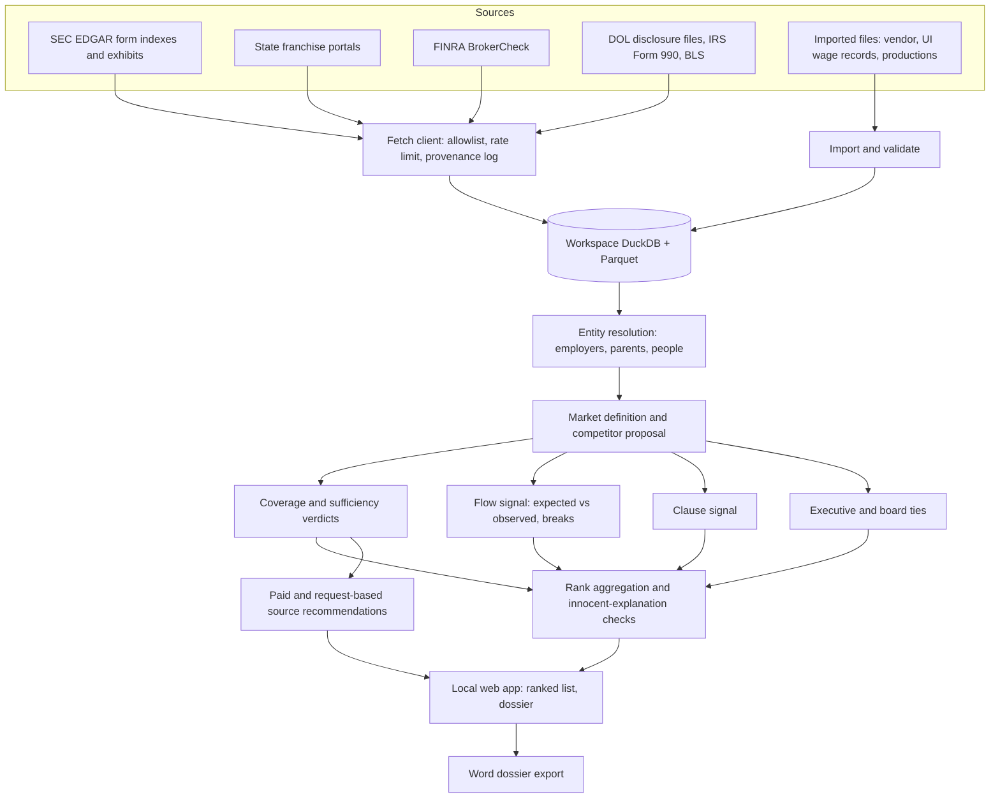
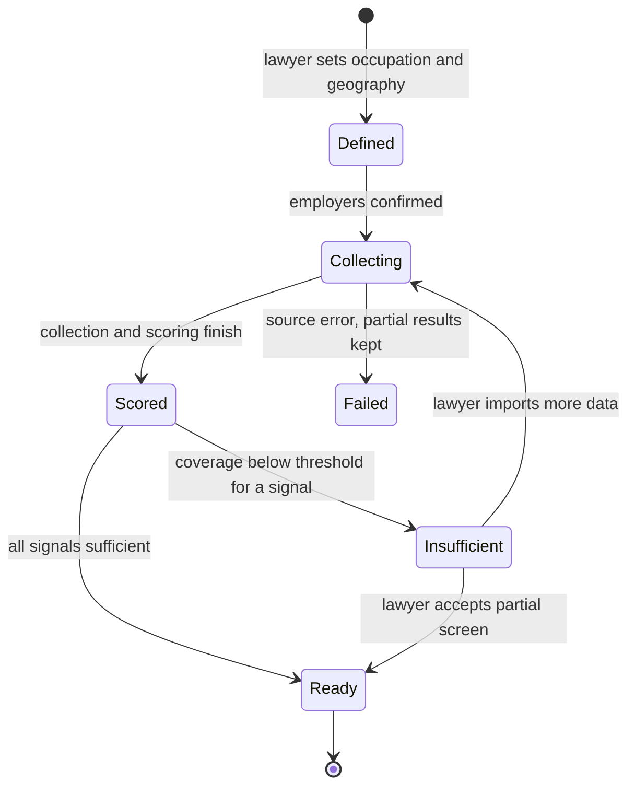

# No-Poach Agreement Screen - Plan

## Goal Capsule

- **Objective:** A state antitrust lawyer can pick a labor market and get a ranked, explainable list of employer pairs that may have a hidden agreement not to hire each other's workers. Each lead is built only from lawfully obtained data and is strong enough to justify the agency's own investigative demands.
- **Means:** A local, open-source screening app that combines three signals (missing worker flow, filed no-hire clauses, executive and board ties) over free public data plus data the agency imports (KTD1, KTD3, KTD4, KTD11).
- **Product authority:** Damien Riehl, building with an antitrust attorney at a state enforcement agency who is the first user. The collaborator and the agency stay unnamed in this repository. The Product Contract wins on behavior; Key Technical Decisions win on mechanism.
- **Stop conditions:** Stop and ask before any spending, including buying a data extract or a code-signing certificate. Also stop before any collection path that logs into a platform, uses an account, or breaches a site's terms. If a free source's terms forbid the planned use, drop that source and record why rather than working around it.
- **Execution profile:** Codex workers implement units. The orchestrating session verifies each unit by rerunning tests and inspecting artifacts. Real-data backtests and the live pilot wait on data that lawful channels supply (R21, R22).
- **Open blockers:** None for implementation. Running the backtest on real historical cases needs person-level data for those markets, which is a spending decision for Damien (see Open Questions).

---

## Product Contract

**Product Contract preservation:** changed: R13 and R16 rewritten, R23 and R24 added, Actor A4 updated, and the data Key Decision revised. This follows Damien's 2026-10-13 decision to use only lawful sources and to disclose paid-source cost and provenance (Cockpit ask `nopoach-screen-2026-10-13-1439-flow-data-source`). Everything else is unchanged.

### Summary

An open-source screening tool that a state agency runs on its own machines. A lawyer defines a labor market. The tool ranks every employer pair in it using three signals: missing worker flow, filed no-hire clauses, and executive or board ties. Each flagged pair opens into a dossier written for lawyers. The tool uses every free, lawful source it can find, says plainly whether that data is enough, and when it is not, lists paid sources with estimated cost and how each one obtains its data.

### Problem Frame

No-poach agreements suppress wages and mobility for workers who never learn the agreements exist. The evidence lives in the companies' own email and HR files. Enforcers can compel those files, but only after they know where to look. Today that takes a tip from an insider, which is rare.

The agreements that have come to light share a visible footprint. In High-Tech Employee (Apple, Google, Intel, Adobe, Intuit, Pixar, Lucasfilm, about 2005-2009), firms that competed hard for engineers stopped recruiting each other's staff. The flow of people between them dropped while flow to every other competitor continued. Animation Workers, Knorr-Bremse/Wabtec (DOJ, 2018), Seaman v. Duke (Duke and UNC medical faculty), and United States v. Patel (Pratt & Whitney engineering suppliers) follow similar patterns. Some agreements are also written down: the Washington Attorney General's 2018-2020 franchise campaign won commitments from more than 200 chains by reading no-poach clauses in public franchise disclosure documents.

Low flow between two firms has innocent explanations too: non-competes, different pay, geography, different occupations, a firm that rarely hires laterally, or plain data gaps. A screen that ignores them buries a busy enforcer in false positives. A state agency also lacks the budget for six-figure workforce datasets, cannot type confidential target names into someone else's hosted service, and cannot build leads on data collected in breach of a platform's terms.

### Actors

- A1. Agency antitrust lawyer: defines markets, reviews rankings, and exports dossiers. Not an economist and not a command-line user.
- A2. Agency reviewer: a supervisor or staff economist who reads an exported dossier before an investigation opens.
- A3. Maintainer: Damien and contributors, who keep the open-source code, method, and paid-source catalog current.
- A4. Lawful data sources: free public sources (SEC EDGAR, state franchise filing portals, FINRA BrokerCheck, DOL foreign-labor disclosure files, IRS Form 990 filings, BLS employment statistics) and data the agency licenses or holds and then imports (vendor extracts, state unemployment-insurance wage records, investigative productions).

### Key Decisions

- **Enforcement agencies are the primary user.** The output is a screen that tells an agency where to aim its investigative demands. It is not proof of an agreement. Governs R11, R13. (session-settled: user-directed — chosen over the plaintiffs' antitrust bar, corporate compliance teams, and journalists or researchers: the first user is a state-agency antitrust attorney, so this tool is built for lawyers by lawyers)
- **Screen a market first, then drill into a pair.** The market screen finds leads nobody has yet. The pair dossier is what a lawyer forwards to a supervisor. Governs R1, R2, R8. (session-settled: user-directed — chosen over a named-pair tester alone: screening is where the new value is, and every flag needs a drill-down)
- **Use only lawfully obtained data: every free source first, then disclose the cost and provenance of paid sources.** The tool never collects from LinkedIn or any site in breach of its terms. LinkedIn-derived data enters only as a file the agency licenses and imports. Governs R13, R16, R17, R23, R24. (session-settled: user-directed — chosen over logged-out LinkedIn collection and over an immediate paid pilot extract: "we definitely want to follow the law"; the earlier choice of LinkedIn plus free public data was reopened after planning research found no free, lawful source of dated LinkedIn job histories)
- **Open source, run by the agency.** Investigation targets never leave the agency, and other states' AGs can adopt the tool. The method is public. The only way to avoid tripping it is to actually hire from competitors. Governs R18, R19, R20. (session-settled: user-approved — chosen over a hosted app run by Damien and over a report-writing service: keeps confidential queries inside the agency)
- **Version 1 carries all three signals: missing flow, filed clauses, and executive and board ties.** Governs R3, R6, R7. (session-settled: user-directed — chosen over a flow screen with document evidence only: each signal catches agreements the others miss, including handshake deals between executives)
- **Prove it with a backtest, then a live pilot.** Governs R21, R22. (session-settled: user-approved — chosen over a backtest alone or a live pilot alone: the backtest earns trust and the pilot earns relevance)
- **The tool produces leads, never conclusions.** Its wording must survive being read aloud by opposing counsel. Governs R11.
- **The repository holds code and method only.** Every repo may become public, so collected data, pilot results, live targets and the agency's identity stay out of git. Governs R20.

### Requirements

**Market screen**

- R1. A lawyer defines a labor market by occupation and geography (state or metro), optionally narrowed to a list of employers. The tool proposes the employers that compete for that talent.
- R2. The tool ranks every employer pair in the market by combined evidence from the three signals (R3, R6, R7), and shows which signals fired for each pair.
- R3. The missing-flow signal compares observed job-to-job moves between a pair, in both directions, with the moves expected from the two employers' size, occupational overlap and geography.
- R4. When a pair's flow dropped and stayed low, the tool reports the approximate break date and the flow before and after it.
- R5. Flow suppressed in only one direction is labeled as a possible unilateral no-hire policy. It is ranked separately from mutual suppression.
- R6. The filed-clause signal finds employee non-solicit and no-hire clauses binding both parties in public filings: SEC exhibits, franchise disclosure documents and merger agreements. It shows each clause's text, date, scope and duration.
- R7. The executive and board signal finds shared directors, executive moves between the pair, and other executive ties visible in public filings.

**Pair dossier**

- R8. Each ranked pair opens into a dossier with expected versus observed flow over time, any break date, filed clauses, executive and board ties, innocent-explanation checks, and data coverage.
- R9. The dossier lists each innocent explanation the tool tested and the result. Candidates include non-compete prevalence, pay gaps, geographic separation, low lateral hiring at either firm, and occupational mismatch. It also names the explanations the available data could not test.
- R10. Every number in a dossier traces back to the underlying records: the people, filings and dates behind it.
- R11. All output describes leads for further inquiry and never states that an agreement exists.
- R12. A dossier exports as a standalone document that a lawyer can attach to an internal case-opening memo, written so a non-economist can follow it.

**Data and coverage**

- R13. The tool collects only from sources whose terms permit its use, and never logs in, uses an account, or collects from LinkedIn. Person-level data it cannot collect lawfully enters only through import of files the agency lawfully holds.
- R14. Every screen reports coverage: the estimated share of each employer's workforce in the market that the data actually sees, and the overall share.
- R15. When coverage falls below a reliability threshold, the tool marks the affected rankings as unreliable rather than presenting low flow as suspicious.
- R16. When coverage is inadequate, the tool recommends specific paid or request-based sources, with an estimated cost (or "quote required" when no price is public) and what each would add for this market.
- R17. Every record carries its provenance: source, collection date and collection method.
- R23. Every screen states a sufficiency verdict for each signal: whether the free and imported data are enough to rely on, and why.
- R24. Each recommended source shows how it obtains its data, classed as first-party LinkedIn, government or administrative records, licensed from the original source, consent-based, or third-party web aggregation with unclear or possibly unlawful collection.

**Operation and distribution**

- R18. The tool runs entirely on agency-controlled machines. Nothing leaves the agency except requests to public data sources.
- R19. A lawyer can run a screen, read results and export dossiers through a point-and-click local interface, without using a command line.
- R20. The tool is MIT-licensed open source. The published repository contains no collected data, live target names, pilot results or agency identity.

**Validation**

- R21. A backtest mode reruns the screen on the markets of known no-poach cases, using only data from before each case became public. It reports where the known pairs ranked.
- R22. A live pilot runs one screen on a market the collaborator chooses in their state, and the collaborator reviews the top leads.

### Key Flows

- F1. Screen a market
  - **Trigger:** A1 wants to find leads in a labor market.
  - **Actors:** A1, A4
  - **Steps:** A1 defines occupation and geography. The tool proposes competing employers and A1 adjusts the list. The tool collects free records for the whole market, includes any imported data, builds the three signals, and shows a ranked list with the coverage report and sufficiency verdicts.
  - **Outcome:** A ranked list of leads, or a statement that coverage is too thin, with recommended sources, costs and provenance classes.
  - **Covered by:** R1, R2, R3, R6, R7, R13, R14, R15, R16, R23, R24
- F2. Review and export a pair
  - **Trigger:** A1 opens a flagged pair.
  - **Actors:** A1, A2
  - **Steps:** A1 reads the dossier and drills into its underlying records, then exports it. A2 reads the export.
  - **Outcome:** A2 can judge whether to open an investigation without running the tool.
  - **Covered by:** R4, R5, R8, R9, R10, R11, R12
- F3. Backtest
  - **Trigger:** A3 or A1 wants to check the method.
  - **Actors:** A1, A3
  - **Steps:** The tool reconstructs each known case's market as of a date before disclosure, runs the screen, and reports the known pairs' ranks.
  - **Outcome:** Evidence of whether the screen finds real agreements.
  - **Covered by:** R21
- F4. Close a coverage gap
  - **Trigger:** A screen's sufficiency verdict says the flow data is not enough.
  - **Actors:** A1, A4
  - **Steps:** A1 reads the recommended sources, their costs and provenance classes. The agency obtains data through a channel it chooses, and A1 imports the file. The tool reruns the screen with the imported records labeled by source.
  - **Outcome:** A screen with adequate coverage, or a documented reason why none was reached.
  - **Covered by:** R13, R16, R17, R23, R24

### Acceptance Examples

- AE1. Mutual break
  - **Covers R3, R4.**
  - **Given** two hospital systems that each hired about 40 of the other's nurses a year through 2019, and about 2 a year after.
  - **When** A1 screens that metro's nursing market.
  - **Then** the pair ranks high, with a break date near 2020 and the before-and-after flow shown.
- AE2. One-way suppression
  - **Covers R5.**
  - **Given** Firm A hires steadily from Firm B but almost never loses staff to B.
  - **Then** the pair is labeled a possible unilateral policy and appears in the separate one-way list, not among mutual leads.
- AE3. Thin coverage
  - **Covers R14, R15, R16, R23, R24.**
  - **Given** free data sees 8% of the workforce at a poultry processor.
  - **Then** pairs involving that employer are marked unreliable, the flow verdict reads "insufficient," and the tool lists sources that would raise coverage. State wage records via a data-sharing agreement appear first, and each listed source shows its cost or "quote required" and its provenance class.
- AE4. Clause without a flow drop
  - **Covers R2, R6.**
  - **Given** an outsourcing contract with a two-year mutual non-solicit clause, and normal flow between the parties.
  - **Then** the pair appears with the clause shown and the filed-clause signal marked, ranked below pairs where several signals agree.
- AE5. Lead wording
  - **Covers R11, R12.**
  - **Given** the top-ranked pair in any screen.
  - **Then** its dossier says the pattern warrants inquiry and lists the innocent explanations, and nowhere states that the firms agreed to anything.
- AE6. Broker provenance
  - **Covers R24.**
  - **Given** a vendor that sells person-level job histories and does not state that it licenses them from their source.
  - **Then** the recommendation labels it third-party web aggregation with unclear collection, and explains in one sentence why that matters for an enforcement lead.

### Success Criteria

- The backtest ranks most known pairs near the top of their markets. The exact bar (for example, a majority in the top decile) is set with the collaborator before the first real-data backtest.
- In the live pilot, the collaborator judges at least one top-ranked lead worth further inquiry.
- An agency reviewer (A2) can follow an exported dossier without asking how the tool works.

### Scope Boundaries

**Deferred for later**

- Sharing screens or methods between state agencies.
- A standalone Clayton Act §8 board-interlock screen beyond what R7 needs.
- Pulling paid data sources directly through vendor APIs. Version 1 recommends them and imports their files.

**Outside this product's identity**

- Hosted or software-as-a-service operation.
- Statements that an agreement exists, or anything framed as proof.
- Tools for plaintiffs' firms, corporate compliance teams or journalists, even though the open-source code allows them.
- Collecting data by logging in, using accounts, or breaching a site's terms, including any LinkedIn collection.

**Deferred to Follow-Up Work**

- PDF export (needs a Windows-safe engine; see KTD12).
- An optional Docker distribution for agencies with a data team.
- A labor-market definition based on flow clustering (Nimczik-style stochastic block model) as an alternative to occupation by geography.
- A Census LEHD job-to-job cross-check of expected flows, built together with the check that consumes it.
- Non-compete clause extraction, so the non-compete explanation check becomes testable.

**Considered and not built**

- A large language model to classify clauses. Sending text to an outside model would leak which filings the agency examines and break R18, and a local rules-based extractor is explainable to a court. Revisit if a vetted local model is accurate enough on the labeled clause set.
- Automatic code-signing. It costs money and Microsoft's reputation system gives no instant trust. Agencies allowlist by hash instead (KTD13). Revisit if a pilot agency's IT requires a signed publisher.

### Dependencies / Assumptions

- Free person-level histories exist only for registered finance workers (BrokerCheck) and executives (SEC filings). Most markets will need imported data before the flow signal is reliable. R14, R15 and R23 report this on every run.
- Imported histories reconstruct past markets imperfectly. People who left the workforce or dropped their profiles are missing (survivorship), and many dates are year-only.
- The collaborator's agency can run a per-user app on its machines. Agency IT may require a hash allowlist entry first.
- Whether a state AG may receive the state's own unemployment-insurance wage records depends on 20 CFR 603 and state statute. The tool recommends that route but cannot confirm eligibility.

### Outstanding Questions

**Resolve Before Planning**

- None.

**Deferred to Implementation**

- The exact reliability threshold for R15. Start at an effective sample of 30 moves per pair-direction across the window and at 20% estimated coverage per employer, then calibrate on synthetic markets (U6).
- Whether each franchise portal's terms permit automated retrieval. Check each portal's terms before writing its collector, and drop any that forbid it (U8).

### Sources / Research

- In re High-Tech Employee Antitrust Litigation, N.D. Cal. No. 11-cv-02509 (Apple, Google, Intel, Adobe, Intuit, Pixar, Lucasfilm).
- In re Animation Workers Antitrust Litigation, N.D. Cal. No. 14-cv-04062.
- United States v. Knorr-Bremse AG and Westinghouse Air Brake Technologies Corp., D.D.C. (2018 consent decree).
- Seaman v. Duke University, M.D.N.C. No. 15-cv-462.
- United States v. Patel, D. Conn. (Pratt & Whitney engineering suppliers; acquittal 2023).
- Washington Attorney General franchise no-poach initiative, 2018-2020.
- hiQ Labs, Inc. v. LinkedIn Corp., N.D. Cal. No. 17-cv-03301 (final judgment 2022 on breach of user agreement).
- LinkedIn Corp. v. Nubela (Proxycurl), N.D. Cal. No. 3:25-cv-00828 (filed January 2025; service shut down July 2025 under settlement).
- Meta Platforms v. Bright Data, N.D. Cal. (January 2024 summary judgment on logged-out collection under Meta's terms).
- DOJ/FTC Antitrust Guidance for Human Resource Professionals (2016).
- Herrera-Caicedo, Jeffers and Prager, "Collusion through Common Leadership" (working paper, December 2024 draft).

---

## Planning Contract

### Key Technical Decisions

- KTD1. **Local web app: a Python server on 127.0.0.1 with server-rendered pages, opened in the agency's own browser, locked to that one browser session.** It has the fewest moving parts for a solo maintainer and needs no desktop runtime. FastAPI serves Jinja templates enhanced with htmx, so no JavaScript build step. Streamlit-style frameworks were rejected because they handle ranked-table drill-down and print layout poorly. Binding to loopback alone does not stop other web pages (cross-site requests, DNS rebinding) or other local users from reaching the app. So each launch mints a random session token, passed once in the opened URL and then held in an HttpOnly, SameSite=Strict cookie. Requests without it, with a Host header other than `127.0.0.1:<port>` or `localhost:<port>`, or (for state-changing requests) with a foreign Origin are refused. All static assets are vendored, and pages carry a `default-src 'self'` Content-Security-Policy, so the browser contacts no third party. Governs R18, R19.
- KTD2. **Storage in one DuckDB file per workspace, with Parquet for bulk raw data.** DuckDB is columnar, works out of core and needs no server, so 1 to 50 million history rows fit on a 16 GB laptop. A workspace is a folder the user picks, outside the app directory, so collected data never lands in the repo. Governs R18, R20.
- KTD3. **Every outbound request goes through one fetch client.** The client enforces a host allowlist, a descriptive User-Agent, per-host rate limits (SEC: at most 10 requests per second), an offline mode, and an append-only provenance log of URL, time, method and SHA-256 hash for each file. This is the single place R13, R17 and R18 are enforced. Governs R13, R17, R18.
- KTD4. **Collect by market, never by target pair.** Collectors pull whole bulk files (DOL disclosure files, BLS tables, IRS Form 990 e-file indexes) and whole-portal listings. EDGAR collection reads the daily form indexes and fetches only the needed form types and exhibits for every resolved employer in the market and its parents, never the multi-gigabyte daily full-filing feeds. Narrowing a market to an employer list (R1) filters results locally after collection, and collection always runs against the full proposed competitor set. Sources that can only be queried one employer at a time are queried for that full set. Pairs are formed locally, so no outside service can infer which companies interest the agency. Governs R18.
- KTD5. **Expected flow comes from a Poisson pseudo-maximum-likelihood gravity model with origin-by-year and destination-by-year employer fixed effects.** It adds occupation-overlap and distance covariates, and it is fit separately for each direction (pyfixest `fepois`). Year-varying employer effects absorb firm-wide shocks, such as a hiring freeze, layoffs, a merger or COVID, so those shocks do not read as pair-specific suppression. Each pair-direction gets an observed-to-expected ratio that a lawyer can read as "we expected 40 moves and saw 3." Governs R3.
- KTD6. **Break detection runs a Poisson changepoint on each pair-direction's yearly observed-to-expected series, with a persistence rule and a minimum-count gate.** Running it on the residual series rather than raw counts means a break reflects this pair falling behind what the firms' own year-by-year hiring predicts. A break counts only if the post-break ratio stays low for at least two periods and the pre-break count clears the gate. The break is reported as a year interval, because many source dates are year-only. Governs R4.
- KTD7. **Pair statistics are shrunk toward the market norm before ranking, and multiple comparisons are controlled.** Empirical-Bayes shrinkage of rate ratios stops tiny pairs from topping the list by noise. Placebo pairs give p-values, and Benjamini-Hochberg controls the false discovery rate across all pairs. Governs R2, R3, R15.
- KTD8. **Signals combine by transparent rank aggregation, not a trained model.** Each pair gets a 0-to-1 score per signal and a combined score from fixed, documented weights. Pairs where two or more signals fire rank first. A trained classifier was rejected because there are too few labeled cases and a court will ask how the score was made. Governs R2.
- KTD9. **Clause detection is a local rules-based extractor.** It uses phrase patterns, party and term extraction, and a small labeled test set drawn from public filings. It runs over EX-10 and EX-2 exhibits selected from the EDGAR indexes, and over the full text of each franchise disclosure document, including the attached franchise agreement and other contract exhibits, where franchise no-poach clauses usually sit. A franchise clause links every franchisee pair under that brand, which marks it as a brand-wide clause in the dossier. Governs R6.
- KTD10. **Employers and people are matched with Splink 4 on DuckDB.** Employers resolve to an ultimate parent as of each date (for example, Pixar under Disney after 2006), and both employer-level and parent-level views are kept, with the dossier saying which one it used. Governs R3, R7, R10.
- KTD11. **A versioned paid-source catalog ships as a data file the maintainer updates.** Each entry has the provenance class (R24), a cost estimate or "quote required," what it adds, and the date it was last checked. Recommendations are generated from the catalog and the market's coverage gaps. State unemployment-insurance wage records are listed as a request-based source ahead of commercial vendors. Entries carry an allowed-use flag, so a source barred from lead generation (Census restricted microdata under Title 13, The Work Number under FCRA) is shown only with its restriction and never recommended for leads. Governs R16, R24.
- KTD12. **Dossiers export as editable Word documents in version 1.** They are generated with python-docx and embedded matplotlib charts. Lawyers edit memos in Word, and Windows PDF engines either need a separate GTK install or are unproven. Governs R12.
- KTD13. **Distribution is a zipped PyInstaller one-folder build that runs from a user folder without admin rights.** Each release ships a SHA-256 hash list, a CycloneDX software bill of materials, GitHub build attestations, and an IT review note so agency IT can allowlist the app by hash. Users with Python can also install from source with `uv`. Governs R18, R19, R20.
- KTD14. **A synthetic labor-market generator is the main test fixture.** It creates employers, workers and moves with planted mutual and one-way agreements, firm-wide shocks, coverage gaps and innocent explanations, so every statistical unit is tested against a known answer without real people's data. Governs R3, R4, R5, R15, R21.
- KTD15. **Committed test fixtures hold no real person's data.** Person-level fixtures (BrokerCheck, Form 990, imported histories) are synthetic copies with real record structure. Committed SEC fixtures are public-record filings cited by accession number. The 60-clause real evaluation corpus lives in an ignored local folder and is evaluated separately, while committed clause fixtures are synthetic or short public-record excerpts cited by accession number. Governs R20.
- KTD16. **Employer workforce estimates follow a fixed source chain, and "denominator unknown" is a real state.** No free source publishes employer-level headcount by occupation and metro. The chain, in priority order, is: imported data with headcounts, a headcount the lawyer enters, the employer's company-wide employee count (SEC 10-K human-capital disclosure or Form 990) times the BLS industry staffing-pattern share for the occupation, apportioned to the geography, and then LCA footprints. Each estimate carries its source and an uncertainty band. When none exists, coverage reads "denominator unknown" and that employer's flow pairs are unreliable for that reason. Governs R1, R14, R15.

### High-Level Technical Design

The pipeline runs left to right for each screen. Collection is market-wide; pair formation and scoring happen only on the agency's machine.



A screen moves through these states. A screen whose flow verdict is insufficient still shows clause and tie results, with the flow column marked unreliable.



### Output Structure

```text
nopoach-screen/
  pyproject.toml
  uv.lock
  LICENSE
  README.md
  THIRD-PARTY.md
  src/nopoach/
    app/            # FastAPI routes, templates, static assets
    collect/        # fetch client and per-source collectors
    imports/        # import schema and validators
    store/          # workspace, schema, provenance log
    resolve/        # entity resolution
    market/         # market definition, coverage, sufficiency
    signals/        # flow, clauses, ties
    rank/           # aggregation and innocent-explanation checks
    catalog/        # paid-source catalog data and recommender
    export/         # Word dossier
    backtest/       # backtest harness and case definitions
    synth/          # synthetic labor-market generator
  tests/
  packaging/        # PyInstaller spec, release scripts, IT review note
  docs/
```

### Sequencing

Units land in the order the Dependencies column sets. U1 comes first, then U3, because the synthetic generator (U2) writes through the real import path. U4 and U5 can proceed in parallel after U3, and U6 follows U5. U7 and U8 both need U6 (U7 also needs U2), and U9 needs U4. Rank aggregation (U10) waits for all three signals, so the backtest harness (U14) and the Word export (U13) follow U10. The UI (U12) starts after both U10 and U11, and packaging (U15) comes last.

---

## Implementation Units

| U-ID | Title | Key files | Depends on |
|---|---|---|---|
| U1 | Workspace, schema, fetch client and provenance log | `src/nopoach/store/`, `src/nopoach/collect/fetch.py` | none |
| U2 | Synthetic labor-market generator | `src/nopoach/synth/` | U1, U3 |
| U3 | Import path and entity resolution | `src/nopoach/imports/`, `src/nopoach/resolve/` | U1 |
| U4 | Free person-level collectors | `src/nopoach/collect/sec_people.py`, `collect/brokercheck.py`, `collect/form990.py` | U1, U3 |
| U5 | Free aggregate baseline collectors | `src/nopoach/collect/dol.py`, `collect/bls.py` | U1, U3 |
| U6 | Market definition, coverage and sufficiency | `src/nopoach/market/` | U3, U5 |
| U7 | Flow signal | `src/nopoach/signals/flow.py` | U2, U6 |
| U8 | Filed-clause signal | `src/nopoach/signals/clauses.py`, `collect/edgar_index.py`, `collect/fdd.py` | U1, U3, U6 |
| U9 | Executive and board ties signal | `src/nopoach/signals/ties.py` | U3, U4 |
| U10 | Rank aggregation and innocent-explanation checks | `src/nopoach/rank/` | U6, U7, U8, U9 |
| U11 | Paid-source catalog and recommender | `src/nopoach/catalog/` | U6 |
| U12 | Local web app | `src/nopoach/app/` | U3, U10, U11 |
| U13 | Word dossier export | `src/nopoach/export/` | U10 |
| U14 | Backtest harness | `src/nopoach/backtest/` | U2, U10 |
| U15 | Packaging, release and repository hygiene | `packaging/`, `README.md`, `THIRD-PARTY.md` | U12, U13 |

### U1. Workspace, schema, fetch client and provenance log

**Goal:** Give every later unit a workspace to store data and one audited way to reach the network.

**Requirements:** R13, R17, R18, R20; KTD2, KTD3, KTD4.

**Dependencies:** None.

**Files:**
- `pyproject.toml`, `uv.lock`, `LICENSE` (MIT), `.gitignore`
- `src/nopoach/store/workspace.py`, `src/nopoach/store/schema.py`, `src/nopoach/store/provenance.py`
- `src/nopoach/collect/fetch.py`
- `tests/store/test_workspace.py`, `tests/store/test_provenance.py`, `tests/collect/test_fetch.py`

**Approach:**
1. A workspace is a user-chosen folder holding one DuckDB file, a Parquet area and the provenance log. The app refuses a workspace inside its own install or source tree.
2. The schema covers employers (with parent-as-of links), people, positions (employer, title, occupation code, start and end with a date-precision flag), filings, clauses, ties, markets, screens and provenance. Every fact row points to a provenance record.
3. The fetch client holds the host allowlist, per-host rate limits, the descriptive User-Agent, retries with backoff, and an offline switch that makes every fetch fail loudly. Each response is hashed and logged before it is parsed.
4. `.gitignore` excludes workspace folders, `*.duckdb` and `*.parquet` so collected data cannot be committed.
5. DuckDB connections set `autoinstall_known_extensions` and `autoload_known_extensions` off, and any extension the app needs ships in the build, so the database engine never downloads code.
6. A new workspace folder is created readable only by the current user.

**Patterns to follow:** None in repo (greenfield). SEC's published fair-access rules govern the EDGAR rate and User-Agent.

**Test scenarios:**
- Creating a workspace in an empty folder produces the database, Parquet area and log.
- Creating a workspace inside the source tree is refused with a clear message.
- A fetch to a host not on the allowlist raises an error and makes no network call.
- Offline mode makes every fetch fail without touching the network.
- Ten rapid requests to the SEC host are spaced to at most 10 per second.
- A successful fetch writes a provenance record with URL, timestamp, method and the SHA-256 of the body, before any parsing.
- The provenance log rejects edits to existing records (append-only).
- Opening a workspace never triggers a DuckDB extension download (no socket opened).
- A new workspace folder is not readable by other local users.

**Verification:** Tests pass. A sample fetch against a local test server shows the provenance record. `git status` in a repo with a workspace folder inside shows nothing to add.

### U2. Synthetic labor-market generator

**Goal:** Produce realistic fake markets with known planted agreements, for tests and for demos.

**Requirements:** R3, R4, R5, R15, R21; KTD14.

**Dependencies:** U1, U3.

**Files:**
- `src/nopoach/synth/generator.py`, `src/nopoach/synth/scenarios.py`
- `tests/synth/test_generator.py`

**Approach:**
1. The generator takes a scenario: employers with sizes and locations, occupations, yearly move rates driven by a gravity process, and planted effects (mutual agreement from year Y, one-way policy, firm-wide hiring freeze from year Y with no agreement, geographic separation, pay gap).
2. It applies a coverage mask by occupation and employer, so tests can produce thin coverage on purpose.
3. It writes through the same import path as real data (U3), with provenance method "synthetic," so synthetic rows can never pass as real.
4. Named scenarios include the acceptance examples (AE1 mutual break, AE2 one-way, AE3 thin coverage, AE4 clause without a flow drop), a firm-wide hiring freeze, and a dense web where most large employers are pairwise suppressed.

**Test scenarios:**
- The same seed produces identical output.
- A planted mutual agreement from 2020 cuts both directions' moves by the configured factor from 2020 on.
- A one-way policy cuts only one direction.
- A coverage mask of 8% on an employer leaves about 8% of its workers visible.
- Every generated row carries the "synthetic" provenance method.
- A hiring freeze at one employer from 2018 cuts that employer's moves with every partner, and no pair-specific effect is planted.

**Verification:** Tests pass. The AE1 scenario plotted for the planted pair shows the step change. Importing a synthetic scenario through U3 and resolving it gives back the generator's true employer and person counts within a small tolerance.

### U3. Import path and entity resolution

**Goal:** Let the agency bring in lawfully held person-level data, and resolve employers and people across all sources.

**Requirements:** R10, R13, R17; KTD10.

**Dependencies:** U1.

**Files:**
- `src/nopoach/imports/schema.py`, `src/nopoach/imports/loader.py`
- `src/nopoach/resolve/employers.py`, `src/nopoach/resolve/people.py`, `src/nopoach/resolve/parents.py`
- `tests/imports/test_loader.py`, `tests/resolve/test_employers.py`, `tests/resolve/test_people.py`

**Approach:**
1. One documented import format covers employment histories: person key, employer name, optional employer ID, title, optional occupation code, location, and start and end dates with precision. The CSV and Parquet layouts come with a template and a column mapper for common vendor layouts.
2. Each import requires the user to name the source and choose its provenance class (R24's classes). That label travels with every row.
3. The loader validates rows and reports rejects with reasons. It never silently drops data.
4. Employer resolution uses Splink plus normalized names and any IDs present (SEC CIK, FINRA CRD, EIN when a source carries one). Parents come from SEC subsidiary exhibits (EX-21) with effective dates, plus manual overrides the lawyer can add.
5. People are deduplicated within and across sources, with the match evidence kept.
6. Job titles map to occupation codes with a keyword-to-SOC table where the source lacks codes. Unmapped titles are counted and shown in coverage.

**Test scenarios:**
- A valid vendor-style CSV imports, and every row carries the chosen source and provenance class.
- A file with a missing required column is rejected with a message naming the column.
- Rows with end dates before start dates are rejected and reported, while the rest import.
- "Pixar Animation Studios" and "PIXAR" resolve to one employer, and for 2010 its parent is Disney.
- The same person appearing in two sources merges, and the match evidence is retrievable.
- An import with no provenance class chosen is refused.

**Verification:** Tests pass against hand-written CSV fixtures, and the U12 import page (built later) drives this same loader.

### U4. Free person-level collectors

**Goal:** Collect the free person-level histories that exist lawfully: SEC executives and directors, nonprofit officers and directors from IRS Form 990, and FINRA-registered representatives.

**Requirements:** R7, R13, R17; KTD3, KTD4.

**Dependencies:** U1, U3.

**Files:**
- `src/nopoach/collect/sec_people.py`, `src/nopoach/collect/form990.py`, `src/nopoach/collect/brokercheck.py`
- `tests/collect/test_sec_people.py`, `tests/collect/test_form990.py`, `tests/collect/test_brokercheck.py`, `tests/fixtures/sec/`, `tests/fixtures/form990/`, `tests/fixtures/brokercheck/`

**Approach:**
1. SEC: select insider Forms 3, 4 and 5, 8-K filings (Item 5.02) and proxy statements (DEF 14A) from the EDGAR form indexes for the market's employers (KTD4). Extract person, company, role and dates.
2. IRS Form 990: from the bulk e-file index, pull Part VII officers, directors and key employees with tax years for nonprofit employers in the market, such as hospital systems and universities.
3. BrokerCheck: before writing the collector, read the current terms and record their permitted-use basis in the module docstring and THIRD-PARTY.md. If automated retrieval is not permitted, ship an import adapter for a regulator-supplied extract instead, and say so in the coverage report.
4. All three write through the U3 path with source-specific provenance. Committed fixtures follow KTD15.

**Execution note:** Check the BrokerCheck terms first. The answer decides between a collector and an import adapter.

**Test scenarios:**
- A fixture Form 4 yields one person, one company, an officer role and the filing date.
- A fixture 8-K Item 5.02 departure yields an end date for the executive's role.
- A proxy biography listing three prior employers with years yields three dated positions with year precision.
- A synthetic Form 990 Part VII fixture yields each listed director with the tax year.
- A malformed filing is skipped, logged, and does not stop the batch.
- (Collector path) A BrokerCheck fixture record yields dated employment at each prior firm.

**Verification:** Tests pass against recorded fixtures with no network. One live run against EDGAR in offline-off mode shows provenance records for every file fetched.

### U5. Free aggregate baseline collectors

**Goal:** Collect the free aggregate data that sizes employers and markets.

**Requirements:** R9, R14, R17; KTD4, KTD16.

**Dependencies:** U1, U3.

**Files:**
- `src/nopoach/collect/dol.py`, `src/nopoach/collect/bls.py`
- `tests/collect/test_dol.py`, `tests/collect/test_bls.py`

**Approach:**
1. DOL foreign-labor disclosure files (LCA, PERM) give employer, occupation, worksite and wage. These support employer-occupation footprints and pay-gap checks.
2. BLS QCEW and OEWS give employment counts by area, industry and occupation, plus industry staffing patterns. These feed the employer workforce estimates in KTD16.

**Test scenarios:**
- A fixture LCA file yields employer, SOC code, worksite metro and wage, and the employer resolves through U3.
- An OEWS fixture gives the denominator for an occupation in a metro.
- A schema change in a source file (missing column) fails with a clear message naming the file and column.

**Verification:** Tests pass on fixtures. A live pull of one state's files records provenance for each.

### U6. Market definition, coverage and sufficiency

**Goal:** Turn the lawyer's occupation and geography into a market, propose its employers, and say how much of it the data sees.

**Requirements:** R1, R14, R15, R23; KTD7.

**Dependencies:** U3, U5.

**Files:**
- `src/nopoach/market/define.py`, `src/nopoach/market/coverage.py`, `src/nopoach/market/sufficiency.py`
- `tests/market/test_define.py`, `tests/market/test_coverage.py`, `tests/market/test_sufficiency.py`

**Approach:**
1. A market is a set of occupation codes (with O*NET similarity used to suggest close ones) and a geography (state or metro).
2. Competitor proposal ranks employers by estimated workforce in the market (KTD16), and the lawyer can add or remove employers. When estimates are too sparse to propose a list, the page says so and asks the lawyer to enter employers.
3. Coverage per employer is visible workers divided by the KTD16 estimate, reported per year with the estimate's source. An employer with no estimate shows "denominator unknown."
4. Sufficiency gives a verdict per signal. Flow is sufficient when coverage and the effective number of moves clear the thresholds (see Outstanding Questions). Clauses and ties are sufficient when the bulk feeds for the period were collected without gaps. Each verdict carries a one-sentence reason.

**Test scenarios:**
- Covers AE3. A synthetic market with 8% coverage at one employer marks that employer's pairs unreliable, and the flow verdict is "insufficient" with a reason naming the employer.
- A fully covered synthetic market gives "sufficient" for flow.
- Missing EDGAR feed days for the period make the clause verdict "insufficient" with the missing dates named.
- Proposed competitors for a synthetic market include all planted employers above a size floor.
- A lawyer-removed employer stays removed when the screen reruns.
- An employer with no headcount source shows "denominator unknown," and its flow pairs are unreliable with that reason.
- An employer with only a 10-K company-wide count gets an estimate labeled with that source and an uncertainty band.

**Verification:** Tests pass. On synthetic markets, the threshold calibration notebook output shows the false-positive rate at the chosen thresholds.

### U7. Flow signal

**Goal:** Score each employer pair, in each direction, on how far observed moves fall below expected, and find breaks.

**Requirements:** R3, R4, R5, R10, R15; KTD5, KTD6, KTD7.

**Dependencies:** U2, U6.

**Files:**
- `src/nopoach/signals/flow.py`, `src/nopoach/signals/breaks.py`, `src/nopoach/signals/shrink.py`
- `tests/signals/test_flow.py`, `tests/signals/test_breaks.py`, `tests/signals/test_shrink.py`

**Approach:**
1. Build yearly origin-destination move counts within the market from resolved positions. A move is an end at one employer followed by a start at another within a set gap.
2. Fit the gravity model per direction (KTD5) on all pairs and years, then compute observed-to-expected ratios with intervals.
3. Run changepoint detection on each pair-direction's observed-to-expected series (KTD6).
4. Shrink ratios and compute placebo-based p-values with FDR control (KTD7).
5. Classify each pair as mutual suppression, one-way suppression, or neither. One-way pairs go to a separate list (R5).
6. Keep the list of person-level moves behind every count, so the dossier can show them (R10).

**Execution note:** Implement test-first against the synthetic scenarios. They are the ground truth for this unit.

**Test scenarios:**
- Covers AE1. The planted mutual pair ranks in the top 5% of pairs, with a break interval containing 2020 and before-and-after rates shown.
- Covers AE2. The planted one-way pair is classified one-way and absent from the mutual list.
- A pair of two small employers with zero moves and tiny expected flow is not flagged, because shrinkage pulls it to the norm.
- A firm-wide hiring freeze at one employer from 2018 flags none of that employer's pairs with a break.
- Geographically distant employers with low flow have low expected flow, so their ratio is near 1 and they are not flagged.
- With no planted effects, the share of flagged pairs at FDR 10% stays at or below 10% across 20 seeds.
- Every count in the output can be expanded to the person-level moves behind it.

**Verification:** Tests pass across seeds. The synthetic AE1 market's top-ranked pair matches the planted pair.

### U8. Filed-clause signal

**Goal:** Find non-solicit and no-hire clauses binding both parties in public filings, collected market-wide.

**Requirements:** R6, R10, R13, R17; KTD4, KTD9.

**Dependencies:** U1, U3, U6.

**Files:**
- `src/nopoach/collect/edgar_index.py`, `src/nopoach/collect/fdd.py`
- `src/nopoach/signals/clauses.py`
- `tests/signals/test_clauses.py`, `tests/collect/test_edgar_index.py`, `tests/collect/test_fdd.py`, `tests/fixtures/clauses/`

**Approach:**
1. Read EDGAR daily form indexes for the period. For every resolved employer in the market and its parents (KTD4), fetch 8-K, 10-K, 10-Q, S-4 and DEFM14A filings and keep their EX-10 (material contracts) and EX-2 (merger agreements) exhibits plus 8-K bodies.
2. Collect franchise disclosure documents from state portals that permit automated retrieval (Wisconsin, Minnesota, California and Indiana are the candidates). Check each portal's terms before writing its collector.
3. Extract clauses from the full text of each exhibit and each franchise disclosure document, including its attached franchise agreement, using phrase patterns ("shall not solicit," "shall not hire," "employ or solicit," "no-hire," "non-solicitation of employees"), then pull the parties, the term or duration, the scope (all employees or a named group) and carve-outs (general solicitations).
4. Link each clause to resolved employers. A franchise clause links every franchisee pair under the brand and is labeled brand-wide.
5. Build a labeled evaluation set of at least 60 real public clauses, with positives and near-miss negatives, kept in an ignored local folder per KTD15. Committed tests use synthetic clauses and short public-record excerpts cited by accession number.

**Test scenarios:**
- Covers AE4. A fixture outsourcing agreement with a two-year mutual non-solicit yields one clause with both parties, a two-year term and "all employees" scope.
- A customer non-solicit (not about employees) is not extracted.
- A one-sided clause binding only one party is extracted and labeled one-sided.
- A clause with a general-solicitation carve-out records the carve-out.
- A franchise agreement's no-poach clause yields a brand-wide clause linked to the franchisor's franchisees.
- A disclosure document whose no-poach clause appears only in the attached franchise agreement, not in Items 15 or 17, still yields the clause.
- On the local labeled evaluation set, precision is at least 0.9 and recall at least 0.8 (run when the corpus is present, skipped with a notice otherwise).

**Verification:** Tests pass. A live run over one month of index-selected filings for a sample market's employers completes within the rate limit, logs provenance for every file, and records the disk space used.

### U9. Executive and board ties signal

**Goal:** Find shared directors, executive moves and other leadership links between each pair.

**Requirements:** R7, R10.

**Dependencies:** U3, U4.

**Files:**
- `src/nopoach/signals/ties.py`
- `tests/signals/test_ties.py`

**Approach:**
1. From resolved people and positions, find overlapping board seats (same person, both boards, overlapping dates), senior executive moves between the two firms, and executives who previously worked together.
2. Score each pair by tie type and recency. Shared directors during the period weigh most, following the common-leadership collusion findings (Herrera-Caicedo, Jeffers and Prager).
3. Keep the person, roles and dates behind each tie.

**Test scenarios:**
- Two companies with one shared director during 2006-2008 yield a shared-director tie with those dates.
- A director who left one board in 2004 and joined the other in 2009 yields no overlap tie, but a sequential link is recorded.
- A CEO who moved from Firm A to Firm B yields an executive-move tie.
- Two nonprofit hospital systems whose Form 990s list the same director in 2019 yield a shared-director tie.
- A pair with no shared people yields a zero score.

**Verification:** Tests pass on SEC fixtures. A small live sample yields ties that match the filings by hand.

### U10. Rank aggregation and innocent-explanation checks

**Goal:** Produce the ranked list and, for each pair, the innocent explanations tested and not tested.

**Requirements:** R2, R5, R9, R11; KTD8.

**Dependencies:** U6, U7, U8, U9.

**Files:**
- `src/nopoach/rank/aggregate.py`, `src/nopoach/rank/explanations.py`, `src/nopoach/rank/wording.py`
- `tests/rank/test_aggregate.py`, `tests/rank/test_explanations.py`, `tests/rank/test_wording.py`

**Approach:**
1. Combine per-signal scores with fixed, documented weights. Pairs with two or more signals rank above single-signal pairs. One-way pairs stay in their own list.
2. Run the innocent-explanation checks the data supports: geographic separation (distance between worksite footprints), pay gap (LCA wages), occupational mismatch (overlap score), and low lateral hiring (each firm's overall external hire rate). Non-compete prevalence is always reported as not testable in version 1, because no non-compete extractor is built. Each check records passed, failed or not testable, with the reason.
3. All user-facing text comes from one wording module that never uses "agreement exists," "colluded" or similar. A test scans every template and string for banned phrases.

**Test scenarios:**
- Covers AE4. A clause-only pair ranks below a pair where flow and clause both fire.
- A pair whose firms are 2,000 miles apart shows geographic separation as a passed explanation check.
- A pair with no wage data shows the pay-gap check as "not testable," with the reason.
- Covers AE5. Every user-facing string passes the banned-phrase scan, and the top pair's summary says the pattern "warrants further inquiry."
- One-way pairs never appear in the mutual ranking.

**Verification:** Tests pass. On the AE1 synthetic market, the top pair carries the flow signal and its explanation checks list.

### U11. Paid-source catalog and recommender

**Goal:** When coverage is short, tell the lawyer exactly which sources would help, what they cost and how they get their data.

**Requirements:** R16, R23, R24; KTD11.

**Dependencies:** U6.

**Files:**
- `src/nopoach/catalog/sources.yaml`, `src/nopoach/catalog/recommend.py`
- `tests/catalog/test_recommend.py`, `tests/catalog/test_catalog_schema.py`

**Approach:**
1. Seed the catalog with these entries (classes per R24; costs as known on 2026-10-13):
   - **State unemployment-insurance wage records,** obtained from the state workforce agency under 20 CFR 603. Class: government records. Cost: usually staff time plus a data-sharing agreement. Notes: whether an AG is an eligible recipient depends on state law.
   - **Census LEHD restricted microdata,** through a Federal Statistical Research Data Center. Class: government records. Cost: about $15,000-20,000 per project per year (unverified). Allowed use: method validation only. Title 13 bars any output that identifies an employer, so it is never recommended for leads.
   - **LinkedIn Talent Insights and the Economic Graph program.** Class: first-party LinkedIn. Cost: quote required. Notes: aggregate data only, no person-level histories.
   - **Revelio Labs.** Class: third-party web aggregation, unclear collection. Cost: about $1,250 per month for the Terminal (unverified); an academic route goes through WRDS.
   - **Coresignal.** Class: third-party web aggregation, unclear collection. Cost: about $1,500 per month for the API (unverified).
   - **People Data Labs, Live Data Technologies, Lightcast, Bright Data and Aura.** Class: third-party web aggregation, unclear collection (Aura names LinkedIn as a source). Cost: quote required.
   - **Equifax The Work Number.** Class: licensed from the original source (payroll). Allowed use: none for leads. FCRA permissible-purpose limits likely bar this use, and it is listed with that warning.
2. Each entry records what it adds (person-level histories, aggregates or payroll), occupations it covers well, its last-checked date, and a source link.
3. The recommender excludes entries whose allowed use bars lead generation, then orders the rest for a market's gaps: government records first, then first-party and licensed sources, then third-party aggregators. Each recommendation carries one plain sentence on what the provenance class means for an enforcement lead.
4. Entries whose last check is more than 180 days old show "price and terms may be out of date."

**Test scenarios:**
- Covers AE3. An insufficient flow verdict yields a list headed by state wage records, with costs or "quote required" on every entry.
- Covers AE6. An aggregator entry shows the third-party class and the one-sentence explanation.
- A sufficient market yields no recommendations.
- A catalog entry missing a provenance class fails the schema test.
- An entry checked 200 days ago shows the staleness notice.
- Census restricted microdata never appears in lead recommendations, and it shows its Title 13 restriction where the catalog lists it.

**Verification:** Tests pass. The catalog loads and renders on a synthetic insufficient market.

### U12. Local web app

**Goal:** Give the lawyer a point-and-click way to define a market, run a screen, read the ranked list and open dossiers.

**Requirements:** R1, R2, R5, R8, R10, R11, R13, R14, R15, R16, R17, R18, R19, R23, R24; KTD1.

**Dependencies:** U3, U10, U11.

**Files:**
- `src/nopoach/app/main.py`, `src/nopoach/app/routes/`, `src/nopoach/app/templates/`, `src/nopoach/app/static/`
- `tests/app/test_routes.py`, `tests/app/test_e2e.py` (Playwright)

**Approach:**
1. Pages: workspace picker, market definition with the competitor list, screen progress, ranked list (mutual and one-way tabs, signal columns), coverage and sufficiency panel with recommendations, the pair dossier with charts and drill-down to records, and an import page.
2. The import page (F4) takes a file, maps its columns with the U3 mapper, requires a source name and provenance class, shows the reject report with reasons, and lets the lawyer add employer-parent overrides. The coverage panel links to it.
3. The ranked list defaults to reliable pairs ordered by combined score. Unreliable pairs sit in a collapsed group below, each with a text label and reason (R15). It offers filters by signal and employer, a sort control, and paging. A screen with no flagged pairs says so and points to the coverage panel.
4. Screen-state controls follow the state diagram. Accepting a partial screen asks for confirmation naming the insufficient signals, and a partial-screen banner then shows on the ranked list and in exports. A failed source has a retry action. Rerunning after an import keeps the confirmed employer list.
5. Long collection and scoring jobs run in the background with progress shown, and partial results survive a failed source (the Failed state in the design).
6. The server binds only to 127.0.0.1, enforces the session token and Host and Origin checks from KTD1, and opens the browser on start with the token in the URL.
7. Apply the frontend-design skill within KTD1's no-third-party rule: fonts and scripts are vendored. The look is a sober legal-document aesthetic with strong typographic hierarchy, built for long reading sessions.
8. Meet WCAG 2.1 AA. Status is never shown by color alone. Each chart has a text summary or data table, drill-downs and tabs work by keyboard with visible focus, and progress and failures are announced in a live region.

**Test scenarios:**
- Starting the app binds to 127.0.0.1 only. A request from another interface is refused.
- A request without the session token is refused, a request with a foreign Host header is refused, and a cross-origin POST is refused.
- During the end-to-end run, the browser makes no request to any host other than 127.0.0.1.
- Importing a synthetic file from the coverage panel's link, with a provenance class chosen, reruns the screen and shows the new rows labeled by source.
- An import with rejected rows shows each reject and its reason.
- Unreliable pairs appear in the collapsed group with their reason, never among reliable leads.
- Accepting a partial screen shows the partial-screen banner on the ranked list and in the exported dossier.
- An automated accessibility (axe) check reports no WCAG 2.1 AA violations on each page.
- Defining a market on a synthetic workspace and running a screen shows the planted pair first.
- Covers AE2. The one-way tab shows the one-way pair, and the mutual tab does not.
- Covers AE3. The coverage panel shows "insufficient" with recommendations and their provenance classes.
- Clicking a count in a dossier opens the person-level moves behind it.
- When one collector fails mid-screen, the screen still shows results from the others with the failure named.

**Verification:** Tests pass, including the Playwright end-to-end run. Screenshots of the ranked list and the dossier are inspected for legibility.

### U13. Word dossier export

**Goal:** Export a pair dossier as a Word document a lawyer can attach to a memo.

**Requirements:** R11, R12; KTD12.

**Dependencies:** U10.

**Files:**
- `src/nopoach/export/dossier.py`, `src/nopoach/export/templates/dossier.docx`
- `tests/export/test_dossier.py`

**Approach:**
1. Sections: plain-language summary, flow chart with expected and observed lines and the break interval, clause excerpts with citations, ties, explanation checks, coverage and sufficiency, data sources with provenance classes, and a method note.
2. Text comes from the U10 wording module.
3. Every figure cites the record set behind it by a stable reference that the workspace can resolve.

**Test scenarios:**
- Exporting the AE1 pair yields a .docx that opens with python-docx and contains every section heading.
- The embedded chart image exists and the break interval appears in the caption.
- Covers AE5. The document text passes the banned-phrase scan.
- A pair with no clauses shows "no filed clauses found in the collected period," not an empty section.

**Verification:** Tests pass. The exported AE1 dossier is opened and read to confirm a non-economist could follow it.

### U14. Backtest harness

**Goal:** Rerun the screen on known cases' markets as of a date before each case became public, and report where the known pairs ranked.

**Requirements:** R21; KTD14.

**Dependencies:** U2, U10.

**Files:**
- `src/nopoach/backtest/cases.yaml`, `src/nopoach/backtest/run.py`
- `tests/backtest/test_run.py`

**Approach:**
1. Case definitions hold the public facts: parties, occupation, geography, agreement period and disclosure date, for High-Tech Employee, Animation Workers, Knorr-Bremse/Wabtec, Seaman v. Duke and United States v. Patel. These are public record and safe to commit.
2. The harness cuts the workspace to data dated before each disclosure, runs the screen, and reports each known pair's rank, percentile and signals, alongside the sufficiency verdicts.
3. When data is insufficient for a case, the report says so instead of producing a rank.
4. Results are written to the workspace only, never the repo.

**Test scenarios:**
- On a synthetic "case" with a planted agreement, the harness reports the planted pair's rank and percentile.
- Data dated after the disclosure date never enters the backtest run.
- A case with insufficient coverage reports "insufficient data" rather than a rank.
- The SEC-based signals run for the High-Tech case definition on fixture data, and the shared-director ties among the parties appear.

**Verification:** Tests pass. A backtest on a synthetic case set produces a readable report.

### U15. Packaging, release and repository hygiene

**Goal:** Ship a build an agency can run without admin rights and review, and keep the repository public-safe.

**Requirements:** R18, R19, R20; KTD13.

**Dependencies:** U12, U13.

**Files:**
- `packaging/nopoach.spec`, `packaging/build.py`, `packaging/IT-REVIEW.md`
- `.github/workflows/ci.yml`, `.github/workflows/release.yml`
- `README.md`, `THIRD-PARTY.md`, `docs/method.md`
- `tests/packaging/test_smoke.py`

**Approach:**
1. CI runs lint and tests on Linux and Windows. Release builds the PyInstaller one-folder app on a Windows runner, zips it, and publishes SHA-256 hashes, a CycloneDX bill of materials and build attestations.
2. `IT-REVIEW.md` lists what the app does on the network (the allowlisted hosts), where it writes, that it has no telemetry, and how to allowlist it by hash.
3. `README.md` covers purpose, personas, use cases, installation for lawyers and for IT, and the lawful-data stance.
4. `docs/method.md` explains the statistics in plain language for A2 reviewers and for court.
5. `THIRD-PARTY.md` logs every dependency and data source with license or terms.
6. A repository scan in CI fails the build if it finds workspace files, DuckDB or Parquet files, or any term on a denylist, so data and identifying details cannot be committed. The denylist itself is never committed. CI reads it from an encrypted Actions secret, and the local pre-commit hook reads it from an untracked file outside the repository. The scan fails closed when no denylist is supplied, and never prints matched terms in logs.
7. `IT-REVIEW.md` also states the data classes a workspace may hold (including state wage records and investigative productions) and that workspaces belong on encrypted, access-controlled storage under agency policy.

**Execution note:** Mostly packaging. Prove it with a smoke run of the built app on the Windows runner rather than unit tests.

**Test scenarios:**
- The built Windows app starts, serves the home page on 127.0.0.1, and shuts down cleanly in CI.
- The repository scan fails when a `.duckdb` file is staged.
- The repository contains no denylist file, and the scan fails when the denylist secret is missing.
- The release job produces the zip, hash list and bill of materials.

**Verification:** The Windows smoke job passes. The release artifacts exist and their hashes match.

---

## Verification Contract

| Gate | Command | Applies to | Done signal |
|---|---|---|---|
| Lint | `uv run ruff check .` and `uv run ruff format --check .` | All units | No errors |
| Types | `uv run mypy src` | All units | No errors |
| Unit and integration tests | `uv run pytest` | U1-U14 | All pass, and statistical tests pass across their seeds |
| End-to-end UI | `uv run pytest tests/app/test_e2e.py` (Playwright Chromium) | U12 | Pass; screenshots inspected |
| Windows smoke | CI `windows-latest` job running the built app | U15 | App serves on 127.0.0.1 and exits cleanly |
| Repository hygiene scan | CI scan step | All units | No data files or denylisted terms |
| Offline guarantee | `uv run pytest -m network_off` | U1, U4, U5, U8, U12 | No socket opened outside the fetch client, and no browser request to a host other than 127.0.0.1 |

## Definition of Done

- Every unit's verification outcome holds and every gate in the Verification Contract passes.
- On the synthetic AE1 market, the app ranks the planted pair first, its dossier exports to Word, and the export passes the banned-phrase scan.
- The coverage panel shows sufficiency verdicts and source recommendations with cost and provenance class for an insufficient synthetic market.
- No collected data, workspace file, agency name or live target name exists anywhere in git history.
- README, `docs/method.md`, `IT-REVIEW.md` and THIRD-PARTY.md are current.
- Abandoned or experimental code from approaches that did not pan out is removed from the diff.

## Open Questions

- **Real-data backtest needs person-level data for the historical markets, and the likely sources are third-party aggregators.** Free data covers only the clause and tie signals for those cases. For 2005-2009 engineering and animation histories, the realistic sources are aggregators the catalog labels unclear collection, and state wage records carry no occupation and may not reach back that far. Damien decides whether aggregator data may be used for method validation only, kept apart from live leads and disclosed in the method note. If not, the backtest success bar covers the clause and tie signals plus synthetic validation of the flow signal. Either way, buying data is spending and needs his yes. It does not block implementation.
- **Pilot market.** The collaborator chooses it (R22).
- **Final product and repository name.** `nopoach-screen` is a working name.

## Appendix

### Research digests

The external research behind KTD3-KTD14 and U11 (data sources, statistical method, app stack, paid-source provenance) was gathered on 2026-10-13. Load-bearing findings are cited where they land above. Vendor prices and data-broker sourcing claims are mostly unverified single-pass findings and are carried in the catalog with a last-checked date for that reason.
