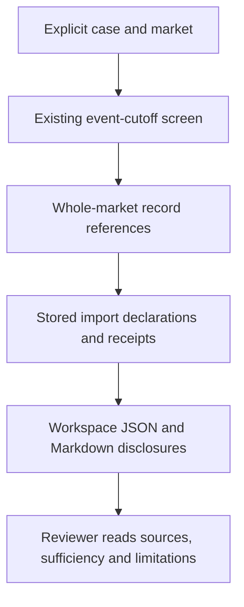

# nopo-1 Historical Validation and Pilot Readiness - Plan

## Goal Capsule

- **Objective:** An agency reviewer can distinguish what a historical backtest demonstrates from what remains unvalidated, then assess a collaborator-chosen pilot using eligible data.
- **Means:** Complete the existing backtest reports' input disclosures and prepare a concrete historical-validation and pilot procedure (KTD1-KTD4).
- **Scope:** Only mandate item `nopo-1`: origin U14/R21 and R22. Software preparation can ship independently; actual historical runs and pilot acceptance remain outstanding until the external prerequisites below are met.
- **Authority:** The origin Product Contract governs product behavior. Campaign rules refer to the chief repository's `docs/plans/2026-10-26-0705-feat-codex-drawdown-campaign-plan.md` and `ops/drawdown/mandates/_common.md`. `Origin R...` and `Campaign R...` distinguish their requirement namespaces from this plan's local R-IDs.
- **Execution:** This stage commits only this plan on `drawdown/nopo-1`. The later build implements U1-U2 locally; the controller scans, pushes and opens the PR, and the campaign merge gate owns merging (Campaign R15, R17, R19). The lane never adds a remote or seeks credentials.
- **Stops:** Campaign R11 and the mandate prohibit spend, credential/security changes, sends in the owner's voice, unbacked deletion and force-push. No real records, workspaces, pilot results or filled-in review forms enter git (Origin R20).

---

## Product Contract

### Summary

Add actual input-source disclosures to the current JSON and Markdown backtest reports and document how an analyst prepares historical runs and a collaborator-led pilot.
Use synthetic tests to prove report behavior while retaining explicit limits on historical availability and empirical accuracy.

### Problem Frame

The backtest harness exists, but its reports list public case citations without summarizing the datasets behind the screen.
Its cutoff uses event dates, while `docs/method.md` describes a stronger requirement: information available before disclosure.
No supplied person-level dataset, collaborator-set benchmark or pilot review is available in this checkout.
Those gaps prevent an honest claim that historical validation or the live pilot is complete.

**Product Contract preservation:** The origin plan remains unchanged. This is an item-specific follow-up, not a replacement for the original build plan.

### Requirements

**Report evidence**

- R1. Each case report discloses the source labels, declared provenance classes and receipts referenced by its whole-market screen, separately from public case citations (Origin R10, R17, R21; U14).
- R2. Both report formats explicitly identify synthetic inputs and unknown or missing provenance; labels alone never establish lawful use, historical availability or empirical validation (Origin R11, R13, R24; method's validation limits).
- R3. Preserve existing ranking, percentile, signal, sufficiency, cutoff and source-preservation behavior, including the event-date limitation and no rank for insufficient pairs (Origin R5, R14, R15, R21, R23; F3).

**Historical validation and pilot**

- R4. The historical procedure requires lawful inputs, documented pre-disclosure availability and a collaborator-set success criterion before the first empirical run; event-only retrospective exercises remain qualified (Origin R21 and Success Criteria).
- R5. The pilot procedure requires the collaborator to select the market in their state, use eligible inputs in a separate workspace, and review top leads through the existing app and dossier flow (Origin R22; A1, A2; F1, F2, F4).
- R6. Keep all real inputs and results in agency storage; public documentation contains only unfilled forms, instructions and invented examples (Origin R18, R20; Campaign R11, R20).

### Key Decisions

- **Historical validation and a live pilot are separate obligations.** Governs R4, R5. (session-settled: user-approved — chosen over a backtest alone or a pilot alone: the origin requires both trust in the method and relevance to the collaborator.)
- **Unclear-collection aggregator data is validation-only.** Governs R2, R4, R5. The origin's resolved backtest-data decision permits historical validation use, requires vendor/dataset/provenance disclosure, and leaves purchases subject to separate approval.
- **Independent preparation proceeds while external inputs remain outstanding.** Governs R4-R6. (session-settled: user-directed — chosen over waiting for the owner through 2026-10-30: the campaign requires completing all work that does not depend on their input.)

### Success Criteria

Preparation succeeds when a reviewer can identify the referenced input sources and the limits of a report without mistaking case citations or synthetic fixtures for validation evidence.
Historical success retains the origin's collaborator-set rank criterion; no threshold is selected here.
Pilot success retains the origin's criterion that the collaborator judges at least one top-ranked lead worth further inquiry.
An unsuccessful or insufficient run is recorded honestly and does not satisfy those success criteria.

### Scope Boundaries

In scope: existing-report disclosure, focused regression coverage, a historical/pilot operating procedure and accurate README/method wording.

The origin's **Deferred for later** and **Outside this product's identity** boundaries remain controlling without alteration.
In particular, there is no hosted operation, account-based collection or claim that a ranking proves an agreement.

#### Deferred to Follow-Up Work

- Distribution/PDF/Docker (`nopo-2`, `nopo-5`), analytical checks (`nopo-3`), non-compete extraction (`nopo-4`) and general hygiene (`nopo-7`).
- Generic reproducible validation packets, a manifest format, bundles or a new verification CLI (`nopo-6`). This plan extends existing reports only to meet the origin's disclosure obligation.

#### Considered and not built

- A new backtest CLI or browser page: the analyst API already provides the required operation. Revisit only if agency use demonstrates a concrete access problem.
- Automated record-availability filtering: the workspace lacks reliable availability metadata. Retain the limitation and require independently supported historical snapshots; do not invent dates, backdate receipts or introduce a temporal schema here.
- A general live-data eligibility engine: the current importer accepts provenance classes without enforcing purpose restrictions. R5 supplies an explicit operating prerequisite; this plan does not claim software isolation or legal clearance. Revisit as separate work before offering unattended mixed-purpose operation.

No migration, data rewrite, dependency change, release, new outside service or deployment change is needed.
No frontend change is planned. Any later frontend scope change triggers the campaign's committed Playwright screenshot requirement under `docs/plans/evidence/`.

---

## Planning Contract

### Reverified Starting State

Source review used clean branch `drawdown/nopo-1` at `dc23ace`.
No application tests or runtime probes ran during this plan stage; baseline test health is unverified.

| Existing evidence | Consequence for this item |
|---|---|
| `src/nopoach/backtest/run.py:194` calls the ordinary pipeline with explicit markets and disclosure minus one day | Keep the existing analyst entry point and comparison employers. |
| `src/nopoach/backtest/run.py:25` and `src/nopoach/pipeline.py:93` implement and disclose event-date filtering | Receipt collection time cannot establish historical availability. |
| `src/nopoach/backtest/run.py:237` already writes JSON/Markdown under the workspace with a containment check | No packet/export subsystem is necessary. |
| `src/nopoach/backtest/run.py:326` lists case-source URLs | Add input disclosures without replacing those citations. |
| `src/nopoach/imports/schema.py:99` and `src/nopoach/export/dossier.py:200` retain source/class/receipt data and show a working disclosure pattern | Reuse existing metadata; no migration is necessary. |
| `src/nopoach/pipeline.py:622` builds references before filtering visible rankings | Use all case references, including comparison and unreliable pairs. |
| `tests/backtest/test_run.py` covers planted rank, thin coverage, SEC event cutoff and spanning ties | Extend the existing suite and retain every assertion. |
| `docs/method.md:174` and `README.md` leave empirical validation outstanding | Preserve that status while clarifying the implementation limit. |

The v1 build handoff was retired in `77ed323`, merged by `dc23ace`; do not revive its completed tasks.
No repository `AGENTS.md`, `CLAUDE.md`, `docs/handoffs/`, `.planning/` or `docs/solutions/` was present.
The chief campaign source and common mandate were unavailable in the accessible checkout and adjacent mounted paths.
The supplied lane rules provide Campaign R11/R15/R16/R17/R19/R20 for this plan; their full source Goal Capsule and text were not independently verified.
The controller must reconcile those cited sections when making the chief source available for the build, without requiring owner time or reopening settled campaign choices.

### Key Technical Decisions

- KTD1. **Extend the current report dataclasses and serializers additively.** Add per-case input disclosures in `src/nopoach/backtest/run.py`; preserve public call arguments, existing fields and ranking semantics. Follow the data lookup in the Word exporter and use `wording.source_entry` for readable metadata, without importing the Word exporter or refactoring it. Governs R1-R3.
- KTD2. **Describe the stored screen reference set, not exact causal lineage.** Union every `CaseResult.references` receipt ID and deduplicate deterministically. Join existing import declarations when present, then receipt metadata. Include unresolved referenced IDs as explicit missing entries; an empty set gets an explicit unavailable-input-disclosure message. Never substitute all workspace imports. These references may overinclude employer-associated records; state that limit. Governs R1, R2.
- KTD3. **Keep source declarations literal and uncertainty visible.** Expose source label, import provenance class where recorded, receipt ID, collection method/time, location and content hash. Missing fields stay unknown. Either a synthetic class or synthetic collection method triggers a synthetic notice, including mixed-input reports. Dataset/vendor/version are not separate schema fields: require new validation imports to identify them in the existing source label, preserve older labels, and state that unrecorded details need a private intake supplement. Do not parse filenames or source labels to invent structured identities. Governs R1, R2, R4.
- KTD4. **Use the existing API and UI in a data-free runbook.** Add `docs/validation.md`, link it from README, and qualify the method's historical-availability wording. Record the actual current API, required market inputs and private review evidence. Keep the software's explicit availability limitation even when an analyst supplies supporting historical documentation. Governs R3-R6.

### Assumptions

- A small disclosure addition and operating procedure are the useful remaining preparation within `nopo-1`; infrastructure for reusable validation packets belongs to `nopo-6`.
- An analyst can call the existing Python API. The collaborator uses the existing point-and-click application; no command-line burden is added to the lawyer.
- Lawful records and collaborator choices will be supplied through authorized agency channels later. Neither their existence nor their legal eligibility is inferred from source labels.

### Evidence Flow

The code trace is `run_backtest` to `run_screen`, an in-memory filtered workspace, and `_persist` back to the original workspace's screen records.
Source facts remain unchanged; the screen and report are new workspace outputs.
This plan changes only the reporting end of that flow.

### Dependencies and Risks

U1 precedes U2's final rehearsal and documentation verification.
External acceptance follows both, but missing real inputs do not prevent either implementation unit from being committed.

The principal risks are omission of comparison-employer sources, accidental promotion of synthetic data into empirical evidence, and overstating what event cutoffs establish.
KTD2-KTD4 and the scenarios below address those risks.
Existing clause/tie completeness inputs are empty in `run_screen`; positive individual evidence does not make those feeds sufficient.
Do not change statistical thresholds or feed-completeness semantics to make validation look successful.

---

## Implementation Units

### U1. Disclose referenced inputs in existing backtest reports

**Goal:** Make each report's data basis and provenance gaps inspectable.

**Requirements:** R1-R3; Origin R10/R17/R21/R24 and U14.

**Dependencies:** Existing import, pipeline, wording and report code only.

**Files:** `src/nopoach/backtest/run.py`; `tests/backtest/test_run.py`.

**Approach:**

1. Collect per-case disclosures from existing references and metadata under KTD1-KTD3.
2. Add the same information to JSON and a separate Markdown input-source section. Keep case citations, percentile method, cutoff limitation and sufficiency output intact.
3. Retain source declarations without reclassifying unknown collection as licensed or empirical. Show synthetic/mixed-input warnings and unresolved references in both formats.

**Patterns to follow:** `src/nopoach/export/dossier.py:200`, `src/nopoach/rank/wording.py:178` and `src/nopoach/rank/wording.py:311`.
Use the current fixtures and temporary external workspaces in `tests/backtest/test_run.py`.

**Execution note:** Add failing disclosure assertions before changing serialization. All new data is invented and explicitly identified as test data, including fixtures that exercise other declared classes.

**Test scenarios:**

1. A fixture import whose source declares an invented vendor and dataset appears with its class, receipt metadata and hash in both formats; the public case citations remain separate.
2. A source attached only to a comparison employer appears, even when the known pair's own records use another source. Unreliable candidate references are included where present.
3. Duplicate references emit one entry per receipt; repeated imports with different receipt IDs remain distinct and ordering is deterministic.
4. Pure synthetic and mixed synthetic/other-class inputs show the empirical-validation warning in both formats. A synthetic collection method cannot be hidden by another declared import class.
5. A referenced non-import receipt without a class is explicitly unclassified; a workspace without the imports companion table still reports receipt metadata.
6. An unresolved referenced receipt ID remains visible as missing; an empty reference set is disclosed without claiming that arbitrary workspace imports were used.
7. A sparse case still reports insufficient data and no rank while disclosing available referenced inputs. Existing synthetic ranks, separate lists, percentiles and cutoff assertions remain unchanged.
8. The existing newly imported, old-event synthetic example retains the record-availability warning. Reports and persisted screens stay in the temporary workspace, and source rows/receipts are not rewritten.

**Verification:** Focused backtest and pipeline tests pass; report data agrees between JSON and Markdown, with no change to scores or existing assertions.

### U2. Document and rehearse historical and pilot preparation

**Goal:** An analyst can prepare a valid run and recognize precisely what still requires agency evidence or collaborator judgment.

**Requirements:** R2-R6; Origin R21/R22, A1/A2, F1-F4, AE3 and AE5.

**Dependencies:** U1 for final report examples and rehearsal.

**Files:** Create `docs/validation.md`; update `docs/method.md` and `README.md`.
Existing `tests/backtest/test_run.py`, `tests/test_pipeline.py` and `tests/export/test_dossier.py` supply executable examples and regression checks.

**Approach:**

1. Document analyst use of `Workspace.open`, `load_cases`, explicit `Market` definitions and `run_backtest`, including optional resolved party IDs. Use invented examples and placeholders, not a new runner or CLI.
2. Specify required histories, occupation/location mappings, coordinates or crosswalks, workforce denominators, comparison employers and input receipts. Distinguish employment/event dates, information availability and actual acquisition time.
3. Supply unfilled intake/review fields for the availability evidence and the predeclared benchmark, including separate-list denominators, insufficient cases, partial screens and allegation-only case labels. Point to the existing catalog instead of redefining public case facts.
4. Explain private historical execution and result review under R4. Preserve the harness limitation, explicitly state that current synthetic SEC examples are not real High-Tech validation, and explain that vendor/dataset details absent from a source label need a private supplement.
5. Document the R5 pilot sequence through imports, competitor confirmation, coverage review, explicit partial-screen acceptance, ranked leads and Word dossier review. Require source eligibility review and an independent pilot workspace before a live screen; the application does not enforce that boundary.
6. Include blank collaborator outcome fields and the unsent request below. Link the procedure from README and correct `docs/method.md` to distinguish the desired historical standard from current event-date filtering.

**Patterns to follow:** README's analyst/IT split and external-workspace instructions; existing backtest fixtures; `docs/method.md`'s cautious interpretation of scores, sources and partial screens.

**Test expectation:** No new test for prose alone. Rehearse the documented API path against existing synthetic fixtures during the build, inspect both report formats, and keep all generated artifacts outside the repository.

**Verification:** A reviewer can follow the procedure without inventing API names or market inputs, distinguish preparation from empirical completion, and locate every required private decision/result field. The rehearsal demonstrates usability only.

---

## Verification Contract

These are build-stage checks, not results claimed by this planning commit.
Use the pinned Python 3.12 environment and existing dependency caches; do not update the lockfile.

| Gate | Command or evidence | Required outcome |
|---|---|---|
| Focused behavior | `uv run --no-sync pytest tests/backtest/test_run.py tests/test_pipeline.py tests/export/test_dossier.py` | New disclosures and existing cutoff/ranking/export behavior pass. |
| Lint | `uv run --no-sync ruff check .` | No errors. |
| Formatting | `uv run --no-sync ruff format --check .` | No formatting changes needed. |
| Types | `uv run --no-sync mypy src` | No errors. |
| Existing suite | `uv run --no-sync pytest` | All default suites pass; no deleted or weakened tests. |
| Repository safety | Review the staged diff and controller's existing repository scan | Only code, documentation and synthetic fixtures; no real records or generated reports. |
| Procedure rehearsal | Run the documented API against synthetic data in an external temporary workspace and inspect both outputs | Actual API matches the guide; limitations, source metadata and insufficient states remain clear. |

Run the current baseline before implementing in the build stage.
Distinguish baseline or sandbox failures from regressions; report any unresolved check without weakening it.
Default pytest already excludes `browser` and `live` tests in `pyproject.toml`; this plan changes neither marker selection nor CI.
Unix-socket restrictions can prevent host checks. The controller/host retains those checks where applicable; this branch must not claim they passed locally.
No browser screenshot is required for the planned backend/documentation changes.

---

## External Acceptance and Blockers

These prerequisites block empirical completion, not U1-U2. Estimates cover human intake/review effort, not unknown data-procurement lead time. No request is sent and no work waits for owner input through 2026-10-30.

- **E1. Lawful historical records and availability evidence.** An authorized data custodian supplies histories, source/vendor/dataset identity, use basis, pre-disclosure availability support and the supporting market inputs in the procedure. Setting: **on-site**. Estimate: **30 minutes** for intake once data exists. Unblocks historical execution and evaluation under Origin R21; a modern retrospective extract alone does not establish historical detectability.
- **E2. Collaborator choices.** The collaborator fixes the historical success bar, denominator and treatment of insufficient cases before the first empirical run, and selects the pilot market in their state. Setting: **5-minute decision**. Estimate: **5 minutes**. Unblocks the predeclared evaluation protocol and Origin R22 market selection.
- **E3. Eligible pilot inputs and lead review.** The agency prepares an independent workspace with lawful live-use inputs, then the collaborator reviews ranked leads and records whether any warrants inquiry. Setting: **on-site**. Estimate: **60 minutes** after inputs and market are ready. Unblocks Origin R22 acceptance; validation-only aggregator data is excluded by the operating procedure.

**Draft request for later review; not sent:**

> Please identify the pilot occupation, state or metro, years and comparison employers. Before the first historical run, please agree on its success threshold and how to count partial or insufficient results. Please also identify the agency channel for lawful historical and pilot data, including vendor/dataset provenance and historical availability evidence. After the pilot, please review the top leads and record whether any merits further inquiry. Data and completed review notes should stay in agency-controlled storage outside the public repository.

The authorized operator runs the historical cases only after E1-E2, retaining selected markets, receipts, availability evidence, raw rank/sufficiency outcomes and the benchmark comparison privately.
The collaborator's pilot follows E2-E3 through the existing app; retain both favorable and unfavorable review outcomes.
No private target names, input paths or results are copied into this plan, git, PR text or public screenshots.

---

## Definition of Done

**Plan stage:** Only this plan is committed on `drawdown/nopo-1`; no implementation or application test run is included.

**Build preparation:** U1-U2 are implemented, their checks pass, every existing test remains intact, the procedure is rehearsed with synthetic data, and any abandoned implementation edits are absent from the final diff.
README and the method still state that real historical validation and pilot work are outstanding wherever that remains true.
The controller can publish the preparation without publishing private empirical artifacts.

**Full `nopo-1` outcome:** Authorized historical runs and collaborator pilot review have actually occurred under E1-E3, with private evidence evaluated against the origin's success criteria.
Record failure or insufficiency without changing the benchmark after seeing results.
Completing software preparation, passing synthetic tests or merging this branch does not establish that full outcome.
