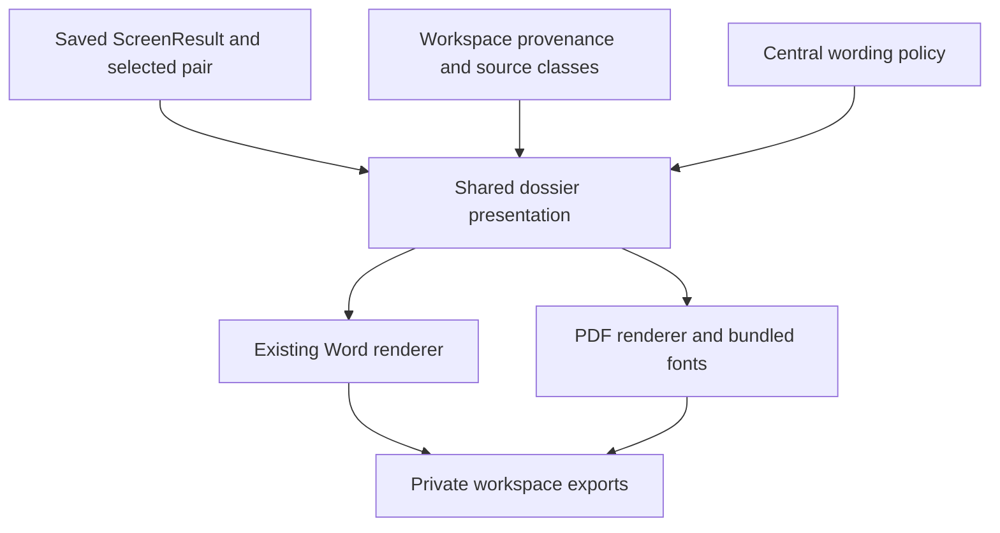
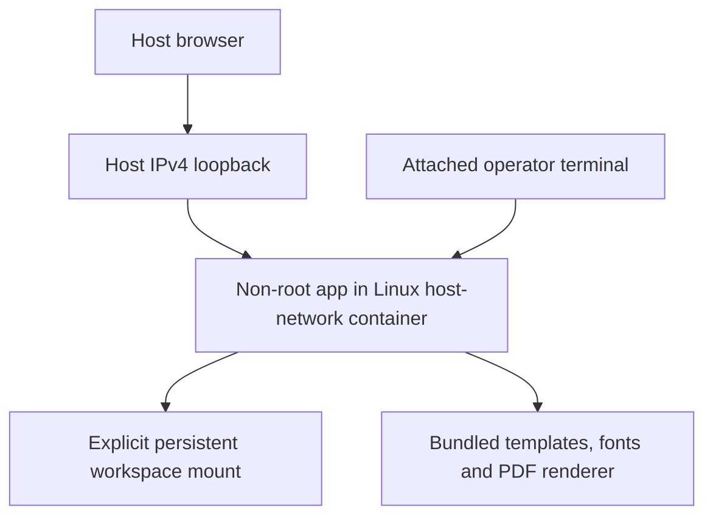

# No-Poach PDF Export and Optional Docker Distribution - Plan

## Goal Capsule

- **Objective:** Agency lawyers can give reviewers readable PDF dossiers, and agency IT can run the same screen through an optional local container distribution.
- **Means:** Shared dossier content, a bundled PDF renderer, and a Linux Docker recipe that retains the existing local application boundary (KTD1-KTD5).
- **Authority:** Mandate item `nopo-2` only, on `drawdown/nopo-2`, classified as planned work. The origin plan governs product behavior; this plan takes up its two distribution/export follow-ups without reopening its other units.
- **Campaign authority:** In the chief repository, `docs/plans/2026-10-26-0705-feat-codex-drawdown-campaign-plan.md`, Goal Capsule and R11, R15, R16, R17, R19, R20. That repository and `ops/drawdown/mandates/_common.md` are unavailable in this sandbox. Campaign constraints below come from the controller-supplied standing rules, not an independently verified reading of those files.
- **Delivery:** This stage commits the plan only. The later build implements and verifies locally; the controller scans, pushes and opens the PR, and the campaign gate handles reviews and merge. No remote or account discovery belongs in this clone.
- **Stop conditions:** No spend, credential or security-setting changes, messages in the owner's voice, unbacked deletion, force-push, production data access, schema migration, data rewrite, package release or new outside service. Preserve existing tests and unrelated work.
- **Remaining prerequisites:** Controller reconciliation with the unavailable campaign authority, followed by capable Windows, browser and Linux Docker runners for acceptance evidence. None requires a product decision or personal data from the owner.

---

## Product Contract

### Summary

Add PDF alongside the existing editable Word dossier and provide an optional, locally built Docker distribution for agency IT.
Both use the current screening and evidence pipeline.

### Problem Frame

The current application exports Word only, and its documented distribution choices are a native Windows bundle or a Python source installation.
The origin plan explicitly deferred PDF because Windows engine packaging was unresolved and deferred Docker for agencies with a data team.
Those two follow-ups are the scope of `nopo-2`.

**Product Contract preservation:** The origin remains unchanged. This follow-up activates only its PDF and optional Docker bullets; its R8-R12, R14-R15, R17-R20, R23-R24 remain constraints. Bare R/U/KTD IDs below belong to this plan; `origin R…` refers to the origin, and `campaign R…` refers to the chief plan.

### Starting State and Evidence Limits

Static inspection on 2026-10-28 found a clean `drawdown/nopo-2` at `dc23ace764ed7ab83f0f9a2d74c8870a848ff80b`.
Commits `77ed323` and `dc23ace` retired the completed v1 handoff; they do not implement either follow-up.
No repository `AGENTS.md`, `CLAUDE.md`, `docs/handoffs/`, `.planning/`, or `docs/solutions/` is present.

| Surface | Verified current behavior | Consequence |
|---|---|---|
| `src/nopoach/export/dossier.py` | `export_dossier` writes DOCX from a saved `ScreenResult`, reads provenance and draws two directional series with Matplotlib Agg | Share presentation data; do not collect or rescore during PDF export |
| `src/nopoach/app/routes/pages.py` | Word route checks idle workspace and saved pair membership, dynamically loads the public exporter, writes a UUID-named file in workspace exports | Preserve the Word route and its callable contract |
| `src/nopoach/app/main.py` | Fixed IPv4 loopback bind, peer/Host/Origin checks, one-use launch token and session cookie; opens browser after readiness | Container networking and bootstrap must fit these controls |
| `pyproject.toml` | Python 3.12, `python-docx`, Matplotlib and `pypdf`; no PDF generator; dependency cutoff `2026-10-13T14:50:00Z` | Add one renderer and keep the cutoff and unrelated pins |
| `packaging/` | PyInstaller one-folder build; notices, hashes and SBOM; no Docker recipe | Native packaging remains required; Docker is additive |
| `tests/` and CI | Word evidence tests, route tests, host-owned Playwright, Linux/Windows suites and frozen-app smoke | Extend these contracts; current frozen smoke proves home/assets, not export |

No tests or runtime probes ran during planning; source and test inspection do not establish a passing baseline.
The build stage must recheck HEAD and execute the existing applicable suites before relying on this baseline.

### Actors and Inherited Decisions

Origin A1 exports and origin A2 reads dossiers without running the app.
Origin A3 and agency IT maintain and operate distribution; IT may use a command line while the lawyer's workflow stays point-and-click.
Origin F2 and AE5 govern review/export and cautious wording; origin AE1-AE4 supply synthetic evidence states.

- **Agency-controlled operation.** Governs R4, R5. (session-settled: user-approved — chosen over hosted operation and a report-writing service: confidential queries stay inside the agency)
- **Leads, never findings of agreement.** Governs R2. The origin's wording policy applies to both formats.
- **Guarded campaign delivery.** Governs R6. (session-settled: user-directed — chosen over holding routine expansions for owner review: the campaign review and verification gate handles delivery)

### Requirements

**Dossier export**

- R1. A lawyer can download a standalone PDF from the pair dossier while the existing Word action, route, public function and content remain compatible. Traces to origin R12, R19 and the deferred PDF bullet.
- R2. PDF preserves the Word dossier's evidence, interpretation and limitations: summary and scope, both flow directions and break captions, clauses and citations, ties, explanation results, coverage, sufficiency, provenance classes, record references and method. Traces to origin R8-R12, R14-R15, R17, R23-R24.
- R3. PDF keeps text readable and complete across pages; unsupported text or rendering failure produces a clear failure without presenting an incomplete export as successful. Traces to origin R10-R12.

**Local operation and distribution**

- R4. PDF works offline in the native Windows distribution without Office, a separately installed PDF engine, browser runtime download, admin rights or a conversion service. Traces to origin R18-R19 and KTD12-KTD13.
- R5. Agency IT can optionally build and run the same app in a local container, with durable workspace storage and the existing session/network boundary intact. Traces to origin R18-R20 and the deferred Docker bullet.

**Verification and public-safe delivery**

- R6. Add tests for changed behavior, retain every existing test, and obtain passing applicable suites plus a reviewed Playwright screenshot of the changed dossier page under `docs/plans/evidence/`. Traces to campaign R15-R17 and R19 as supplied by the controller.
- R7. Repository artifacts and container layers contain no collected records, workspaces, generated dossiers, launch tokens or private matter text; notices describe the new dependency and supported distribution accurately. Traces to origin R20 and campaign R11.

### Scope Boundaries

Active work is U1-U5 below, all within `nopo-2`.
The overlapping PDF proposal in `nopo-5` creates no separate expansion in this branch; its mandate status can be re-verified after this item lands.
No historical-case runs, pilot work, analytical signals, non-compete extraction, validation packets or general hygiene campaign are included.
The PDF-specific data-file guard is included because exports must remain outside git under R7.

#### Deferred for later

- Sharing screens or methods between state agencies.
- A standalone Clayton Act §8 board-interlock screen beyond what R7 needs.
- Pulling paid data sources directly through vendor APIs. Version 1 recommends them and imports their files.

These three origin scope bullets retain the origin's R numbering.

#### Outside this product's identity

- Hosted or software-as-a-service operation.
- Statements that an agreement exists, or anything framed as proof.
- Tools for plaintiffs' firms, corporate compliance teams or journalists, even though the open-source code allows them.
- Collecting data by logging in, using accounts, or breaching a site's terms, including any LinkedIn collection.

#### Deferred to Follow-Up Work

The origin's flow-cluster markets, LEHD cross-check and non-compete extraction remain deferred to their separately assigned items.
Historical validation and pilot work remain subject to lawful data availability under their own mandate.

#### Considered and Not Built

No generic report framework, additional export formats, automatic font downloads, PDF/A or tagged-PDF certification, registry publishing, automatic updates, remote container access, or installer/daemon changes.
These do not satisfy an additional requirement of this item; a later explicit requirement can justify them.
Office conversion, browser printing and GTK-based conversion are rejected for R4.

---

## Planning Contract

### Key Technical Decisions

- KTD1. **Share evidence content and the chart, keep format renderers separate.** Extract a small dossier-specific presentation layer from `src/nopoach/export/dossier.py`, with ordered text, coverage rows, citations, warnings and PNG chart/caption data. Both renderers consume it and the central `src/nopoach/rank/wording.py` policy. Preserve `export_dossier` and its partial-screen argument; do not introduce a general document DSL. Governs R1-R2.
- KTD2. **Use ReportLab Platypus directly.** Pin ReportLab 5.0.1, which predates the repository cutoff and supports Python 3.12, then update only the necessary lock entries. Its paragraph/image/table model fits the existing dossier. Do not select optional Cairo or conversion components. fpdf2 is viable but offers no decisive advantage for long flowing evidence; the renderer boundary makes replacement inexpensive, so a bake-off is unnecessary. Governs R3-R4. Sources: [release metadata](https://pypi.org/project/reportlab/5.0.1/), [Platypus](https://docs.reportlab.com/reportlab/userguide/ch5_platypus/).
- KTD3. **Embed existing bundled static TTF fonts and preserve literal evidence.** Use Matplotlib's DejaVu Sans faces, located through its package data, with the font license retained. Escape evidence before placing it in ReportLab paragraph markup. Check every displayed string, including chart labels, for unsupported glyphs or shaping needs before final output. Use flowing paragraphs for long excerpts and an explicit split layout for oversized table content; never clip or shrink text into illegibility. Assemble the PDF before exposing a final download; leave prior exports intact. Governs R2-R4. Sources: [ReportLab tables](https://docs.reportlab.com/reportlab/userguide/ch7_tables/), [fonts](https://docs.reportlab.com/reportlab/userguide/ch3_fonts/), [Matplotlib font coverage](https://matplotlib.org/stable/users/explain/fonts.html).
- KTD4. **Add a distinct PDF route and capability.** Keep the existing Word URL and add `/pairs/{a}/{b}/export.pdf`, returning `application/pdf` and attachment name `dossier.pdf`. Store UUID-named PDF files in the selected workspace's `exports/` directory. Reuse `idle`, `find_pair` and session middleware. PDF availability or failure must not disable Word. Known failures produce a short local message without echoing evidence or exception details. Governs R1, R3, R7.
- KTD5. **Support local Linux Docker Engine with host networking.** The container runs non-root and keeps the application's fixed loopback bind and checks. Use an explicit workspace bind mount, writable temporary/cache locations, a locked production environment and an allowlisted build context. No published ports, privileged mode, Docker socket mount, registry or remote daemon. The Linux host-network mechanism is documented by [Docker](https://docs.docker.com/engine/network/drivers/host/); unchanged loopback reachability is an inference that the runtime smoke must prove. Governs R5, R7.
- KTD6. **Give an attached container operator a ready-session link.** Add an opt-in `--no-browser` launch mode that uses the existing fresh token and readiness event, prints the one-use local URL once, and leaves default browser opening unchanged. The documented container invocation stays attached and disables logging for that container with `--log-driver=none`; it changes no daemon setting. Tests capture the URL privately and never include it in logs or screenshots. Governs R5, R7. Docker's [logging documentation](https://docs.docker.com/engine/logging/configure/) explains why attachment alone would not prevent persistence.
- KTD7. **Prove packaging at runtime without publishing.** Extend the existing Windows frozen-app smoke and add a Linux image build/smoke gate. Preserve locked CI installation and existing release safeguards. Extend the generated-dossier guard to PDF, including archive members and history, without allowing PDF as an opaque asset. Governs R4-R7.
- KTD8. **Confine container workspaces to the durable mount.** Add an optional `--workspace-root` launch setting, propagated through the application session and unset for native launches. Restricted sessions accept only resolved paths within that existing writable root; reject traversal, sibling-prefix matches and symlink escapes before writes or session replacement. Apply the same check to existing storage children and export destinations. The Docker recipe requires a pre-existing bind source, read-only root filesystem and separate writable cache/temp locations. Startup refuses a missing or unwritable root before offering a session URL. This closes a data-loss path: `Workspace.open` currently allows writable temporary folders, even with a read-only container root. It does not promise protection against a hostile local filesystem race. Governs R5, R7.

### High-Level Technical Design

Evidence ownership and renderer boundaries:



PDF request and failure behavior:

```mermaid
sequenceDiagram
  actor Lawyer
  participant Route as PDF route
  participant Guard as Existing session and pair checks
  participant PDF as PDF renderer
  participant Store as Workspace exports
  Lawyer->>Route: Select PDF
  Route->>Guard: Validate session, idle workspace and pair
  Guard-->>Route: Saved result and pair
  Route->>PDF: Render preserved evidence
  alt Complete render
    PDF->>Store: Write new PDF
    Route-->>Lawyer: PDF attachment
  else Unsupported text or render failure
    Route-->>Lawyer: Explain failure; Word remains available
  end
```

Container topology:



| Launch mode | Browser bootstrap | Persistent application data |
|---|---|---|
| Existing native default | Opens the browser after readiness | User-selected workspace; no new root restriction |
| Optional container `--no-browser` with `--workspace-root` | One ready-session URL in attached terminal; container logging disabled | Only the persistent mount or its descendants, under KTD8 |

### Assumptions and Execution-Time Unknowns

- The optional Docker audience can use an already available local Linux Docker Engine. Initial support is Linux/amd64; Docker Desktop, remote and rootless daemon compatibility are unproven and not advertised. No platform or security configuration is changed to make this assumption true.
- DejaVu covers the ordinary Latin-script dossier fixtures, not arbitrary scripts. Unsupported content gets the explicit R3 failure with Word still available; broad international typography is not silently claimed.
- Exact image digests, available numerical-library wheels, renderer resource collection and row-splitting behavior must be established by build-stage experiments against the pinned dependencies. Resolve them without moving the repository's dependency cutoff or upgrading unrelated packages.
- The chief campaign source is unavailable here. The controller must check its Goal Capsule and cited R-IDs against this plan at build intake; this document does not claim that check has passed.
- This sandbox denies Unix sockets. Windows, real Docker and browser evidence must come from capable controller/CI runners; a skipped or sandbox-blocked test is not a passing acceptance gate.

### Sequencing and System Impact

U1 precedes U2; U2 precedes U3; U3 precedes U4 and U5.
U1's refactor is limited to export presentation, with existing Word tests retained as regression coverage.
No scoring, database schema, import format, collector permissions, source allowlist, authentication policy or production deployment changes are intended.
Rollback restores the previous code/build while leaving workspace data and prior exports untouched.

---

## Implementation Units

### U1. Share dossier presentation without changing Word

**Goal:** Keep one source of dossier evidence for two renderers.

**Requirements:** R1-R2; origin F2 and AE5; KTD1.

**Dependencies:** Existing exporter and saved-screen model.

**Files:** Modify `src/nopoach/export/dossier.py`; add `src/nopoach/export/content.py` and `tests/export/test_content.py`; retain `tests/export/test_dossier.py` unchanged except additive coverage if needed.

**Approach:**

1. Extract the existing section content, source-class lookup and chart construction into dossier-specific helpers.
2. Keep Word layout and the public function contract intact, including explicit and persisted partial-screen notices.
3. Keep PDF imports out of the shared layer so a missing PDF dependency cannot break Word.

**Patterns to follow:** `src/nopoach/rank/wording.py` for text, `_sources` for whole-market receipts, and the current Agg chart with both directional series.

**Test scenarios:**

1. Synthetic AE1 produces the same section text, chart series, break caption and resolvable screen reference as the existing Word tests.
2. Clauses, ties and imported provenance classes survive extraction; no-clause, no-tie, no-flow and unknown-source states retain their explicit text.
3. Partial and unreliable results keep their reasons; one-way evidence retains its classification (origin AE2-AE3).
4. Constructing presentation data neither calls collectors/scoring nor mutates saved result/provenance records.

**Verification:** All existing Word assertions pass, including its exported public keyword-call contract, plus the new content tests.

### U2. Generate complete offline PDF dossiers

**Goal:** Produce readable standalone PDFs from U1's content.

**Requirements:** R2-R4; origin F2, AE1 and AE5; KTD2-KTD3.

**Dependencies:** U1.

**Files:** Add `src/nopoach/export/pdf.py` and `tests/export/test_pdf.py`; modify `pyproject.toml`, `uv.lock` and `THIRD-PARTY.md` for the renderer and font notices.

**Approach:**

1. Add the pinned renderer and use the shared content to lay out US Letter pages, numbered pages, flowing evidence, repeated coverage headers and embedded charts.
2. Resolve bundled regular/bold/italic fonts independently of current directory and apply KTD3 to text and layout.
3. Keep PDF metadata free of account names, host paths and workspace locations; preserve intentional source citations in the content.

**Test scenarios:**

1. Covers origin F2 / AE5. Parse the PDF using existing `pypdf`; all eight dossier headings, warnings, evidence and method text appear, and generated prose passes the existing banned-phrase policy.
2. Covers origin AE1. The PDF embeds the chart, both directions and break caption; its record-set reference resolves to the saved screen's whole-market inputs.
3. Long synthetic clauses, URLs, employer names and multi-page coverage remain complete; table headers repeat and the final source/method text is present.
4. Accented names, curly quotes, en dashes, section signs, ampersands and markup-like literal evidence survive text extraction. Unsupported glyphs/shaping and missing fonts fail visibly without a successful incomplete PDF.
5. Empty signal sections, unknown source classes, unreliable pairs and accepted partial screens keep the same facts as Word.
6. Generation works from a path containing spaces/non-ASCII characters and an unrelated working directory with network and converter subprocess calls forbidden.

**Verification:** PDF semantic and resource checks pass on Linux and Windows; visually inspect a multi-page synthetic export for clipping and legibility. Keep generated PDF files outside git.

### U3. Offer PDF in the local dossier page

**Goal:** Make both export formats discoverable and usable in the existing interface.

**Requirements:** R1, R3, R6-R7; origin A1, A2 and F2; KTD4.

**Dependencies:** U2.

**Files:** Modify `src/nopoach/app/routes/pages.py`, `src/nopoach/app/templates/dossier.html`, `src/nopoach/app/templates/unavailable.html` and, only if layout needs it, `src/nopoach/app/static/app.css`; add coverage in `tests/app/test_routes.py` and `tests/app/test_e2e.py`; add `docs/plans/evidence/nopo-2-dossier-exports.png`.

**Approach:**

1. Add the distinct PDF route and `Export dossier (PDF)` link beside the existing Word action.
2. Resolve format availability separately and show a useful local failure for missing PDF capability or a known rendering error.
3. Preserve existing session refusals, status checks, partial-screen state and keyboard/accessible layout.

**Test scenarios:**

1. Both links download their own MIME type, filename and parseable content; the persisted PDF matches the response bytes, and the Word contract remains unchanged.
2. Missing workspace, collecting state, absent result and foreign pair retain the existing 409/404 behavior; missing token, foreign Host, foreign peer and state-changing foreign Origin remain refused.
3. Missing PDF capability or unsupported content leaves the Word page/action working; no incomplete PDF is offered. A failed write returns an error without leaking evidence or removing earlier exports.
4. Playwright downloads both formats for a synthetic accepted partial screen and verifies notices, accessible names, keyboard access and the existing no-third-party request assertion.
5. At desktop and narrow viewport widths, actions and warnings remain legible and axe checks pass. Capture and inspect the changed dossier page with synthetic data only.

**Verification:** Preserve the current browser scenarios and commit the reviewed screenshot at the named evidence path. The build-stage final message must include `SCREENSHOT: docs/plans/evidence/nopo-2-dossier-exports.png`.

### U4. Verify Windows packaging and protect generated PDFs

**Goal:** Establish that the bundled Windows app can export both formats and that dossiers stay outside repository history.

**Requirements:** R4, R6-R7; KTD7.

**Dependencies:** U3.

**Files:** Modify as needed `packaging/nopoach.spec`, `packaging/build.py`, `packaging/scan_repository.py`, `tests/packaging/test_smoke.py`, `tests/packaging/test_safety_gates.py`, `packaging/IT-REVIEW.md`, `README.md`, `docs/method.md` and `.github/workflows/ci.yml`.

**Approach:**

1. Extend the actual frozen-app smoke from home/assets to synthetic screen creation and Word/PDF download; retain shutdown and current smoke assertions.
2. Verify the renderer, all required TTF faces and license notices exist in the bundle. Keep hashes and SBOM generation in the existing build path.
3. Extend generated-dossier rejection to PDF for staged, archived and historical content, retaining DOCX and all existing data rules.
4. Update export/install/storage documentation with verified behavior. Keep real-data validation and pilot limitations unchanged.

**Execution note:** Prove the frozen executable; a source-level import test cannot establish packaged support.

**Test scenarios:**

1. A Windows frozen app launched from an unrelated directory and a path with non-ASCII characters exports a synthetic PDF with expected text, embedded fonts and a chart, plus the existing Word file, without external conversion software.
2. A synthetic generated PDF is rejected in staged files, nested archives and reachable history, including uppercase suffixes; logs reveal no matched content. Existing DOCX and workspace guard tests still pass.
3. The build retains notices, matching checksums and SBOM entries. No generated dossier enters the release or committed screenshot directory.

**Verification:** Linux/Windows CI and the extended frozen Windows smoke pass; existing install-step, scan, attestation and release safety assertions remain intact. No release is dispatched.

### U5. Package the optional local Docker path

**Goal:** Let agency IT build and run the app locally with persistent workspace data.

**Requirements:** R5-R7; KTD5-KTD8.

**Dependencies:** U3; coordinate packaging documentation with U4.

**Files:** Add `packaging/Dockerfile`, `.dockerignore`, `packaging/DOCKER.md` and `tests/packaging/test_docker.py`; modify `src/nopoach/app/main.py`, `src/nopoach/app/routes/pages.py`, `tests/app/test_routes.py`, `.github/workflows/ci.yml`, `README.md` and `packaging/IT-REVIEW.md`.

**Approach:**

1. Build a Linux/amd64 image from digest-pinned Python 3.12 and uv inputs with locked runtime dependencies and package resources. Use an explicit source/document allowlist; exclude development tools and all user data from the runtime image.
2. Add KTD6's opt-in launch mode and KTD8's session-owned path validation, retaining existing callers/default behavior and graceful stop. Reuse the existing source/install-tree checks in `src/nopoach/store/workspace.py` without redesigning storage.
3. Document the local invocation, host UID/GID matching and the exact container-visible workspace path to enter in the browser. Explain the difference from the host path. Wrong ownership produces an actionable refusal, not automatic permission changes.
4. Add an explicit Linux image build/live smoke to CI without changing daemon configuration, publishing an image or weakening any existing job. Preserve workspace data when the container is stopped or replaced.

**Execution note:** A Dockerfile inspection is insufficient; build and run on a compatible Linux Docker Engine.

**Test scenarios:**

1. Default launch still opens the browser only after readiness; no-browser mode prints one ready URL, opens no browser and emits no URL when startup fails.
2. The real image runs non-root, serves only the host loopback listener and retains missing-token/foreign-Host/foreign-peer/foreign-Origin refusals. Its attached launch URL redeems once; it is absent from persisted container logs and CI output.
3. Through the authenticated app, a synthetic workspace imports data, runs a screen and exports PDF and Word. Restarting/replacing only the container preserves the mounted workspace and prior exports, uses a fresh session token and shuts down cleanly.
4. Missing or read-only startup roots produce no session URL. Wrong ownership fails without changing permissions; valid mounted exports have the documented host ownership, and templates/fonts/caches work without root.
5. Harmless synthetic sentinel files placed outside the build-context allowlist are absent from every image layer. No real secret or credential is used to exercise this test.
6. Native workspace selection remains unchanged. Restricted selection accepts the root and subfolders but refuses temporary folders, traversal, sibling-prefix paths and symlinked storage/export escapes before writes, preserving the active session after refusal.

**Verification:** Local image build and Linux runtime smoke pass without runtime dependency downloads. Published instructions identify the supported host/architecture and preserve the native Windows path.

---

## Verification Contract

Commands below are build-stage gates, not planning-stage results.
Run the existing ordinary suite first, retain its tests, then run the affected gates after implementation.

| Gate | Scope and invocation | Required evidence |
|---|---|---|
| Locked environment | `uv sync --locked --group dev --group build` | Compatible lock, existing cutoff retained; only justified dependency changes |
| Lint and format | `uv run --no-sync ruff check .`; `uv run --no-sync ruff format --check .` | No errors |
| Types | `uv run --no-sync mypy src` | No new type failures |
| Existing and added tests | `uv run --no-sync pytest` on Linux and Windows | Existing tests retained and all applicable tests pass |
| Offline export | `uv run --no-sync pytest -m network_off` with added PDF coverage | No export-time network or converter process |
| Browser | `uv run --no-sync pytest -m browser tests/app/test_e2e.py` on a capable runner | Both downloads, axe and request-host assertions; reviewed committed PNG |
| Frozen Windows | Existing CI build plus `uv run --no-sync pytest -m live tests/packaging/test_smoke.py` with the built executable configured | Actual bundled PDF and Word, resource inclusion and clean exit |
| Docker | New explicit Linux build/live gate using `tests/packaging/test_docker.py` | Built image, authenticated exports, network boundary, persistent storage, non-root ownership and context isolation |
| Public-safe scan | Existing staged/history scanner and synthetic guard tests | No generated dossiers, live data, credentials or launch URLs committed |

Do not substitute a skipped browser/live marker or a sandbox socket failure for any required runtime proof.
Record remaining runner work accurately for the controller; do not remove checks to make the lane appear complete.

---

## Definition of Done

- R1-R7 hold, with U1-U5 verified against the build's final revision.
- Existing Word content, route, public API and every existing test remain compatible.
- The native Windows app exports readable PDFs; the optional Linux container runs the same workflow and retains workspace data across container replacement.
- The screenshot named in U3 is committed, inspected and reported, while generated documents and workspaces remain outside git.
- README, IT review, Docker guide, method export wording and dependency/font notices match proven behavior.
- Required campaign reviews and source reconciliation are reported by the controller before merge; no passing review or runtime result is inferred from this plan.
- The diff contains only this item's implementation and proof, with abandoned experiments removed safely and unrelated work preserved.
- No migration, data rewrite, release publication, new service, spend, credentials or personal decision is required by the selected design.
