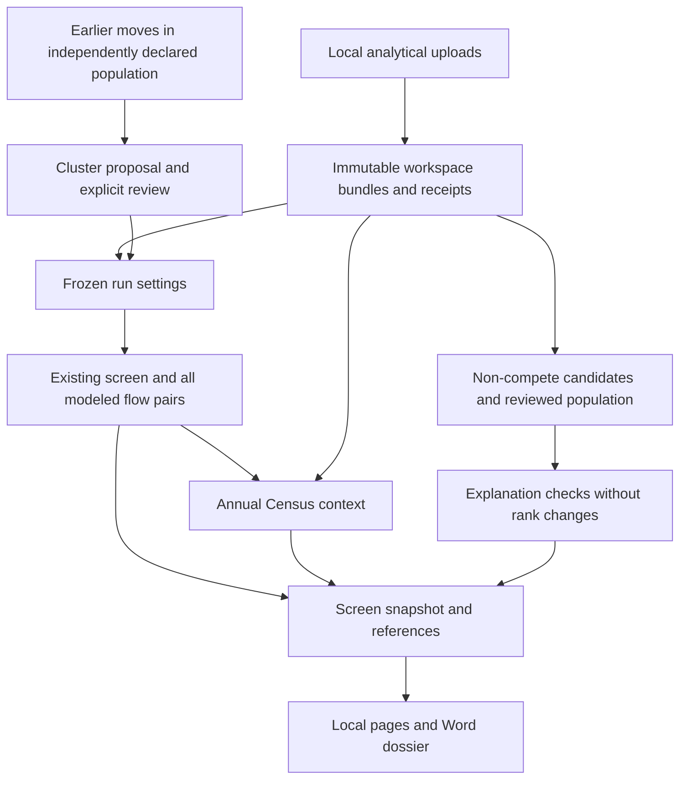
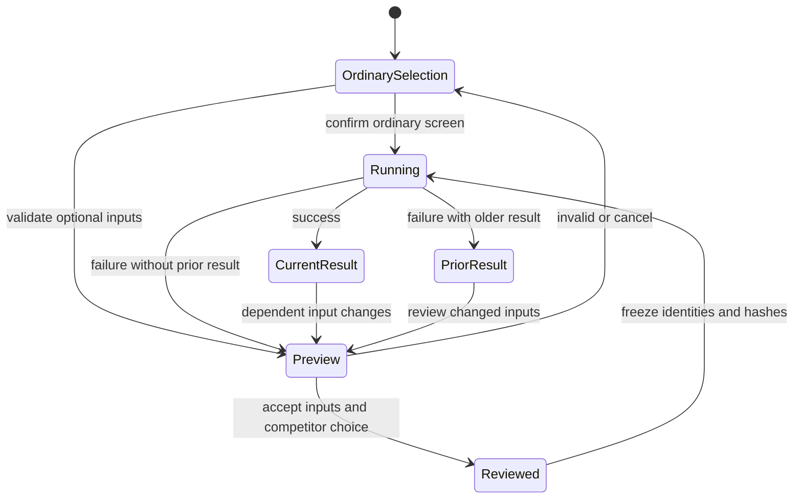
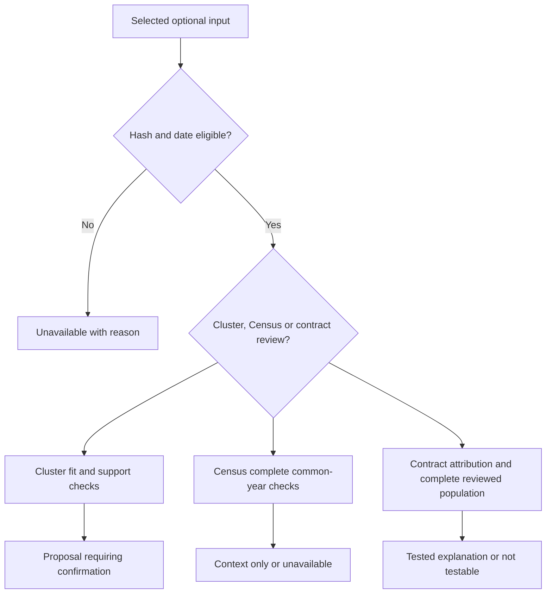

# nopo-3 Analytical Checks - Plan

## Goal Capsule

- **Objective:** An agency lawyer can assess how a flow-based competitor selection, public mobility trends, and documented individual employment restrictions affect the interpretation of a lead.
- **Means:** Optional local analytical inputs, a reproducible pre-period flow partition, a Census J2J contextual check, and reviewed non-compete evidence carried into the screen and dossier (KTD1-KTD8).
- **Scope:** Mandate item `nopo-3` only: the three analytical follow-ups in the origin plan. This is a focused follow-up plan, not a replacement for the completed v1 implementation plan.
- **Authority:** The origin Product Contract governs product behavior. Campaign authority is the chief repository's `docs/plans/2026-10-26-0705-feat-codex-drawdown-campaign-plan.md` and `ops/drawdown/mandates/_common.md`. `Origin R...` and `Campaign R...` distinguish those requirements from this plan's local R-IDs. The campaign-source access limitation is recorded below.
- **Execution profile:** One item, one branch, one eventual PR: `drawdown/nopo-3`. This stage commits only the plan. The build stage runs `lfg` on this plan to implement, simplify, review, verify and commit locally; the controller scans, pushes and opens the PR, and the campaign merge gate owns merging (Campaign R15, R17, R19). The lane does not add a remote or seek credentials.
- **Stop conditions:** No spend, sends, credential or security-setting changes, production-data access, destructive deletion, or force-push. No schema migration, data rewrite, release or new outside service is required. Follow Campaign R11 and the supplied lane's forbidden-file rules.

---

## Product Contract

### Summary

Add three optional analytical checks to the local screening workflow.
Lawyers can review a competitor grouping learned from earlier worker moves, inspect public mobility context alongside modeled annual flows, and review individual non-compete clauses with an explicitly scoped prevalence assessment.
The existing occupation/geography screen remains the default.

### Problem Frame

The current comparison depends on a manually confirmed employer list, has no independent public mobility context, and always reports non-compete prevalence as untestable.
Those limitations make it harder to examine alternative explanations for a lead.
Aggregate mobility data and filed employment contracts have different populations from the tool's job histories, so unsupported comparisons could be more misleading than the missing checks.

**Origin preservation:** The origin plan remains unchanged. This item activates its three named analytical follow-ups while retaining the existing signals, reliability rules, lawful-data constraints and lead-only wording. Distribution, historical validation and pilot work remain separate mandates.

### Actors and flows

Origin A1 defines and reviews a screen through the local interface; Origin A2 reads the exported dossier; Origin A3 maintains the method and synthetic verification.
Origin A4 supplies lawful records through existing collection or local import.

- F1. A1 chooses the ordinary occupation/geography mode or a flow-defined alternative, declares the latter's independent input population, reviews a grouping from a strictly earlier period, then confirms a competitor set. This extends Origin F1.
- F2. A1 imports optional analytical files, sees accepted inputs and reasons for unavailable checks, runs the screen, and opens or exports the same frozen analytical context. This extends Origin F2 and F4.
- F3. A1 changes a market or input, reviews any invalidated proposal, and starts a new screen without silently reusing the old result's interpretation.

### Key Decisions

- **Lawful local analysis remains the product boundary.** Governs R6, R8. (session-settled: user-directed — chosen over platform-account collection and immediate paid extracts: the origin requires lawfully supplied records and keeps investigation inputs inside the agency.)
- **Outputs remain leads for inquiry.** Governs R3-R7; carried from Origin R11. Analytical agreement, a document match, and a cluster assignment are not findings of misconduct or enforceability.
- **The campaign controller publishes this lane.** Governs R8. (session-settled: user-directed — chosen over lane-owned push and PR creation: the isolated clone has no remote or GitHub login.)

### Requirements

**Alternative competitor selection**

- R1. Offer a flow-defined alternative whose declared training universe and selected employer group are independent of the ordinary occupation/geography boundary, fitted solely on a strictly earlier period and confirmed before screening. Trace: origin analytical follow-up, Origin R1, R3, R19; F1.
- R2. Show the fitted membership, manual changes, excluded and unassigned employers, and unevaluated cross-boundary pair count; unavailable or incomplete clustering preserves the ordinary selection path. Trace: Origin R8, R10, R14, R15; F1, F3.

**Public mobility context**

- R3. Import public LEHD J2JOD aggregates locally and consume them in an annual temporal-pattern check against existing modeled flows, with explicit scope differences and unavailable reasons. The check never supplies employer-pair expected counts or claims to validate them. Trace: origin LEHD follow-up, Origin R3, R8, R10, R11.

**Individual restrictions**

- R4. Extract individual post-employment non-compete language with exact source spans, employer attribution, stated terms and uncertainty, separately from the employer-pair filed-clause signal. Trace: origin non-compete follow-up, Origin R9, R10, R11.
- R5. Make the non-compete explanation testable only for a declared, reviewed worker population with supported applicability and a complete denominator; otherwise show evidence and the reason prevalence remains untestable. Trace: Origin R9, R14, R15; F2.

**Compatibility, evidence and delivery**

- R6. Retain input bytes, source declarations, hashes, transformations and analytical settings in the external workspace, and freeze their identities and results for each screen. Historical cutoffs also apply to optional inputs. Trace: Origin R10, R13, R17, R18, R20, R21; F2, F3.
- R7. Display analytical context independently of whether any pair fires, and carry relevant context into HTML and existing Word dossiers without changing default rankings, weights, sufficiency or partial-screen behavior. Trace: Origin R2, R5, R8, R11, R12, R19, R23; Origin AE2, AE3, AE4, AE5.
- R8. Add synthetic verification without deleting or weakening an existing test, keep the change migration-free and service-free, and commit Playwright screenshots of changed pages during the build. Trace: Campaign R11, R15, R16, R17, R19, R20.

### Acceptance Examples

- AE1. Covers R1, R2, R6. A planted pre-period network spans two occupations and two metros and yields a reproducible grouping without a required occupation/geography boundary. Changing only later moves leaves the grouping and its input digest unchanged; confirming a group retains omitted employers and the original input universe.
- AE2. Covers R3, R7. Two complete synthetic public years and two modeled years produce labeled context with raw totals and annual shares. A suppressed quarter excludes its entire year; one remaining year yields an unavailable check, not a substituted zero or calibration claim.
- AE3. Covers R4, R5. A quoted individual employment restriction appears with exact offsets. Without a reviewed worker denominator, prevalence remains untestable; a complete scoped review can produce a tested result under KTD5.
- AE4. Covers R6, R7. A new import invalidates the dependent screen, while an already produced dossier remains a record of its original input version. A screen with no firing pairs still shows its optional diagnostics and sources.
- AE5. Covers R7, R8 and Origin AE2-AE5. With every optional setting absent, existing synthetic rankings, separate one-way results, insufficient-data notices and Word exports retain their existing behavior.

### Scope Boundaries

**In scope:** All three analytical follow-ups named by `nopo-3`, including the minimum import, review, persistence and output work their use requires. The non-compete work overlaps the later `nopo-4` catalog entry; this branch remains `nopo-3`, and that later lane must reverify what remains before building anything.

**Deferred for later** — retained from the origin:

- Sharing screens or methods between state agencies.
- A standalone Clayton Act §8 board-interlock screen beyond what R7 needs.
- Pulling paid data sources directly through vendor APIs. Version 1 recommends them and imports their files.

**Outside this product's identity** — retained from the origin:

- Hosted or software-as-a-service operation.
- Statements that an agreement exists, or anything framed as proof.
- Tools for plaintiffs' firms, corporate compliance teams or journalists, even though the open-source code allows them.
- Collecting data by logging in, using accounts, or breaching a site's terms, including any LinkedIn collection.

#### Deferred to Follow-Up Work

- Historical-case runs, the live pilot and validation packets: `nopo-1` and `nopo-6`.
- PDF and Docker distribution: `nopo-2` and `nopo-5`; general hygiene: `nopo-7`.
- Automatic selection of the economically correct cluster count and empirical validation of cluster boundaries.
- Substantively comparable Census calibration, state crosswalk ingestion, finer industry stratification, and restricted LEHD microdata.

**Considered and not built:** A hosted classifier, a native graph-tool dependency, automatic Census downloads, a general document-management system, OCR, and saved-screen rehydration. Local text rules, existing numeric dependencies, explicit file imports and the current screen lifecycle meet this item's requirements; measured accuracy or usability failures would justify reconsideration. No automatic legal-enforceability classifier or extrapolation from executive filings to the workforce is supported.

---

## Planning Contract

### Reverified starting state

Static inspection used clean branch `drawdown/nopo-3` at `ddc0807`.
No application tests, builds or runtime probes ran in this plan stage; baseline test health remains unverified.
The retired v1 handoff stays retired (`77ed323`, `dc23ace`).

| Current evidence | Consequence |
|---|---|
| Origin plan, Scope Boundaries, three analytical follow-ups | All remain planned follow-up work; no matching implementation was found. |
| `src/nopoach/market/define.py`, `Market` and version-1 JSON | Employer subsets and manual edits are already supported; retain their meaning. |
| `src/nopoach/signals/flow.py`, `build_moves` and `YearFlow` | Flow observations and expectations are annual; no quarterly expectations may be invented. |
| `src/nopoach/pipeline.py`, `run_screen`, `_filtered_workspace`, `_persist` | Event cutoffs use an ephemeral database copy; JSON screen envelopes can carry additive analytical snapshots. |
| `src/nopoach/rank/explanations.py`, `check_explanations` | Five checks always appear and do not alter ranking; non-competes currently have no input path. |
| `tests/rank/test_explanations.py`, missing-data test | Preserve its literal `no non-compete extractor` assertion with truthful conditional wording. |
| `src/nopoach/store/provenance.py`, `ProvenanceLog.append` | A receipt hashes bytes but does not retain them; optional uploads need workspace-owned bytes. |
| `src/nopoach/app/routes/pages.py`, `Session` and import routes | One worker owns scoring; workspace changes and imports need corresponding analytical-state invalidation. |
| `src/nopoach/export/dossier.py`, `_sources` and `export_dossier` | Existing Word output consumes an in-memory screen and largely pair-oriented references; add explicit screen-level context. |
| `pyproject.toml`, `.github/workflows/ci.yml`, `tests/app/test_e2e.py` | Python 3.12, NumPy/SciPy and Playwright already exist; default pytest excludes browser/live checks. |

No repository or ancestor `AGENTS.md`/`CLAUDE.md`, `docs/handoffs/`, `.planning/`, `docs/solutions/`, or configured Compound Pack was present.
The chief campaign source and common mandate were unavailable in the checkout and accessible adjacent locations, as also recorded by the earlier `nopo-1` plan.
The supplied lane text supplies Campaign R11/R15/R16/R17/R19/R20; the chief Goal Capsule and full cited requirements were not independently verified.
The controller must supply or reconcile just those source sections before the build handoff, without seeking owner time or credentials.

### Assumptions

These bounded interpretations are engineering assumptions for this follow-up, not claims that the origin specified their details.

- Flow-defined markets use employer membership and an explicit record population across occupations and geographies. They require denominators for that population; ordinary occupation/metro estimates cannot establish its coverage. The method remains experimental.
- A useful first Census check is temporal context for a metro screen. Existing inputs cannot establish matching Census populations or transition definitions, so a successful check remains contextual.
- Non-compete prevalence means prevalence in a named reviewed worker population. The application cannot infer workforce representation from filings or a supplied denominator.
- Initial clustering budgets and the 50%-of-reviewed-workers criterion below are disclosed provisional conventions. Synthetic verification establishes implementation behavior, not economic validity or field accuracy.

### Key Technical Decisions

- KTD1. **Use immutable analytical bundles and additive screen JSON.** A small `src/nopoach/analytical_inputs.py` module owns typed input descriptors and optional run settings. Store original bytes, normalized text where needed, and versioned manifests under workspace-relative `analysis/inputs/`; retain raw and normalized hashes plus provenance receipts. Filenames are generated identifiers, never supplied paths. Publish a validated bundle atomically, never overwrite an earlier version, and verify hashes before use. Existing `screens.parameters_json` and `results_json` hold selected versions, outputs and source references. Keep ordinary `Market` JSON version 1, use a distinct tagged flow-definition envelope per KTD8, and add defaulted optional context to `ScreenResult`; do not create tables, lazy schema extensions, or migrations. Governs R6-R8.

- KTD2. **Fit a directed degree-corrected Poisson block model on earlier moves.** Use existing resolved transitions and NumPy/SciPy; preserve the no-bridging rule for intervening jobs. The likelihood uses eligible ordered off-diagonal dyads, separate employer sending/receiving factors and a full block-rate matrix. Excluding self-dyads must also exclude their expected-value terms. Fit fixed assignments by iterative proportional fitting, then search assignments with deterministic employer order, fixed seeded restarts and canonical labels. Record likelihood, convergence residuals and restart agreement; describe a local optimum, not a replicated or validated economic market. Degree correction avoids grouping solely by firm size. A modularity-only community heuristic is not this model. Governs R1, R2; see the primary method sources below.

- KTD3. **Keep cluster choices explicit and bounded.** The pre-period ends before the assessment starts; omit moves whose entire date interval cannot be assigned to it. Build the graph from KTD8's independent population before group selection, with pre-period coverage and identity inputs only. Employers lacking known coverage or both sending and receiving support remain unassigned with reasons; zero eligible counts remain zero. Default to two groups, include a one-group reference, and allow an explicit group count up to four when every group can contain at least three supported employers. The initial experimental envelope is at most 64 supported employers, four restarts, 20 partition sweeps, 200 inner fitting sweeps, and 4096 candidate refits per fit. Exceeding a bound or failing convergence returns an incomplete/unavailable proposal without silently sampling. Numerical tolerances and their measured runtime are finalized in U2 and persisted with the method version. The lawyer selects a group and may edit it; store the fitted and final sets separately, plus the original population and omitted-pair count. No setting is selected by downstream suppression strength. Governs R1, R2, R6.

- KTD4. **Use Census only for annual temporal context.** Parse locally supplied public J2JOD CSV or gzip plus release/version and pair-availability metadata. Support one release and one explicit, nonoverlapping Q/U all-industry, all-demographic, all-firm-characteristic tabulation for the selected metro's same-CBSA origin/destination cell. Retain ownership and all dimensions; reject unsupported combinations instead of summing rollups. Preserve leading zeros, unknown categories and per-indicator flags. Annual public flow is the sum of `EE + AQHire` over four quarters, each component requiring status 1 and a finite nonnegative count. An absent, suppressed or unavailable component excludes that year. Use the identical complete-year intersection for public counts and the sum of all modeled directional expectations, including unflagged and zero-observation pairs. Require at least two complete common years, complete modeled-pair support and positive totals. Display raw totals and each series' annual share of its own common-year total, with percentage-point differences. Successful output is `context_only`; insufficient support is `unavailable` with reasons. Occupation coverage, selected employers, main-job inference, gap definitions and ownership/population differences remain visible. State screens, unknown workplace-geography meaning, partial years and unsupported schemas cannot produce a numeric comparison. Never split annual predictions into quarters, rescale Census totals into expected flows, or change scores/sufficiency. Governs R3, R6, R7.

- KTD5. **Separate extraction from reviewed prevalence.** A local extractor identifies an employee's restriction on working for a competitor after employment, retaining negation, scope, duration, exceptions and unknown applicability. It emits candidates, never legal conclusions. Import a UTF-8 CSV review corpus containing document text, employer, source document identifier/date, normalized scope, optional local worker key, effective interval, document completeness and explicit positive/negative/uncertain review. Preserve the source declaration, population description, sampling/coverage basis and declared unique-worker count in the bundle manifest. Worker keys remain local and are omitted from dossier prose. A regex miss is unreviewed, not negative; negatives require an explicit review of the complete applicable document set. Deduplicate repeated documents/worker keys, and make conflicting amendments or missing applicability unresolved. For each employer, a testable population requires all declared workers to have an unambiguous reviewed outcome matching the assessment scope. The descriptive criterion is at least 50% reviewed workers with an applicable candidate restriction. The pair check passes if either employer meets it, fails only when both complete populations fall below it, and otherwise remains untestable. Always report numerator, denominator, threshold and population limits. Keep the existing `non_compete_prevalence` key and three statuses; absent input uses a truthful reason containing `no non-compete extractor evidence was supplied`. Individual restrictions never become `ClauseSignal` pair evidence. Governs R4-R7.

- KTD6. **Freeze selection before jobs and invalidate dependencies on change.** Capture market, bundle versions, pre-period settings, proposal digest and review version as immutable job inputs before submission. Changes to the workspace, market, imports, parent overrides or input content invalidate dependent proposals/results even when `Market` compares equal. A failed import preserves the last valid input selection. Retry and partial acceptance retain the same selected analytical versions and recheck their hashes; a changed upstream graph requires a new proposal review. A retained result from a failed run is visibly identified as the prior screen and may export only its own snapshot. New evidence is subject to event/effective dates and the requested `as_of`; a public release after a historical cutoff is excluded. Unknown historical availability remains an explicit limitation, as in `docs/method.md`. Governs R1, R6, R7.

- KTD7. **Render one analytical result across the local UI and Word export.** Persist structured outcomes, exact evidence spans, source references, omissions and method settings alongside the in-memory result. Screen-level references exist even without ranked pairs. Dossiers add relevant cluster context, the contextual public check and reviewed non-compete evidence through centralized wording. Use the existing FastAPI/Jinja/htmx patterns and vendored assets, with text labels, accessible tables, keyboard review and escaped source text. No new rank contribution, external request, or export format is introduced. Governs R2-R7.

- KTD8. **Give the flow-defined population its own market variant.** Add a `FlowDefinedMarket` beside the unchanged ordinary `Market`, with assessment dates, declared candidate employers and source population, frozen cluster identity, and confirmed member IDs. Training and assessment include all occupations and workplace geographies in that declared population; an unknown occupation/geography does not silently remove an otherwise known transition. Preserve complete person spell sequences to avoid bridging excluded records. Population-scoped annual headcounts and their source/date/bounds enter through U1's manifest and a small CSV import, without reusing occupation/metro denominators or adding workforce-input columns. Unknown denominators keep the existing reliability failure. Compute occupation shares from attributable records and distance from supplied worksite coordinates; missing covariate support stays explicit rather than becoming unit overlap or zero distance. Multi-geography flows use geodesic pair distances instead of the current metro-scale planar approximation. The existing gravity, shrinkage, break and reliability conventions remain the scoring mechanisms. A common scope predicate and display description serve flow construction, coverage, explanations, catalog recommendations and exports; market-specific source recommendations remain unknown when their population support is unknown. Flow-mode collection uses already held records, never fabricated SOC/metro arguments to ordinary collectors. Store the tagged definition in screen JSON; existing nullable market summary columns need no migration. Census context is unavailable for this multi-population mode, because KTD4 requires one explicit metro comparison. Governs R1, R2, R6, R7.

### High-Level Technical Design

The component flow keeps new analysis beside the existing three-signal screen:

Input and review lifecycle:

Check eligibility is explicit rather than encoded as zeros:

Market mode determines which population each optional check can describe:

| Mode | Screening population | Public J2J context | Reviewed non-competes |
|---|---|---|---|
| Ordinary metro | Existing occupation/metro scope | Context only when KTD4's complete-year checks pass | Testable only for a complete reviewed population matching that scope |
| Ordinary state | Existing occupation/state scope | Unavailable: unsupported comparison | Same complete-population rule |
| Confirmed flow-defined group | Independent declared population and confirmed members | Unavailable: no supported single-metro comparison | Same complete-population rule, using the flow population |
| Incomplete flow proposal | No newly confirmed flow market | No comparison from the proposal | No prevalence result from the proposal; ordinary selection remains available |

### System-Wide Impact and Risks

The input module owns bundle publication, domain modules own interpretation, and the pipeline owns the immutable screen result.
Routes must not select files or revisions on behalf of a background job after it starts.
Exporters consume that screen result; they do not recompute from current imports.
The ordinary Python entry point and local UI share the same optional settings and defaults.

Clustering can omit the very pair being investigated, so R2 requires visible exclusions and a way to return to the original full competitor scope.
Its pre-period can itself contain suppressed mobility; temporal separation reduces leakage but does not establish an unbiased market.
Census revisions and unrepresentative contract samples remain visible under KTD4-KTD5.
Tests establish deterministic behavior and honest unavailable states, not empirical detection accuracy.

Resource limits protect this local app while processing large public tables and regex input.
U1/U3 must stream gzip/CSV with explicit decompressed-byte, row, field-size and retained-cell limits, reject archives/URLs outside the supported formats, and leave prior selections intact on failure.
Limit values are disclosed parser settings chosen during the build from synthetic boundary checks; no telemetry or benchmark service is needed.

### Sources and design rationale

- `src/nopoach/collect/bls.py` supplies the pattern for typed aggregate records with missing values and provenance; it does not treat aggregates as employer workforce observations.
- `src/nopoach/signals/clauses.py` supplies `full_text`, stable evidence IDs and exact normalized-text spans. `Clause.pairs` and its persistence decoder are deliberately not reused for individual restrictions.
- [Nimczik's original manuscript](https://www.econstor.eu/bitstream/10419/168147/1/VfS-2017-pid-2742.pdf) motivates the directed degree-corrected Poisson model; its indexed text was accessible, while direct retrieval was blocked. [Karrer and Newman](https://arxiv.org/html/1008.3926v1) explain degree correction and why blocks need not represent dense communities. These motivate KTD2, not a claim of exact replication of a later paper.
- [NumPy reproducibility policy](https://numpy.org/doc/stable/reference/random/compatibility.html) motivates persisting dependency/method versions and content digests in addition to a seed. [SciPy xlogy](https://docs.scipy.org/doc/scipy/reference/generated/scipy.special.xlogy.html) supports correct zero-count likelihood terms without disguising impossible positive-count cells.
- [Census J2J schema](https://lehd.ces.census.gov/data/schema/j2j_latest/lehd_public_use_schema.html), [indicator definitions](https://lehd.ces.census.gov/data/schema/j2j_latest/variables_j2jod.csv), [identifiers](https://lehd.ces.census.gov/data/schema/j2j_latest/lehd_identifiers_j2jod.csv), and [status flags](https://lehd.ces.census.gov/data/schema/j2j_latest/label_flags.csv) define KTD4's parsing. Research retrieved schema V4.14.0; version-check supplied inputs rather than following a moving latest alias at runtime.
- [Census quick-start guide](https://lehd.ces.census.gov/doc/J2J_quickstart_guide.pdf), [technical method](https://lehd.ces.census.gov/doc/jobtojob_documentation_long.pdf), and [release notices](https://lehd.ces.census.gov/doc/J2J_data_notices.pdf) establish main-job/quarter definitions, changing coverage and release revisions. Those differences rule out a population-calibration verdict from current workspace fields.

---

## Implementation Units

### U1. Retain and freeze optional analytical inputs

**Goal:** Make selected input versions inspectable and reproducible without database changes.
**Requirements:** R6-R8; F2, F3; KTD1, KTD6.
**Dependencies:** None.
**Files:** New `src/nopoach/analytical_inputs.py`, `tests/test_analytical_inputs.py`; existing `src/nopoach/store/workspace.py` only if a small containment helper is necessary.

**Approach:**

1. Define typed, versioned descriptors for J2J input, contract-review input, flow-population headcounts and cluster settings, with absent defaults.
2. Retain content and metadata using existing provenance receipts and workspace containment. Publish only validated immutable bundles and read them through verified descriptors.
3. Provide the optional run-input snapshot consumed by U2-U7, including content/version identities and review decisions. Keep domain parsing in its owning unit.

**Patterns to follow:** `Workspace.open`, `ProvenanceLog`, and the existing versioned JSON serializers.
**Test seam:** `tests/test_analytical_inputs.py` proves file containment, integrity and version handling; it does not prove domain interpretation or UI state.
**Test scenarios:**

1. A synthetic upload roundtrips exact bytes and declarations with verifiable raw and normalized hashes.
2. Reimporting identical input does not double-count observations; changed content produces a new immutable version.
3. A supplied traversal path, symlink escape, corrupt manifest, hash mismatch or unsupported version is rejected without replacing valid input.
4. Interrupted publication leaves no selectable partial bundle; reopening finds previously published bundles.
5. Missing optional settings load as the original behavior and no new database table or altered schema is required.

**Verification:** Bundle references survive workspace reopen, while input failures preserve the earlier selection. Use synthetic temporary workspaces only.

### U7. Carry a flow-defined population through market calculations

**Goal:** Make the new market alternative work without inheriting an occupation or geography boundary.
**Requirements:** R1, R2, R6, R7; F1; AE1, AE5; KTD8.
**Dependencies:** U1.
**Files:** `src/nopoach/market/define.py`, `src/nopoach/market/coverage.py`, `src/nopoach/signals/flow.py`, `src/nopoach/catalog/recommend.py`, `src/nopoach/rank/explanations.py`, `src/nopoach/rank/wording.py`; new `src/nopoach/imports/flow_population.py`, `tests/imports/test_flow_population.py`; extend `tests/market/test_define.py`, `tests/market/test_coverage.py`, `tests/signals/test_flow.py`, `tests/rank/test_explanations.py`, `tests/catalog/test_recommend.py`.

**Approach:**

1. Introduce the tagged market variant and shared scope operations under KTD8, keeping ordinary constructors and serialized values compatible.
2. Import population-specific headcount evidence into the immutable bundle contract, and compute distinct-worker coverage for exactly that population.
3. Adapt move membership and covariate preparation to the variant without changing ordinary-mode fitting. Reuse supplied coordinates for geodesic pair/footprint distances where applicable; unsupported explanation inputs stay untestable.
4. Supply a truthful scope description and recommendation path for a flow-defined population, without inventing its occupation or location.

**Patterns to follow:** Existing `Market`, `Headcount`, `coverage_report`, `_in_market`, `_gravity` and source recommendation restrictions.
**Test seam:** These domain tests prove membership, coverage and distance semantics; U5/U6 verify pipeline and user-facing parity.
**Test scenarios:**

1. Known transitions spanning two SOC codes and two metros enter the flow-defined population while the existing ordinary market still filters them by its own dimensions.
2. A worker with multiple in-scope spells is counted once per employer/year; excluded intermediate spells never create a shortcut transition.
3. A population-specific denominator yields coverage, but a similarly named ordinary-market denominator does not. Missing, conflicting or future-dated counts remain unavailable with source reasons.
4. Legacy Market JSON roundtrips unchanged, and a tagged flow definition roundtrips its independent universe and confirmed members.
5. Supplied distant coordinates produce symmetric finite geodesic distances; absent geography or occupation support is never silently encoded as distance zero or full overlap.
6. Ordinary flow/explanation/ranking tests remain intact, and source recommendations retain their allowed-use exclusions for either variant.

**Verification:** A synthetic population crossing ordinary boundaries reaches the flow model with correctly scoped coverage, while the complete ordinary-mode suite remains compatible.

### U2. Propose flow-based competitor groups

**Goal:** Produce an inspectable earlier-period grouping that can feed the existing employer selection.
**Requirements:** R1, R2, R6; F1; AE1; KTD2, KTD3.
**Dependencies:** U1, U7.
**Files:** New `src/nopoach/market/clusters.py`, `tests/market/test_clusters.py`; extend `tests/market/test_define.py` and `tests/synth/test_generator.py` only for needed fixtures. Reuse `src/nopoach/signals/flow.py` move construction without changing its default semantics.

**Approach:**

1. Build pre-period counts and explicit dyad eligibility from the independent flow population, preserving intervening spells and date uncertainty.
2. Implement and verify the fixed-partition likelihood before partition search. Report unsupported data, nonconvergence and resource exhaustion distinctly from a fitted proposal.
3. Package canonical memberships, diagnostics, input references and settings for review. Populate the confirmed `FlowDefinedMarket` member set and preserve manual edits separately.

**Execution note:** Start with hand-computable likelihood and temporal-leakage fixtures; synthetic ground-truth labels never enter the fitter.
**Test seam:** `tests/market/test_clusters.py` checks the mathematical and proposal contract; pipeline tests prove the selected set reaches screening.
**Test scenarios:**

1. A small directed fixture verifies count multiplicity, sending/receiving factors and exclusion of self-dyad exposure; fixed-partition updates are nondecreasing within tolerance and converged margins meet tolerance.
2. Strong planted blocks with heterogeneous degrees recover coassignment under a declared group count; a source/sink fixture is not mislabeled as proof of a dense community.
3. Shuffled inputs and label permutations preserve canonical assignments in the pinned environment; later-period changes leave the proposal digest unchanged.
4. Empty, isolated, one-sided, unknown-coverage, impossible-group-count, boundary-date and budget-exhausted inputs return reasons without fabricated assignments.
5. An intervening out-of-scope job is never bridged; an unknown date interval crossing the cutoff does not enter training.
6. Manual employer additions/removals survive confirmation and reruns, with exclusions and cross-boundary pair count retained; a one-group fit makes no claim of a reliable subdivision.

**Verification:** Likelihood properties, deterministic behavior and frozen-period invariance pass; record the bounded synthetic runtime and settings in build evidence.

### U3. Import and consume public J2J context

**Goal:** Show a functioning public temporal-pattern check alongside annual modeled flows.
**Requirements:** R3, R6, R7; F2; AE2; KTD4.
**Dependencies:** U1; U5 supplies the complete modeled series at integration.
**Files:** New `src/nopoach/collect/lehd.py`, `src/nopoach/signals/lehd.py`, `tests/collect/test_lehd.py`, `tests/signals/test_lehd.py`.

**Approach:**

1. Parse the declared tabulation and its version/availability metadata into immutable aggregate records, retaining all join dimensions and status reasons.
2. Compute KTD4's complete-year intersection, raw series and shares from parser output plus the pipeline's full annual expectations.
3. Return a typed context result with exclusions, scope differences and source references; an unavailable check does not fail the ordinary screen.

**Patterns to follow:** `collect/bls.py`, `collect/tables.py` and typed flow results. Keep this importer separate from person-history mapping.
**Test seam:** Parser tests cover Census semantics; consumer tests must consume parsed records and cannot substitute mocked aggregate totals for that integration.
**Test scenarios:**

1. Synthetic same-CBSA Q/U data across two complete years yields correct annual `EE + AQHire`, common-year totals and shares, using all supplied modeled pairs.
2. Status-1 zero stays zero; absent, suppressed, unavailable and invalid components exclude their year with distinct reasons.
3. Reversed origin/destination dimensions, overlapping totals/subgroups, conflicting duplicate cells, mixed releases, adjusted series and unsupported schema cannot be silently combined.
4. One incomplete public year removes the corresponding modeled year too; fewer than two common years or zero totals yield unavailable context.
5. State scope, absent geography provenance, partial cutoff year or incomplete modeled support yields unavailable context; missing occupational/main-job equivalence always remains disclosed even for a successful contextual display.
6. CSV/gzip parsing respects byte/row/field/cell limits and starts no network request. Invalid metadata leaves the previously selected bundle intact.

**Verification:** The parser and consumer run together offline. No returned value can replace pair expected counts or alter reliability.

### U4. Extract and review individual non-compete evidence

**Goal:** Support an honest non-compete explanation when the supplied review population makes it testable.
**Requirements:** R4-R7; F2; AE3; KTD5.
**Dependencies:** U1.
**Files:** New `src/nopoach/signals/noncompetes.py`, `src/nopoach/imports/noncompetes.py`, `tests/signals/test_noncompetes.py`, `tests/imports/test_noncompetes.py`; modify `src/nopoach/rank/explanations.py`, `src/nopoach/rank/wording.py`; extend `tests/rank/test_explanations.py`, `tests/rank/test_aggregate.py`, `tests/rank/test_wording.py`.

**Approach:**

1. Parse the declared review corpus and population metadata, preserving exact normalized source text and its transformation version.
2. Extract candidate individual restrictions and link them to explicit employers and documents. Review classification and complete-population validation remain separate from text matching.
3. Extend optional employer explanation inputs and apply KTD5. Centralize reasons and display labels without changing existing check keys or rank aggregation.

**Patterns to follow:** `ClauseDocument`, `full_text`, `ExplanationCheck` and the current missing-data conventions; do not reuse pair-Clause persistence.
**Test seam:** Extractor tests establish text/offset behavior, import tests establish denominator validity, and rank tests establish status and score isolation.
**Test scenarios:**

1. A post-employment employee covenant yields the exact excerpt, employer, duration and exceptions; negation, solicitation-only wording, customer restrictions and commercial sale-of-business covenants do not become worker non-competes.
2. Ambiguous actor, effective dates or scope remains uncertain; filing date alone does not establish applicability.
3. Duplicate filings count one worker once, while conflicting amendments block that worker's classification instead of silently selecting one.
4. A regex miss remains unreviewed; an explicit negative requires complete-document review. Missing worker keys, unmatched scope or an incomplete declared denominator remains untestable.
5. A complete review of 6 positive and 4 negative workers meets the 50% criterion; two complete populations below it fail. One missing employer population cannot create a failed result.
6. Existing missing-input tests and assertions remain intact; absent evidence has the conditional compatibility wording. Adding individual evidence leaves `ClauseSignal`, signal counts, rank scores and ordering unchanged.
7. Text resembling HTML/scripts is retained as evidence and later escaped; synthetic fixtures contain no real worker data.

**Verification:** Every tested prevalence result resolves to reviewed worker outcomes and supporting receipts, with population limits in the reason. Existing clause and explanation suites remain unchanged and pass.

### U5. Integrate frozen checks, references and dossier outputs

**Goal:** Run the optional checks once and preserve the same interpretation across stored results and exports.
**Requirements:** R1-R7; F1-F3; AE1-AE5; KTD1, KTD4-KTD7.
**Dependencies:** U1-U4, U7.
**Files:** `src/nopoach/pipeline.py`, `src/nopoach/export/dossier.py`, `src/nopoach/rank/wording.py`, `tests/test_pipeline.py`, `tests/export/test_dossier.py`, `tests/backtest/test_run.py`, `tests/store/test_workspace.py`.

**Approach:**

1. Accept both market variants in the shared screen contract and invoke the consumer with the full `screen_flow` result before visibility filtering. Apply the variant's matching, coverage and covariate preparation consistently; ordinary backtest cases remain ordinary markets.
2. Apply explicit dates and input versions to sidecar evidence, preserving the existing event-cutoff database copy and historical-availability limitation.
3. Persist settings, outcomes, exclusions and screen-level source references in the existing JSON columns. Dossier source collection includes market-level analysis even when pair references are sparse.
4. Extend Word output with the confirmed cluster definition, contextual annual table and applicable reviewed contract excerpts. Keep ordinary exports and centralized lead wording compatible.

**Test seam:** Pipeline tests verify real domain-module composition and JSON persistence; Word tests inspect document text/tables and citations, not the entire browser experience.
**Test scenarios:**

1. Covers AE5 and Origin AE2-AE5. No optional inputs reproduces existing rankings, one-way separation, partial status, recommendations and exports.
2. A completed optional run retains input digests, settings, results and citations in JSON without new tables; older Market JSON and existing constructors remain usable.
3. A flow-defined screen spanning occupations and metros reaches scoring without ordinary scope filters. Excluded cluster employers/pairs remain described and cannot appear as nonsuspicious zero-flow observations; intervening spells are still respected.
4. Future-dated contract evidence, a Census release after `as_of`, and imprecise training dates crossing the cutoff are excluded; source receipts never stand in for historical availability.
5. Public context aggregates all modeled directions before ranking filters. No leads or only unreliable pairs still retain screen-level analytical evidence.
6. A changed/missing bundle fails integrity validation or produces a named unavailable check, without recomputing an earlier dossier from replacement content.
7. HTML-ready context, saved JSON and Word share outcomes, denominators, exclusions and source IDs; Word includes no unnecessary worker keys and passes banned-phrase checks.

**Verification:** Default and opted-in pipeline paths pass with synthetic workspaces; exports can be traced back to their exact stored analytical input versions.

### U6. Expose review flows and capture browser evidence

**Goal:** Let a lawyer use the optional checks through the existing local interface and understand their limits.
**Requirements:** R1-R8; F1-F3; AE1-AE5; KTD6, KTD7.
**Dependencies:** U5.
**Files:** `src/nopoach/app/routes/pages.py`, `src/nopoach/app/templates/base.html`, `src/nopoach/app/templates/market.html`, `src/nopoach/app/templates/imports.html`, `src/nopoach/app/templates/screen.html`, `src/nopoach/app/templates/dossier.html`, `src/nopoach/app/static/app.css` only as needed; `tests/app/test_routes.py`, `tests/app/test_e2e.py`; `README.md`, `docs/method.md`, `THIRD-PARTY.md`; new synthetic screenshots under `docs/plans/evidence/`.

**Approach:**

1. Add an explicit ordinary/flow-defined mode choice, with independent population/source selection and headcount import for the latter. Add pre-period/group count, J2J file and metadata selection, and contract-corpus review with visible population/classification summaries; ordinary SOC/geography fields are not mandatory in flow mode.
2. Preserve existing idle guards, progress handling and ordinary screen controls. Freeze job inputs, invalidate changed dependencies and label retained prior results according to KTD6.
3. Render cluster review/exclusions, public context/unavailable reasons, and reviewed/unreviewed restrictions on results and dossier pages using KTD7. Retain keyboard review, text status labels and accessible tabular alternatives.
4. Document the bounded methods, input fields and limitations. Update the obsolete no-extractor statement and distinguish public J2J context from restricted LEHD catalog entries.
5. Extend the existing Playwright flow and commit inspected screenshots required by R8; retain the original screenshot and accessibility assertions.

**Test seam:** Route tests cover request/state contracts without a browser; Playwright verifies actual controls, accessibility, layout and loopback-only requests.
**Test scenarios:**

1. Covers F1/AE1. Choose flow mode without SOC/metro fields, load a synthetic multi-occupation/multi-metro population, request a cluster, inspect exclusions and confirm a manual change; screen captions and dossier name the independent population and fitted/final choices.
2. Covers F2/AE2/AE3. Import public context and reviewed contracts, inspect limits and sources, then open a dossier with the same analytical result. Exercise unavailable and untestable states as well as successful ones.
3. Covers F3/AE4. Changing an input, employer-parent override, market or workspace invalidates dependent choices. Invalid uploads preserve valid selections; mutations during scoring are refused; retries and partial acceptance retain their documented snapshots.
4. A failed run with an older result labels it as prior and exports only that prior snapshot; a zero-lead screen still displays diagnostics.
5. Script-like document text is escaped, controls are keyboard operable, axe reports no relevant WCAG violations, and the browser contacts only loopback.
6. Screenshots cover changed market/import review, result and dossier pages, including visible exclusion and unavailable states; the ordinary flow remains usable at desktop and narrow widths.

**Verification:** Route and browser assertions pass and synthetic screenshots are visually inspected. README/method/source documentation describes implemented behavior without claiming real-data validation.

---

## Verification Contract

The build begins by re-verifying its checkout and running the existing baseline suite; this plan supplies no passing-test claim.
Add characterization and feature coverage at the named seams, retain every existing assertion, and record actual command outcomes.

| Gate | Command or evidence | Done signal |
|---|---|---|
| Focused new and changed behavior | `uv run --no-sync pytest tests/test_analytical_inputs.py tests/market tests/collect/test_lehd.py tests/signals tests/imports tests/rank tests/test_pipeline.py tests/export tests/app/test_routes.py tests/backtest tests/store` | New scenarios and preserved tests pass. |
| Existing default suite | `uv run --no-sync pytest` | No regression; browser/live exclusions are disclosed. |
| Lint and format | `uv run --no-sync ruff check .`; `uv run --no-sync ruff format --check .` | No errors. |
| Types | `uv run --no-sync mypy src` | Strict type check passes. |
| Offline behavior | `uv run --no-sync pytest -m network_off` plus new no-network import/check scenarios | No new remote request path. |
| Browser and accessibility | `uv run --no-sync pytest -m browser tests/app/test_e2e.py` | Actual Playwright flow, loopback checks and axe assertions pass. |
| Committed visual evidence | `docs/plans/evidence/nopo-3-market.png`, `docs/plans/evidence/nopo-3-imports.png`, `docs/plans/evidence/nopo-3-screen.png`, `docs/plans/evidence/nopo-3-dossier.png` | Synthetic captures from the changed pages are committed and visually inspected; build final names each with `SCREENSHOT:`. |
| Public-safe repository | Existing `packaging/scan_repository.py` and controller scan | No collected files, workspaces, private text or prohibited artifacts enter git. |
| Windows compatibility | Existing Windows CI/check/build-smoke path after controller publication | New numeric/parser paths and existing Word export work with the locked environment; no new native runtime. |

Unix sockets and browser launch may be denied in the lane sandbox.
The build must report the exact environmental failure and arrange the controller's authorized host run; it must not skip/soften a browser assertion or claim a screenshot exists.
The implementation is not visually verified until the host captures are committed.
This is a controller execution dependency, not a request for credentials or owner approval.

---

## Definition of Done

- All three `nopo-3` analytical follow-ups have a working local user path and explicit unavailable states, including a consuming Census check and a tested reviewed-population non-compete result.
- R1-R8 and the linked acceptance examples hold; default behavior and all existing tests remain intact.
- Screen JSON, visible results and Word dossiers retain consistent settings, evidence and limitations without schema migrations or data rewrites.
- The verification gates report truthful results, and the required synthetic Playwright screenshots are committed.
- README, method and source notes match the delivered behavior; no empirical accuracy or historical-pilot completion is claimed.
- Abandoned implementation attempts are removed from the change without deleting unrelated or unbacked user material.
- Only this plan is committed in the plan stage. The build and controller retain their separate implementation, review, publication and merge responsibilities.
