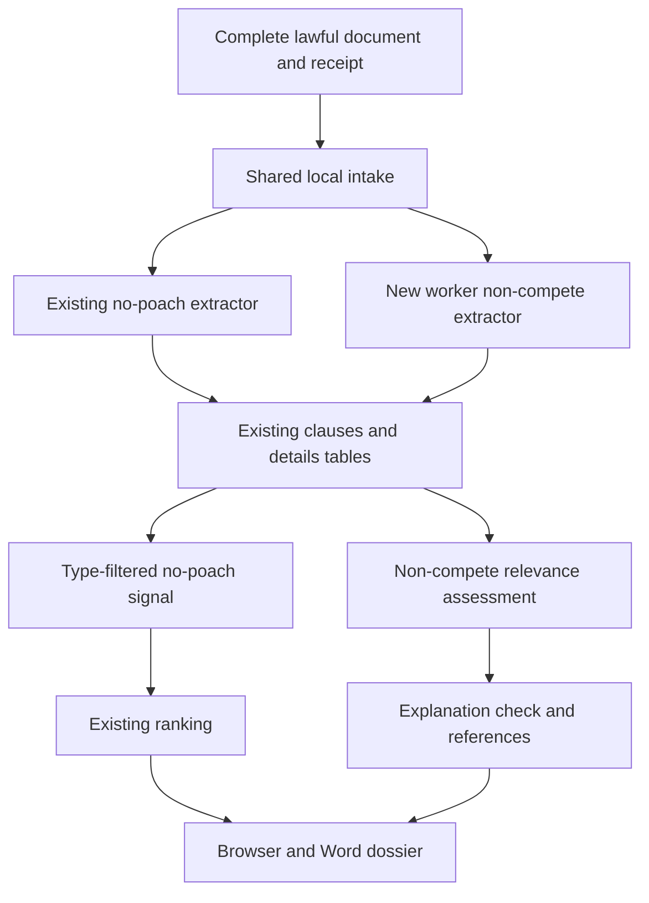
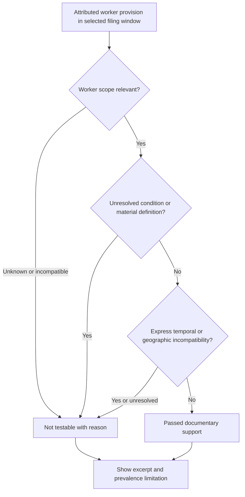

# nopo-4 Non-Compete Document Evidence - Plan

## Goal Capsule

- **Objective:** A lawyer reviewing a pair can inspect documented worker non-competes as a possible explanation for limited mobility and distinguish supporting evidence from an untestable explanation.
- **Means:** Extend the local clause intake and explanation path, with cited evidence in the existing browser and Word dossiers (KTD1-KTD6).
- **Authority:** The supplied mandate assigns expansion `nopo-4` only. The origin plan's R9 and deferred non-compete item supply product intent; Origin R10-R13/R17-R20 constrain evidence, wording and operation. Campaign R11/R15/R16/R17/R19/R20 govern delivery and safety. The chief-source availability limit is recorded below.
- **Execution profile:** One item on `drawdown/nopo-4`, delivered as one controller-managed PR. This stage commits only this plan. The later build implements U1-U4, verifies and reviews locally; the controller scans, pushes and opens the PR, and the campaign gate handles merging. This clone does not acquire a remote or credentials.
- **Stop conditions:** Follow R8-R9. No spending, messages in the owner's voice, credential/security changes, destructive deletion or force-push. No schema migration, bulk rewrite, release, deployment change or outside service is required.
- **Completion owner:** The build executor supplies implementation and acceptance evidence; the controller supplies any host-only browser run and campaign-source reconciliation. No owner decision or private dataset is required to build this expansion.

---

## Product Contract

### Summary

Extract worker non-compete provisions from the complete documents already supplied to the local clause intake.
Keep them separate from employer-to-employer no-poach signals, and make their supporting text and limitations visible in the fifth explanation check and both dossier formats.

### Problem Frame

The current fifth check always says that no extractor exists.
A lawyer cannot use a supplied contract to inspect this possible explanation through the dossier.
The current stored no-poach excerpts also do not establish which workers have non-competes, so counting matches cannot produce a workforce prevalence estimate.

**Origin preservation:** This item advances the origin's deferred non-compete extraction and U10/R9 only.
The origin plan remains unchanged; its other unfinished items are not reopened.
Origin A1/A2 and F2 govern the lawyer/reviewer experience, F1 supplies screen context, and AE4/AE5 constrain separation of clause signals and cautious wording.

### Requirements

**Extraction and interpretation**

- R1. Recognize operative restrictions on a worker accepting employment, providing services or competing with the explicitly identified employing business in lawfully supplied full document text. Distinguish these from employer no-hire clauses, customer solicitation, confidentiality, sale-of-business covenants and restrictions binding franchisees as businesses. Traces to mandate `nopo-4` and Origin R9/KTD9.
- R2. Preserve each finding's exact excerpt, canonical text offsets, filing date, document identity, employer attribution, stated worker scope, duration, exceptions and receipt. Missing or ambiguous facts remain unknown rather than becoming an inferred worker count or universal employee scope. Traces to Origin R10/R17.
- R3. Keep the stable check key `non_compete_prevalence`, display it as **Non-compete document evidence**, and apply the result contract below. Every result explains that **Non-compete prevalence cannot be estimated from these documents**; it makes no finding of enforceability, actual operation or causation. Traces to Origin R9/R11 and AE5.

**Integration and presentation**

- R4. Non-compete evidence never fires the filed-clause signal or changes weights, scores, ranking order, mutual/one-way placement, reliability or signal sufficiency. Genuine no-poach evidence in the same document retains its existing effect. Traces to Origin R2/R5/R6/R9 and AE4.
- R5. Select evidence within the screen's existing filing-date window and event cutoff, associate it only with the relevant employer, and preserve clause, filing and receipt references with the screen. Source facts remain unchanged during screening. Traces to Origin R10/R17/R21.
- R6. The browser and Word dossier show the same status, attributed employer, excerpts, scope, term, exceptions, citations and limitations under their existing explanation sections. All five checks and the current point-and-click review/export flow remain available. Traces to Origin R8-R12/R19 and F2.

**Compatibility and delivery**

- R7. Existing workspaces, version-1 clause payloads, no-poach extraction identifiers, collector return values and tests remain compatible. All feature-bearing changes gain synthetic regression coverage; no existing test or assertion is deleted or weakened. Traces to Campaign R15/R16 and Origin KTD15.
- R8. Use existing local intake and permitted collectors without new network requests, services, permissions or dependencies. Keep real documents, people, workspaces and results outside git; committed examples and screenshots contain invented data only. Traces to Origin R13/R18/R20 and Campaign R11/R16.
- R9. Commit an inspected Playwright screenshot of the changed dossier at `docs/plans/evidence/nopo-4-non-compete-dossier.png` during the build and report that path as `SCREENSHOT:`. Complete the verification contract before claiming the expansion is done; host restrictions are reported honestly. Traces to Campaign R15/R16/R19.

### Result Contract for R3

The check tests documentary support for a possible explanation, not the proportion of employees covered.
KTD3 defines conservative relevance assessment.

| Supplied evidence | Result | Required interpretation |
|---|---|---|
| At least one qualifying provision for either employer | `passed` | Name that employer and the stated worker group; do not imply a restriction at the other employer or explain both flow directions. |
| Attributed worker provision with unknown group applicability or unresolved activation/definition | `not_testable` | Show the excerpt and the unresolved fact. |
| Only provisions expressly outside the selected occupation, geography or period | `not_testable` | Explain the mismatch; do not treat it as evidence that other restrictions are absent. |
| No extracted findings, including older workspaces without new extraction | `not_testable` | Describe unavailable extractor results and incomplete evidence. |
| Documents contain no recognized operative provision | `not_testable` | No match establishes neither worker coverage nor absence of restrictions. |

This version never emits `failed` for this check: it has no representative negative sample or worker denominator.
The other four checks keep their current meanings.

### Key Decisions

- **Keep investigation data local and lawfully sourced.** Governs R8. (session-settled: user-directed — chosen over account-based/platform collection and an immediate paid extract: the origin's lawful-source decision remains controlling.)
- **Treat the result as a lead, with reviewable contrary evidence.** Governs R2-R6; inherits Origin R11's explicit boundary against conclusions that an agreement exists.
- **Deliver the expansion behind campaign guardrails.** Governs R7-R9. (session-settled: user-directed — chosen over holding every expansion for owner review: the campaign delegates ordinary delivery to its verification and merge gates.)

### Acceptance Examples

- AE1. **Covers R1-R6; Origin F2/AE5.** A complete synthetic employment provision expressly covers registered nurses at Employer A. A nursing-market dossier shows `passed` documentary support for A, the quoted term and citations, and the prevalence limitation; B and the pair's rank acquire no new inference.
- AE2. **Covers R2-R3.** A chief executive's covenant appears in a nursing-market input. Its excerpt remains reviewable with `not_testable`; an incidental mention of nurses elsewhere does not make it nursing evidence.
- AE3. **Covers R4/R7; Origin AE4.** One paragraph contains an actual employer no-hire covenant and a worker non-compete. Both survive under different record IDs, while the no-hire signal retains exactly its former score.
- AE4. **Covers R3/R5/R7.** An older workspace has only its previous no-poach excerpts. Rerunning remains compatible and reports missing non-compete evidence; deliberate full-document re-ingestion adds the new finding without changing old records.

### Scope Boundaries

This plan covers extraction, additive evidence storage, explanation assessment, existing dossier presentation and their tests.
The assumption about using documentary support rather than estimating prevalence is explicit below.

The origin's **Deferred for later** and **Outside this product's identity** boundaries remain controlling without alteration.
In particular, agency sharing, a standalone board-interlock screen and paid-source API collection stay deferred; hosted operation, agreement-as-proof output and account-based or terms-breaching collection remain outside scope.

#### Deferred to Follow-Up Work

- Historical-case/pilot work and validation packets (`nopo-1`, `nopo-6`), distribution/PDF/Docker (`nopo-2`, `nopo-5`), flow-cluster/LEHD work (`nopo-3`), and general hygiene (`nopo-7`).
- Workforce prevalence measurement requires representative worker coverage and a denominator; document matches do not provide them.

#### Considered and not built

- A new document-upload page: existing collectors and the analyst intake API provide the feature's input seam. Revisit if agency use establishes a need; this item changes dossier review only.
- Automatic rescanning of old raw files: ordinary screening must not become a background data rewrite. Deliberate re-ingestion is sufficient for this addition.
- OCR, an LLM classifier, a generalized contract graph or automatic amendment reconciliation: these introduce capabilities beyond the bounded local extractor. Unresolved source language remains visible; revisit against a separate measured accuracy requirement.
- A legal-validity or active-covenant engine: the workspace lacks the legal and triggering facts such a conclusion would require, and Origin R11 forbids converting the screen into a legal finding.

---

## Planning Contract

### Reverified Starting State

Source review used clean branch `drawdown/nopo-4` at `ddc0807`.
No application tests, browser runs or runtime experiments were performed in this plan stage; baseline test health remains unverified.

| Source evidence | Consequence |
|---|---|
| `src/nopoach/rank/explanations.py::check_explanations` hardcodes the fifth result | The assigned expansion is still absent. |
| `src/nopoach/signals/clauses.py::store_document` stores filings and positive no-poach excerpts in one transaction | Extend this shared intake; a filing row without a finding is not a completed non-compete review. |
| `src/nopoach/store/schema.py` allows arbitrary `clause_type`; existing `clause_details` stores version-1 `Clause` JSON | No new table, column or migration is necessary. |
| `Clause.pairs`, `score_pairs` and `rank/aggregate.py` currently treat any pair clause as scored evidence | Separate kinds at selection and scoring boundaries. |
| Existing clause IDs omit evidence type; `_scope` can default to `all employees` | New IDs need a distinct namespace, and new scope extraction must not reuse that fallback. |
| `pipeline.py::_filtered_workspace`, `_explanation_inputs`, `_references`, `_persist` | Reuse the cutoff view and expand input references; do not invent a saved-result reload feature. |
| `app/templates/dossier.html` and `export/dossier.py` render checks but lack their exact excerpts | Add inline evidence to the existing sections. |
| `tests/rank/test_explanations.py` and `tests/export/test_dossier.py` assert legacy wording and headings | Preserve those assertions through truthful missing-result wording and the explicit prevalence limitation. |
| `pyproject.toml` excludes `browser` and `live` by default | Default pytest and existing CI alone cannot establish R9. |

No repository `AGENTS.md`, `CLAUDE.md`, `docs/handoffs/`, `.planning/`, `docs/solutions/` or strategy document was present.
The v1 build handoff was retired by `77ed323`/`dc23ace`; its completed tasks are not revived.
The adjacent `nopo-1` plan does not implement this feature.

The chief source `docs/plans/2026-10-26-0705-feat-codex-drawdown-campaign-plan.md` and `ops/drawdown/mandates/_common.md` were unavailable in the accessible sandbox.
The supplied lane instructions provide Campaign R11/R15/R16/R17/R19/R20 here; their full source Goal Capsule and cited sections were not independently verified.
The controller must reconcile those specific sections before build execution without reopening settled campaign choices or requiring owner time.

### Key Technical Decisions

- KTD1. **Extend `signals/clauses.py` with a separate non-compete extractor.** Reuse `ClauseDocument`, `Clause`, full-text conversion and storage helpers, while keeping `extract_clauses` no-poach-only. This avoids a new cyclic dependency and preserves existing callers. Work only on canonical document text; spans must slice back to the exact excerpt. Python's [match-offset contract](https://docs.python.org/3.12/library/re.html#match-objects) supports this choice; a separately normalized search view would require an offset map. Governs R1-R2/R7.
- KTD2. **Use the existing evidence representation with an explicit kind.** Store `clause_type=non_compete` in existing version-1 payloads. A safely attributed finding has one employing employer, no bound employer IDs, and `binding=unknown` because the worker is restricted. Unknown employer attribution stays unlinked and cannot affect a pair. Keep scope/term/conditions literal in the available fields and excerpt; use an in-memory assessment for relevance. Give only new non-compete IDs a type namespace, and retain all existing no-poach IDs. Governs R2/R4/R7.
- KTD3. **Assess a worker obligation, then its documented scope.** Require operative competing-employment/services language tied to a worker and an explicit employing party or locally defined alias. The issuer, a mentioned competitor and a brand relationship do not establish that relationship. Accept explicit all-employee scope, an explicit matching SOC code, or a restricted-worker role mapped through `imports/schema.py::TITLE_SOC`; inspect the bound subject, never arbitrary document words. Generic singular `Employee`, unknown/conflicting roles and unresolved geographic limits remain unknown. Apply the R3 result contract; scope across part of a multi-occupation market is disclosed as that subset, never generalized to the whole market. Governs R1-R3/R5.
- KTD4. **Select by filing window, preserve temporal uncertainty.** Use the existing in-memory cutoff view and inclusive market window. Filing time is evidence-selection time, not a contract's effective or termination date. Preserve relative terms without converting them to calendar activity; an unknown duration alone does not erase a clear unconditional provision. Expressly incompatible dates, unresolved activation conditions and unresolved material definitions keep the finding untestable. A referenced original agreement is not reconstructed from an amendment. The [SEC employment agreement with conditional application](https://www.sec.gov/Archives/edgar/data/1083643/000108364316000080/employmentagreement.htm) and [amendment with category-specific durations](https://www.sec.gov/Archives/edgar/data/1861622/000149315226024854/ex10-1.htm) motivate these cases. Governs R2-R3/R5.
- KTD5. **Persist both kinds together, expose them separately.** Intake inserts both kinds atomically, but `store_document` and `CollectionReport.clauses` keep returning no-poach evidence only. A separate reader supplies non-competes to explanation inputs. Explicit type exclusion protects `Clause.pairs`, `score_pair`/`score_pairs`, the pipeline's legacy clause fallback and rank aggregation, including malformed multi-employer inputs. Do not automatically scan old snippets or retained raw files for missing facts. Governs R4-R5/R7.
- KTD6. **Carry evidence through the existing check and reference objects.** Add defaulted explanation-input/assessment fields and a default-empty evidence collection on `ExplanationCheck`, preserving existing positional callers. Keep per-finding eligibility reasons in memory, so a nonempty tuple is not sufficient to pass. Include explanation clauses and their filings in `PairReferences`, alongside their receipts. Browser and Word output use centralized wording and the same assessment without reclassifying during rendering. Governs R3-R7.

The distinction between the employee, employing subsidiary and protected business is also illustrated by a [filed SEC employment agreement](https://www.sec.gov/Archives/edgar/data/70318/000119312521265516/d268536dex101.htm).
Its combined covenant heading and separate exceptions support clause-local parsing in KTD1/KTD3, rather than classifying a whole heading or borrowing the first duration in a document.
These examples guide invented test structures; they are not legal authority for enforceability or empirical accuracy claims.

### Assumptions

- The useful bounded interpretation of `nopo-4` is the documentary-support check in R3. Estimating population prevalence would require inputs this repository does not have; this plan makes that limit visible rather than inventing a percentage.
- An analyst supplies complete lawful contract text through the existing intake API or existing configured collectors. The lawyer continues using the current screen/dossier/export interface; a new upload workflow is unnecessary for this item.
- Existing text extraction is sufficient for this expansion. Image-only PDFs continue to fail visibly under the existing FDD parser; no OCR or new dependency is introduced.

### Evidence Flow

The source trace is `run_screen` to its filtered workspace, `_explanation_inputs`, `rank_pairs`, `_references`, and `_persist`.
The persisted screen stores summaries and input references, while the UI and exporter use the current in-memory result.
Opening a workspace and screening again reads durable clause evidence; this item adds no saved-screen restoration subsystem.

### Sequencing, Compatibility and Risks

U1 defines extraction; U2 adds durable intake and separation; U3 connects assessment and references; U4 exposes the result and completes acceptance evidence.
All ship in the same PR.
There is no unresolved architectural mechanism requiring competing prototypes: the existing evidence type and intake transaction satisfy storage needs, while a parallel store would duplicate references and cutoff handling.

The main risks are misidentifying the restricted actor, inflating worker scope, leaking a non-compete into the 30% clause contribution, and changing exact excerpt offsets.
KTD1-KTD6 and the unit scenarios address each directly.
A positive contract is not a representative sample; no accuracy, prevalence or historical-validation claim follows from synthetic tests.

Existing raw bodies are retained by collectors under the external workspace; direct `store_document` callers are responsible for retaining full input text and its receipt.
Intake already persists filing metadata even when no clause matches, but it does not record a complete negative-review inventory.
For older workspaces, deliberate re-ingestion of the complete document is the additive upgrade path under KTD5; an ordinary rerun cannot recover omitted text.

---

## Implementation Units

### U1. Extract worker non-competes with exact documentary evidence

**Goal:** Recognize worker employment restrictions without broadening them into employer no-poach or workforce-wide claims.

**Requirements:** R1-R3/R7-R8; AE1-AE3; Origin R9/R10/R17/KTD9/KTD15.

**Dependencies:** Existing clause model, canonical-text conversion and receipt API.

**Files:** `src/nopoach/signals/clauses.py`; new `tests/signals/test_non_competes.py`; new synthetic `tests/fixtures/clauses/non_compete.txt` and `tests/fixtures/clauses/non_compete.html`; existing `tests/signals/test_clauses.py`.

**Approach:**

1. Add an independently callable extractor using KTD1-KTD3 and domain-separated IDs.
2. Resolve worker-role and employing-party aliases conservatively within the document. Keep supporting context and adjacent exceptions needed to understand a provision; unresolved references are not invented.
3. Preserve separate durations in mixed covenant text and the exact original canonical slice. Do not change shared HTML conversion or existing no-poach rules to simplify the new detector.

**Patterns to follow:** `ClauseDocument`, `Clause`, `_aliases`, `full_text`, and existing authored clause fixtures. Reuse mechanics without inheriting `_scope`'s universal-employee fallback.

**Execution note:** Add focused failing extraction examples before changing the detector. This suite proves controlled classification and offsets; it does not establish real-world recall.

**Test scenarios:**

1. A registered-nurse covenant with an explicitly defined employer yields one worker restriction with the stated duration, scope, employer and receipt.
2. A singular executive or `Employee` covenant retains that limited/unknown scope; it never becomes `all employees` by default.
3. A document names an issuer, a different employing subsidiary and a competitor. Only the explicitly resolved employing business is attributed; missing or conflicting identity produces no pair assignment.
4. Bare headings, unconditional negation, affirmative permission to compete, customer-only solicitation, confidentiality and business/franchisee non-competes produce no qualifying worker finding.
5. A mixed paragraph has separately operative no-hire and non-compete provisions. Both extract with distinct IDs, and one provision's duration is not borrowed for the other.
6. Passive-investment exceptions, noncompeting-unit exceptions and conditional activation remain visible without erasing the underlying restriction or claiming the condition occurred.
7. An amendment-only reference lacks a standalone operative covenant; a material unresolved definition remains marked for review rather than supplying an invented scope.
8. Mixed case, Unicode hyphens, nonbreaking spaces and HTML entities preserve `excerpt == canonical_text[start:end]`; hidden script/style text supplies no finding.

**Verification:** New extractor scenarios and all existing clause assertions pass; fixtures contain invented entities and no copied person-level data.

### U2. Persist new evidence without changing no-poach consumers

**Goal:** Make extraction available through existing document intake while preserving stored records and scoring contracts.

**Requirements:** R2/R4-R5/R7-R8; AE3-AE4; Origin AE4.

**Dependencies:** U1.

**Files:** `src/nopoach/signals/clauses.py`, `src/nopoach/rank/aggregate.py`, `src/nopoach/pipeline.py` at the legacy no-poach fallback; `tests/signals/test_non_competes.py`, `tests/signals/test_clauses.py`, `tests/rank/test_aggregate.py`, `tests/collect/test_edgar_index.py`, `tests/collect/test_fdd.py`.

**Approach:**

1. Extend the existing intake transaction and add a separate stored-evidence reader under KTD2/KTD5.
2. Filter non-compete kind at no-poach consumption boundaries, including defensive handling of externally supplied `ClauseSignal` values.
3. Preserve collector return semantics and receipts. Exercise existing offline collector fixtures to prove integration without changing endpoints or permission gates.

**Patterns to follow:** `store_document` transaction/rollback, `_decode`, collector fake-response tests and deterministic `score_pairs` ordering.
These tests prove durable intake and signal isolation; U3 proves market relevance.

**Test scenarios:**

1. A non-compete-only document persists its filing and distinct evidence, returns the existing empty no-poach tuple, and produces no clause signal through either public scorer or direct rank aggregation.
2. A mixed paragraph stores both IDs and retains the genuine no-poach result, order and contribution.
3. Repeated ingestion and workspace reopen preserve one record per finding and the first receipt. Version-1 no-poach payloads still decode unchanged.
4. Re-ingesting a full document into an older workspace adds only missing non-compete evidence; old no-poach IDs, text and receipts remain intact after a second re-ingestion.
5. A failure inside the evidence transaction rolls back the filing/clause/detail changes from that attempt; append-only source receipts are not deleted.
6. A deliberately malformed non-compete with several employer IDs never expands into a pair signal, including through the pipeline's unstructured fallback.
7. Existing fake SEC and FDD collection paths persist the new findings while their no-poach report counts and request sets remain unchanged. Disabled portals and image-only PDF failures retain their current behavior.
8. Storage uses only the existing tables/columns and existing payload version; no schema upgrade or automatic historical rescan occurs.

**Verification:** Intake, persistence, collector and rank tests pass with no migration, changed no-poach API result, or new request.

### U3. Evaluate bounded documentary support and retain screen references

**Goal:** Replace the unconditional placeholder with the R3 result contract on actual screen inputs.

**Requirements:** R2-R5/R7; AE1-AE4; Origin R9/R10/R11/R21.

**Dependencies:** U1-U2.

**Files:** `src/nopoach/rank/explanations.py`, `src/nopoach/rank/wording.py`, `src/nopoach/pipeline.py`; `tests/rank/test_explanations.py`, `tests/rank/test_wording.py`, `tests/rank/test_aggregate.py`, `tests/test_pipeline.py`, `tests/backtest/test_run.py`.

**Approach:**

1. Build employer assessments from separately loaded evidence in the filtered view, following KTD3-KTD4. Record each candidate's eligibility and reason before assembling checks.
2. Extend the existing dataclasses additively under KTD6, retain all five keys and centralize status/reason/limitation wording.
3. Include the explanation's clause and filing IDs in the existing reference set and persist them with screen parameters. Keep source facts unchanged and evidence reads deterministic.

**Patterns to follow:** `_explanation_inputs`, `check_explanations`, `_references`, existing cutoff tests and synthetic resolved-market fixtures.
Pipeline/backtest tests prove the real storage-to-screen handoff; explanation tests alone cannot prove cutoff selection.

**Test scenarios:**

1. Relevant unrestricted-by-condition nurse evidence for A alone produces `passed`, identifies A and the worker group, preserves B's unknown status in the reason, and reports no workforce percentage.
2. An executive-only covenant stays `not_testable` for a nurse market, even with incidental nurse words elsewhere. Explicit SOC and mapped bound-role matches pass; unknown roles do not.
3. Partial occupation coverage is named as a subset; conflicting roles, unresolved geographic limits, activation conditions and material cross-references remain untestable with their evidence retained.
4. A normal relative duration is reproduced without a computed end date. An expressly future/expired restriction does not support the selected period; a filing date never substitutes for a termination date.
5. Empty inputs and no matches retain all five checks and truthful missing-evidence reasons. Preserve the current `no non-compete extractor` assertion with wording about unavailable extractor **results**, not an unbuilt extractor.
6. Evidence on the inclusive filing-window/cutoff boundary is included; next-day and out-of-window filings are excluded. Other employers' findings never attach to the pair. Backtest filtering agrees with the ordinary pipeline.
7. Positive and untestable attributed evidence both retain the exact relevant clause/filing/receipt IDs in screen references; unrelated evidence does not enter them.
8. Adding only non-compete evidence leaves scores, signal counts, ranking order, separate one-way placement and sufficiency unchanged, including unreliable and accepted-partial screens.
9. A workspace reopened and rerun yields the same assessment and references. Existing source rows remain unchanged; old workspaces without new evidence remain readable.

**Verification:** The fifth check is testable for qualifying synthetic evidence, uncertainty remains visible, and the existing statistical/ranking behavior passes unchanged.

### U4. Show cited explanation evidence in browser and Word dossiers

**Goal:** Let a lawyer and reviewer read the finding and its limits without leaving their existing dossier workflow.

**Requirements:** R2-R3/R6-R9; AE1-AE4; Origin F2/AE5.

**Dependencies:** U3.

**Files:** `src/nopoach/app/templates/dossier.html`, `src/nopoach/export/dossier.py`, `src/nopoach/rank/wording.py`; `tests/app/test_routes.py`, `tests/app/test_e2e.py`, `tests/export/test_dossier.py`, `tests/rank/test_wording.py`; `README.md`, `docs/method.md`; build evidence `docs/plans/evidence/nopo-4-non-compete-dossier.png`.

**Approach:**

1. Render the assessment and evidence beneath the existing explanation heading, using the current typography and escaped Jinja output. Include filing identity/date, canonical character offsets, clause and receipt references, attribution, scope, duration, exceptions and uncertainty.
2. Render equivalent content beneath Word's existing `Explanation checks` heading. Keep its top-level heading set unchanged and do not place worker covenants among scored no-poach clauses.
3. Replace the method's unbuilt-extractor statement with the R3 interpretation and KTD3-KTD4 limits. Document the existing analyst intake/re-ingestion seam, full-text retention responsibility and lack of a general document-upload UI.
4. Exercise the real browser flow on synthetic data, inspect the changed section at desktop and narrow widths, and commit the R9 screenshot. Leave existing tests' temporary artifact behavior intact; copy the inspected new evidence image to the mandated location.

**Patterns to follow:** Existing dossier sections, `wording.explanation_entry`/citation helpers, route fixtures, Word section assertions and `tests/app/test_e2e.py`'s local axe/loopback checks.
Route/Word tests prove content parity and escaping; only the browser run proves layout and keyboard usability.

**Test scenarios:**

1. A positive synthetic finding appears under explanations in both formats with identical status, attributed employer, excerpt, term, scope, exceptions and resolvable citations; the scored clause section remains unchanged.
2. A conditional or mismatched candidate displays its specific `not_testable` reason with the excerpt. An empty workspace displays the missing-evidence explanation.
3. Both formats retain the exact prevalence-limitation phrase from R3, all five checks and current Word heading assertions. Generated wording passes the existing banned-phrase scan.
4. Synthetic source text containing HTML-like markup is displayed as text; the page neither executes it nor creates an unsolicited external request.
5. Long excerpts and identifiers remain readable at the existing 1440-pixel and 360-pixel browser widths, with accessible headings, keyboard access and the current axe checks passing.
6. Partial-screen/unreliable notices and Word download remain usable with the new evidence. The inspected screenshot contains invented records, no private input paths and no visible session token.

**Verification:** Browser and Word evidence agree; documented intake matches the existing API; the R9 screenshot is present and inspected. Synthetic results are not described as historical or field validation.

---

## Verification Contract

These are build-stage gates, not results claimed by this planning commit.
Recheck the current baseline before implementation using the pinned Python 3.12 environment and cached locked dependencies.
Do not update dependencies or weaken tests to work around sandbox errors.

| Gate | Command or evidence | Required outcome |
|---|---|---|
| Focused extraction/intake | `uv run --no-sync pytest tests/signals/test_non_competes.py tests/signals/test_clauses.py tests/collect/test_edgar_index.py tests/collect/test_fdd.py` | U1-U2 cases pass; old extraction and collection contracts hold. |
| Explanation/integration/presentation | `uv run --no-sync pytest tests/rank tests/test_pipeline.py tests/backtest/test_run.py tests/app/test_routes.py tests/export/test_dossier.py` | U3-U4 semantics, references, cutoffs and dossier parity pass. |
| Existing suite | `uv run --no-sync pytest` | Default suites pass with no deleted/weakened assertions; report skips accurately. |
| Lint and format | `uv run --no-sync ruff check .`; `uv run --no-sync ruff format --check .` | No errors or formatting drift. |
| Types | `uv run --no-sync mypy src` | No errors. |
| Offline guarantees | `uv run --no-sync pytest -m network_off` | Existing offline behavior passes; no new external calls. |
| Browser and screenshot | `uv run --no-sync pytest -m browser tests/app/test_e2e.py` plus inspected R9 image | Real dossier flow, accessibility, narrow layout and loopback-only requests pass; screenshot committed. |
| Public-safe delivery | Staged diff review and existing repository scan through the controller | Only implementation, documentation, synthetic fixtures and the approved synthetic image enter git. |

Existing Linux/Windows CI remains the compatibility gate; no workflow or packaging change belongs to this item.
The optional outside-repository no-poach evaluation corpus does not measure the new extractor and is not a substitute for its synthetic cases.
Unix-socket/Chromium restrictions may block browser execution here; the controller must run that gate on a capable host and commit the inspected image before the build is called complete.
A skipped browser run, an HTML dump or a mocked screenshot does not satisfy R9.
No screenshot is expected from this plan-only stage.

---

## Definition of Done

**Plan stage:** This plan alone is reviewed and committed locally on `drawdown/nopo-4`; implementation files and existing tests remain untouched.
The source-review baseline, campaign-source limitation and unrun checks are disclosed.

**Build stage:** U1-U4 satisfy R1-R9, all applicable verification gates pass, and the inspected synthetic screenshot is committed at the specified path.
A reviewer can trace a positive and an untestable result from supplied text through stored evidence to both dossiers.
Existing workspaces and no-poach scoring remain compatible, with no migration, rewritten source facts or new outside service.
Abandoned implementation attempts are absent from the final diff, and the controller receives the local commits and truthful acceptance evidence for publication.
