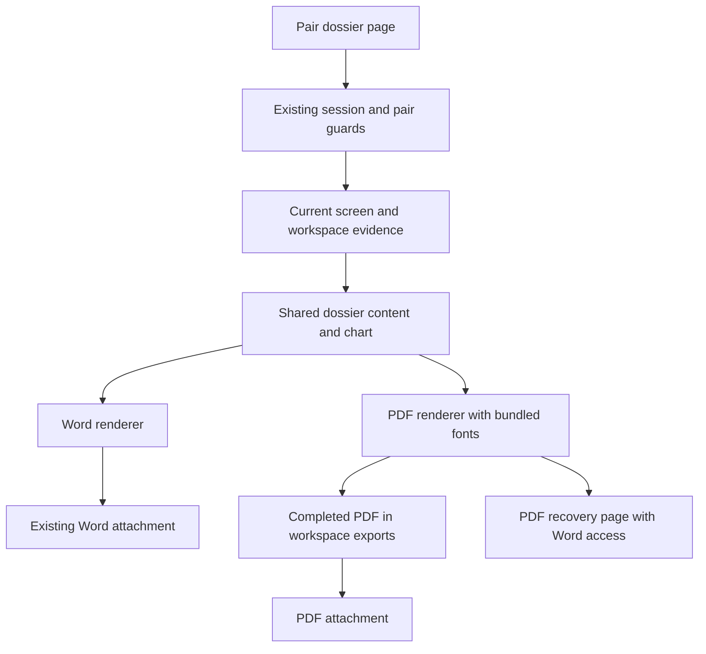

# nopo-5 Windows-Safe PDF Dossiers - Plan

## Goal Capsule

- **Objective:** A lawyer can download a readable PDF dossier from the local app and attach it to a memo, while retaining the editable Word option.
- **Means:** Add local PDF rendering alongside Word, using the existing dossier evidence and wording (KTD1-KTD3).
- **Scope:** Mandate item `nopo-5`, kind `expansion`, only. This plan takes up the origin's deferred PDF export; it does not reopen the other deferred work.
- **Authority:** The origin Product Contract governs product behavior. Campaign authority is the chief repository's `docs/plans/2026-10-26-0705-feat-codex-drawdown-campaign-plan.md` and `ops/drawdown/mandates/_common.md`. `Origin R...` and `Campaign R...` distinguish those namespaces from this plan's R-IDs. The source-availability limitation below must be reconciled by the controller.
- **Execution profile:** One item, one branch, one eventual PR on `drawdown/nopo-5`. This stage commits the plan only. The later build implements U1-U4 locally; the controller scans, pushes and opens the PR, and the campaign gate owns merging (Campaign R15, R17, R19). The lane does not add a remote or seek credentials.
- **Stop conditions:** Follow the supplied Campaign R11 and mandate hard stops: no spend, credential or security-setting changes, sends in the owner's voice, unbacked deletion, force-push, or access to prohibited credential files. No schema migration, data rewrite, package release or outside service is required.

---

## Product Contract

### Summary

Offer PDF and Word downloads on the pair dossier page.
The PDF carries the existing Word dossier's evidence, qualifications and citations, with pagination and fonts packaged for local Windows use.

### Problem Frame

The origin deferred PDF because Windows conversion engines required extra installations or lacked proof of compatibility (Origin KTD12).
The current app exports Word only, leaving a reviewer who needs a fixed-layout attachment to convert it separately.
Origin A1 is the lawyer choosing the export; Origin A2 is the reviewer reading it without running the app.

### Key Decisions

- **Agency-local operation.** Governs R4. (session-settled: user-approved — chosen over a hosted app or report-writing service: keep confidential queries inside the agency; carried from the origin.)
- **Expansion delivery uses the campaign's guardrails.** Governs R8-R10. (session-settled: user-directed — chosen over holding every expansion for owner review: tested expansions proceed through the campaign gate.)

### Requirements

**Downloads and fidelity**

- R1. Add a clearly labeled PDF download beside Word on each currently exportable dossier, preserving the Word link, public exporter and download behavior (Origin R12, R19; F2).
- R2. PDF preserves the eight existing dossier sections and their substantive content, including directional flow charts, break descriptions, clause and tie citations, explanation results, coverage, sufficiency, source provenance and method limitations (Origin R8-R10, R12, R17).
- R3. Preserve lead-only wording and explicit partial, unreliable, unknown and untestable states in both formats (Origin R9, R11, R14, R15, R23; AE3, AE5).

**Local operation and usability**

- R4. Generate PDF entirely on the agency machine from the existing screen, without fetching data, recomputing signals, or installing Office, GTK, a browser engine or another application for conversion (Origin R18; KTD12, KTD13).
- R5. A long dossier remains readable across pages without silently dropping text, rows, citations or unsupported characters (Origin R10, R12).
- R6. PDF-specific failures leave the screen and Word export usable, with a recoverable explanation that discloses no source text or local exception details (Origin R12, R18, R19).
- R7. Use the existing session and workspace boundary for PDF downloads, preserving current pair eligibility and earlier exports (Origin R18; KTD1).

**Delivery and evidence**

- R8. Add meaningful tests for the new behavior and retain every existing test and assertion (Campaign R15, R16).
- R9. Verify the changed page with Playwright and commit an inspected synthetic screenshot under `docs/plans/evidence/` (Campaign R16).
- R10. Keep generated dossiers, workspaces and real records out of git; document dependencies, font licenses and the PDF workflow (Origin R20; Campaign R11, R15).

### Acceptance Examples

- AE1. **Covers R1-R4.** A synthetic AE1 dossier downloads as readable PDF and editable Word. Both retain the break interval, lead wording, source citations and all eight sections.
- AE2. **Covers R3, R7.** An insufficient screen can export before partial acceptance, just as Word can today. Accepting it does not remove the partial banner or reliability warnings from either format.
- AE3. **Covers R5, R6.** A dossier with long clauses, URLs and accented names spans pages without losing its final source receipt. A character the bundled font cannot represent causes a clear PDF error while Word remains available.
- AE4. **Covers R4, R7.** The relocated Windows one-folder app exports through its ordinary authenticated local workflow without a separate converter or runtime download.

### Scope Boundaries

The origin Product Contract is unchanged; this separate item plan implements only its deferred PDF export.
Word content is the parity baseline, rather than every interactive drill-down table in the web page.
Source records remain resolvable by their existing identifiers; this item does not embed a workspace or all person-level records in an export.

**Deferred for later**

- Sharing screens or methods between state agencies.
- A standalone Clayton Act §8 board-interlock screen beyond what R7 needs.
- Pulling paid data sources directly through vendor APIs. Version 1 recommends them and imports their files.

**Outside this product's identity**

- Hosted or software-as-a-service operation.
- Statements that an agreement exists, or anything framed as proof.
- Tools for plaintiffs' firms, corporate compliance teams or journalists, even though the open-source code allows them.
- Collecting data by logging in, using accounts, or breaching a site's terms, including any LinkedIn collection.

The preceding two lists are carried from the origin; their `R7` refers to Origin R7.

**Deferred to Follow-Up Work**

Historical validation/pilot work, Docker distribution, flow-cluster markets, LEHD checks, non-compete extraction, validation packets and broad repository hygiene remain with their other mandate items.

**Considered and not built**

- PDF/A certification, signatures, encryption, forms and active links: none is needed for the requested memo attachment; a later explicit agency requirement could justify them.
- Export queues, caches, retention automation and history UI: the current synchronous, uniquely named export flow is adequate; measured export latency or an explicit retention requirement could change that decision.
- A generic report framework or full UI-to-export parity refactor: sharing only the existing export content closes the format-drift risk; a third report type would justify reconsidering a broader abstraction.

---

## Planning Contract

### Reverified Starting State

Static inspection at `ddc0807` found a clean `drawdown/nopo-5` branch and no PDF renderer or download route.
No tests, application execution, dependency installation or build ran during planning, so this is not a passing-test receipt.

| Evidence | Current behavior and consequence |
|---|---|
| `src/nopoach/export/dossier.py` | Builds Word styles in code; there is no existing binary dossier template. Receives an existing `ScreenResult` and `RankedPair`. |
| `src/nopoach/rank/wording.py` | Owns headings, warnings, captions, citations and method wording; reuse it in both formats. |
| `src/nopoach/app/routes/pages.py` | `/pairs/{a}/{b}/export` returns Word, uses `idle` and `find_pair`, and writes a UUID-named file in workspace `exports/`. |
| `src/nopoach/app/main.py` | Existing middleware enforces loopback, Host and session checks and adds no-store/no-sniff headers. |
| `tests/export/test_dossier.py` | Covers AE1, actual directional chart values, break citations, partial output, source classes, clause/tie records and banned wording. |
| `tests/app/test_e2e.py` | Explicit `browser` marker, Chromium, axe, loopback-only requests, desktop/mobile checks and an actual Word download; screenshots currently stay temporary. |
| `packaging/nopoach.spec`, `tests/packaging/test_smoke.py` | Windows one-folder build exists, but its smoke test proves home/static assets and shutdown, not dossier export. |
| `pyproject.toml`, `uv.lock` | Python 3.12; Word, Matplotlib and pypdf already present; no PDF generation library. Preserve the existing `exclude-newer` cutoff. |

No checkout `AGENTS.md`, `CLAUDE.md`, `docs/handoffs/`, `.planning/`, strategy document or solutions store was present.
The earlier `docs/plans/2026-10-28-0314-feat-nopo-1-validation-readiness-plan.md` is a different item's plan, not completed PDF work.

### Key Technical Decisions

- KTD1. **Use ReportLab 5.0.1 base, without optional renderers.** Platypus supplies paragraph and table pagination while Matplotlib supplies the existing chart image. The published version predates the repository's resolution cutoff and supports Python 3.12. Change only the dependency and required transitive lock entries. Governs R4, R5. [ReportLab metadata](https://pypi.org/project/reportlab/5.0.1/) and [installation guidance](https://docs.reportlab.com/install/open_source_installation/) support feasibility; they do not prove this frozen application works.
- KTD2. **Share dossier content, not document layout.** Extract narrowly scoped content and chart helpers from `dossier.py`; retain its public `export_dossier` entry point and optional partial override. Shared content must import neither ReportLab nor its font initialization. Formatting stays in each renderer. Governs R1-R3, R6. The existing Word tests are characterization coverage for this refactor.
- KTD3. **Use Letter pages and embedded static DejaVu Sans fonts from Matplotlib's packaged resources.** Follow the current Word hierarchy and restrained chart styling, with readable coverage tables, repeated headers and page numbers. Bundle regular, bold, oblique and bold-oblique styles and their notices; do not depend on installed Calibri or convert the web's variable WOFF2 fonts. Preflight text against the actual bundled font coverage, rejecting absent or glyph-zero mappings and unsupported shaping rather than silently altering evidence. Governs R5, R6, R10. [ReportLab fonts](https://docs.reportlab.com/reportlab/userguide/ch3_fonts/) and [DejaVu notices](https://github.com/matplotlib/matplotlib/blob/main/lib/matplotlib/mpl-data/fonts/ttf/LICENSE_DEJAVU).
- KTD4. **Keep source strings literal and evidence complete.** Escape text before passing it to ReportLab paragraphs; only application-owned markup can set styles. Use wrapping paragraphs for excerpts and paragraph cells for tables; avoid putting an unbounded excerpt in a non-splittable row. Preserve the union of every screen reference's provenance receipts, including peer employers used by expected flow. Governs R2, R5. [Paragraph](https://docs.reportlab.com/reportlab/userguide/ch6_paragraphs/) and [table](https://docs.reportlab.com/reportlab/userguide/ch7_tables/) behavior determines the layout tests.
- KTD5. **Add `/pairs/{a}/{b}/export.pdf` with independent availability.** Preserve the Word route and its exact action label. Capture the request's folder, result and pair consistently after the existing guards. Return `dossier.pdf` with `application/pdf`; store it under a UUID name so employer names never become Windows filenames. Render fully before exposing a final file. Missing PDF resources, rendering failures and filesystem failures receive a PDF-specific recovery page; no raw exception is shown. Governs R1, R6, R7.
- KTD6. **Prove Windows support through the frozen application's real export path.** Extend the existing Windows smoke test and package only the resources it needs. The current CI already invokes that test file; no release or deployment workflow change is planned. Governs R4, R8-R10.

ReportLab was chosen over fpdf2 because its paragraph/table model fits the existing narrative dossier and its BSD distribution fits the existing notices workflow.
Matplotlib PdfPages would require hand-built narrative pagination; keep Matplotlib's role limited to charts.
Office, LibreOffice, browser and GTK-backed conversion introduce the external runtimes this item must avoid.
The choice is bounded and uses established renderers, so it does not require a prototype or competing implementations before the planned smoke proof.

### High-Level Technical Design



```mermaid
sequenceDiagram
    participant Lawyer
    participant Route
    participant Renderer
    participant Workspace
    Lawyer->>Route: Download PDF for current pair
    Route->>Route: Apply existing guards and snapshot inputs
    Route->>Workspace: Read existing evidence and source receipts
    Route->>Renderer: Prepare complete dossier locally
    alt Rendering and file publication succeed
        Renderer-->>Route: Complete PDF
        Route->>Workspace: Save new unique export
        Route-->>Lawyer: Download dossier.pdf
    else PDF resources, content or write fails
        Route-->>Lawyer: PDF recovery page; Word remains available
    end
```

### Assumptions

- An ordinary PDF attachment meets this item; archival certification and universal-script typography were not requested. This is an unvalidated product assumption, not a claim of PDF/A or PDF/UA conformance.
- Using the existing Word content as the comparison baseline meets the request for dossiers alongside Word; adding all interactive evidence tables is not inferred.
- ReportLab's published compatibility and Matplotlib's packaged fonts are sufficient to attempt the implementation. Actual dependency resolution, glyph coverage, pagination and frozen-resource behavior remain build-time proofs.

Exact [ReportLab 5.0.1 metadata](https://pypi.org/pypi/reportlab/5.0.1/json) lists Pillow and charset-normalizer as base dependencies.
Versioned source was inaccessible during research; newer upstream source corroborates the proposed font and image mechanisms but does not prove their pinned-version behavior.
Inspect the resolved package before relying on internal font APIs or assuming a table can split within a page-tall row.

### Authority Prerequisite and Verification Limits

The chief campaign source and common mandate are not available in this sandbox; the adjacent mount is inaccessible.
The supplied lane rules establish Campaign R11, R15, R16, R17, R19 and R20 here, but the source Goal Capsule and cited sections were not independently read.
Before the build handoff, the controller must reconcile those exact sections or supply the relevant excerpt.
This is a controller-owned prerequisite, not a request for owner judgment or credentials.

Windows execution and browser launch are separate build verification obligations.
If this sandbox denies the required sockets, carry the exact failed invocation and unexecuted proof to the controller's permitted host; do not weaken or skip a test and count it as passed.
No current PDF compatibility, browser screenshot or test pass is claimed.

### System-Wide Impact and Risks

The new output contains the same potentially sensitive evidence as Word, so it belongs in agency workspace storage under existing retention/access policy.
Use fixed or blank PDF author metadata; do not add usernames or workspace paths to metadata.
Keep citations' intentional source locations intact.
No database, ranking, collection, authentication or security-setting change is needed.

The main regression risk is content lost during helper extraction; U1 retains the Word tests and U2 compares semantic content across formats.
Text extraction cannot prove visual layout, so U2 requires page inspection in addition to assertions.
An embedded font is not proof of complete Unicode coverage; KTD3 requires a visible failure for text it cannot represent.

---

## Implementation Units

### U1. Share the existing dossier content and chart

**Goal:** Give both renderers the same evidence without changing Word behavior.

**Requirements:** R1-R3, R8; Origin F2, AE1, AE5; KTD2, KTD4.

**Dependencies:** None after the authority prerequisite is reconciled.

**Files:** `src/nopoach/export/dossier.py`; new `src/nopoach/export/content.py`, `src/nopoach/export/charts.py`; `tests/export/test_dossier.py`; new `tests/export/conftest.py` only if fixture sharing is needed.

**Approach:**

1. Extract the existing content assembly and Agg chart output into dossier-specific helpers, leaving Word style/layout code in place.
2. Keep the source union, declared/synthetic/unknown class handling, section order and existing wording helpers authoritative.
3. Reuse the synthetic AE1 and clause/tie fixtures without removing or relaxing any assertions.

**Execution note:** Run the existing Word tests before refactoring, then add characterization assertions where extraction would otherwise lack proof.

**Test scenarios:**

1. Covers Origin AE1/AE5. The same input still produces an editable Word document with all sections, both chart series, break caption, stable screen reference and permitted lead wording.
2. A receipt used only by another market pair still appears in the dossier sources, with its original class and hash.
3. Partial override, empty evidence and unknown coverage/classification retain their current text.
4. Making the PDF library unavailable has no effect on importing the Word renderer or producing Word output.

**Patterns and seam:** `tests/export/test_dossier.py` exercises generated Word content and charts; it cannot prove PDF layout or HTTP behavior.

**Verification:** Existing Word tests and new characterization tests pass with the public function and return contract intact.

### U2. Render complete, readable PDF dossiers locally

**Goal:** Produce standalone PDF bytes from the shared dossier evidence.

**Requirements:** R2-R6, R8; AE1, AE3; KTD1-KTD4.

**Dependencies:** U1.

**Files:** new `src/nopoach/export/pdf.py`, `tests/export/test_pdf.py`; `pyproject.toml`, `uv.lock`; shared helpers from U1 only where PDF needs the same existing content.

**Approach:**

1. Add the selected base dependency within the existing resolution cutoff and build the renderer around paragraph, table and image flowables.
2. Resolve bundled fonts explicitly, validate source text coverage and escape literal input before styling.
3. Assemble the entire document before publishing output; preserve earlier exports and surface a bounded PDF failure to the route.
4. Use the existing pypdf dependency for semantic/resource checks, normalizing only layout whitespace when comparing formats.

**Test scenarios:**

1. Covers AE1. A synthetic AE1 PDF parses with pypdf, contains every section and caption, embeds the actual two-direction chart, and passes the existing banned-phrase policy.
2. Compare Word/PDF content for partial and unreliable pairs, event cutoff, explanation status/reasons, empty flow/clauses/ties, unknown denominators, clause/tie citations and declared/synthetic/unknown provenance.
3. Assert the complete expected source-ID/hash set, including peer-only receipts, remains present after multiple pages.
4. Long clauses, a coverage row taller than one page, long unbroken URLs/IDs, and literal angle brackets/ampersands wrap or split without clipping or dropping the final text. Repeated coverage headers remain legible.
5. Curly quotes, an en dash, section sign and accented names survive extraction; regular and styled fonts are embedded. An unsupported glyph or shaping-dependent string produces a controlled failure rather than substitution or misleading text order.
6. Deny outbound socket/HTTP access and collection/recomputation entry points during rendering; export still succeeds from existing evidence.
7. Missing font resources, a render failure and a destination-write failure yield no successful PDF result or overwritten earlier file. PDF metadata contains no added workspace path or username.

**Patterns and seam:** `tests/export/test_pdf.py` proves content/resource contracts, not Windows packaging or visual legibility. Inspect representative first, middle and final rendered pages during the build; keep generated PDF fixtures temporary.

**Verification:** Renderer tests pass; visual inspection finds no missing glyphs, clipped content or orphaned coverage headers in the stress fixtures.

### U3. Offer independent PDF and Word actions in the local app

**Goal:** Let the lawyer choose a format and recover from PDF failure on the existing dossier page.

**Requirements:** R1, R3, R6-R9; AE2, AE3; Origin F2, R19; KTD5.

**Dependencies:** U2.

**Files:** `src/nopoach/app/routes/pages.py`, `src/nopoach/app/templates/dossier.html`, `src/nopoach/app/templates/unavailable.html`, `src/nopoach/app/static/app.css` only if action wrapping needs it; `tests/app/test_routes.py`, `tests/app/test_e2e.py`; new `docs/plans/evidence/nopo-5-dossier-export.png`.

**Approach:**

1. Add the PDF route and its own renderer availability check, preserving the Word resolver and existing public-function test seam.
2. Add `Export dossier (PDF)` beside `Export dossier (Word)` using the current button style, keyboard focus and responsive layout.
3. Make unavailable/recovery text format-aware while preserving the existing Word wording; provide access back to the dossier and to Word where available.
4. Extend the real browser download flow and capture the synthetic changed page for R9.

**Test scenarios:**

1. Both actions have the intended URLs; PDF returns `application/pdf`, attachment name `dossier.pdf` and valid bytes stored in workspace `exports/`. Word's exact existing response assertions still pass.
2. Covers AE2. Unaccepted insufficient and accepted-partial results both export with their warnings. Include unreliable and one-way pairs; preserve retained-result behavior after collection failure.
3. Missing workspace/collecting returns 409; no result/unknown pair returns 404; missing session/foreign Host is refused. None creates an export.
4. A PDF-only missing module, font or render/write failure produces a safe recovery response while the real Word download succeeds; no source excerpt or local exception path leaks into that page.
5. Repeated PDF requests create distinct stored files with the same safe download filename, leaving earlier files unchanged.
6. Playwright downloads and parses both formats using synthetic data, checks keyboard access and existing axe assertions at desktop/mobile widths, and observes no non-loopback request.

**Patterns and seam:** ASGI route tests prove guards and downloads; the explicit `browser` run proves actual links, downloads, focus and layout. Inspect and commit the screenshot at the named path, then report it as `SCREENSHOT: docs/plans/evidence/nopo-5-dossier-export.png` in the build receipt.

**Verification:** Existing and added route/browser assertions pass, and the committed screenshot visibly shows both readable actions without hiding partial/reliability warnings.

### U4. Prove the Windows bundle and document the added format

**Goal:** Establish that the packaged app can export PDF and preserve the repository's generated-data boundary.

**Requirements:** R4, R8, R10; AE4; KTD6.

**Dependencies:** U2, U3.

**Files:** `packaging/nopoach.spec`, `packaging/build.py` only for required resource/license inclusion, `packaging/scan_repository.py`, `tests/packaging/test_smoke.py`, `tests/packaging/test_safety_gates.py`, `README.md`, `THIRD-PARTY.md`, `packaging/IT-REVIEW.md`.

**Approach:**

1. Include the PDF library, static font data and exact redistribution notices in the existing one-folder build; keep converter/browser test dependencies out of the runtime.
2. Extend the frozen smoke using a temporary synthetic workspace and ordinary authenticated routes. Place the relocated build in a user-writable path containing spaces and Unicode.
3. Extend the existing `dossier-` filename prohibition to `.pdf`; do not exempt PDF from binary/content inspection or change optional-denylist settings.
4. Document both export formats, local storage, font limitations and actual Windows verification. Update third-party notices without publishing a package or changing deployment configuration.

**Execution note:** Prove the frozen executable's output, not merely an import from the source virtual environment.

**Test scenarios:**

1. Covers AE4. The Windows executable starts from the relocated folder, opens a synthetic workspace, runs a screen and downloads a parseable multi-page PDF with embedded chart/fonts through the normal session. Word still downloads and shutdown remains clean.
2. Export uses no converter subprocess or outbound request, and packaged font lookup does not depend on the working directory or a developer checkout.
3. Existing bundle/hash/SBOM tests pass and the new engine and font notices appear in the built distribution.
4. An ASCII-valid `dossier-synthetic.pdf` outside `exports/`, uppercase `.PDF`, and PDF inside `exports/` are rejected without printing sensitive paths; all existing DOCX/data rejection cases remain.

**Patterns and seam:** The existing `live` smoke runs the built executable and proves packaged resources; source renderer tests do not. Repository scan tests enforce artifact hygiene, not PDF content correctness.

**Verification:** The existing Windows CI smoke command exercises the new test, dependency notices are checked, and the documentation matches the verified behavior. A skipped or unavailable Windows run is an outstanding proof, not success.

---

## Verification Contract

These are build-stage gates, not results from this planning stage.

| Gate | Existing command or proof | Required outcome |
|---|---|---|
| Dependency resolution | Locked sync with runtime, development and build groups | New engine resolves under the existing cutoff; no unrelated dependency refresh. |
| Lint/format/types | `uv run ruff check .`; `uv run ruff format --check .`; `uv run mypy src` | All pass. |
| Regression suite | `uv run pytest` | Every existing and added default-suite test passes on Linux and Windows. |
| Offline behavior | `uv run pytest -m network_off` | PDF tests explicitly deny network/recomputation and retain the existing guarantee. |
| Browser | `uv run pytest -m browser tests/app/test_e2e.py` | Real dual-format downloads, accessibility and layout pass; R9 screenshot inspected and committed. |
| Frozen Windows | Existing CI Windows build followed by `uv run --no-sync pytest -m live tests/packaging/test_smoke.py` with `NOPOACH_EXECUTABLE` pointing to that build | Actual PDF export from the relocated executable succeeds; no separate converter installation or runtime network. |
| Artifact hygiene | `python packaging/scan_repository.py --history` plus packaging tests | Generated data remains excluded; only synthetic PNG evidence is committed. No credential/denylist file is read by this lane. |
| Visual PDF inspection | Synthetic ordinary and long-content PDFs, first/middle/final pages | No clipped text, lost rows, glyph substitutions or unreadable chart/citation content. |

The default pytest configuration excludes `browser` and `live`; a default-suite pass cannot satisfy those two gates.
Build receipts identify any host restrictions and the exact proof still awaiting controller execution.

---

## Definition of Done

- R1-R10 and U1-U4 hold, with the verification results tied to the final build revision.
- Existing Word behavior and tests remain intact, and PDF contents retain the same material evidence and qualifications.
- The actual Windows one-folder export and explicit browser run pass; the inspected screenshot is committed at the U3 path.
- Only this expansion appears in the diff; generated dossiers and workspace data remain outside git.
- Dependency/font notices and user/IT instructions match the implementation; abandoned experimental code is absent.
- The controller receives the local branch, this plan path, verification receipts and screenshot path for campaign review and publication. No owner-only decision, held change or new service is currently required.
