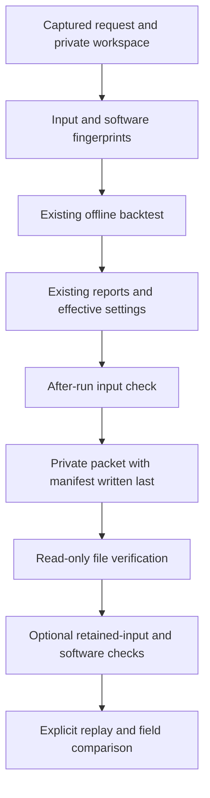
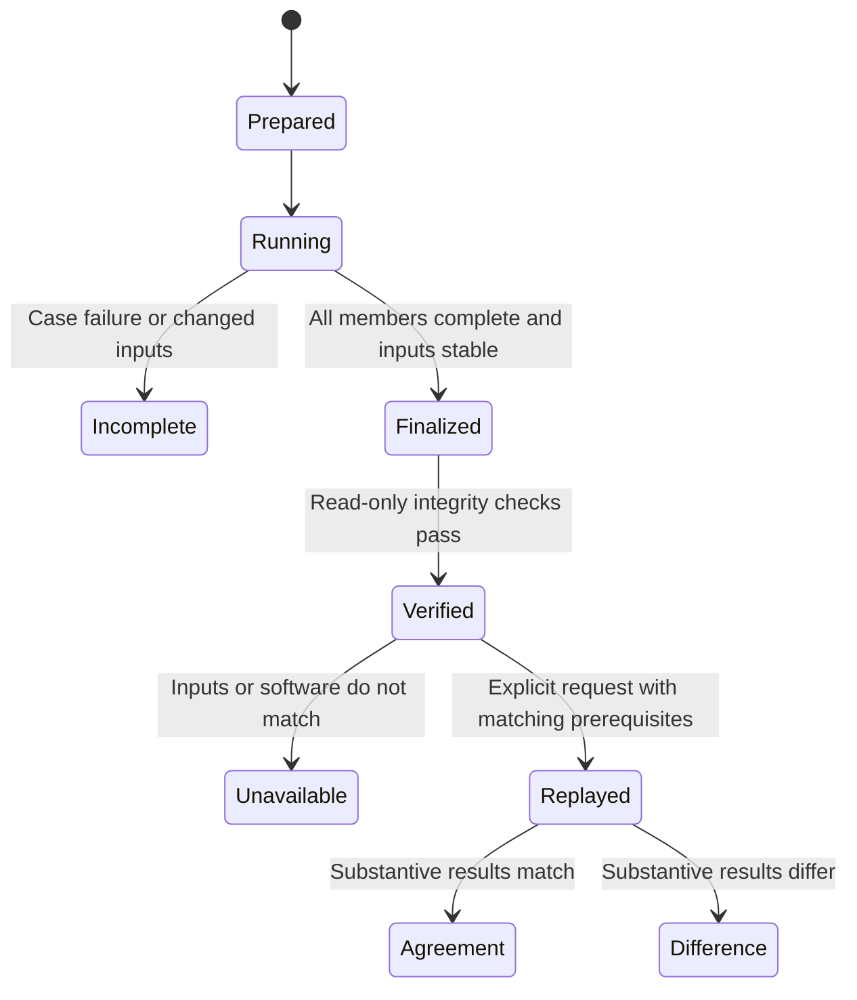

# nopo-6 Reproducible Historical Validation Packets - Plan

## Goal Capsule

- **Objective:** An agency analyst can reproduce a historical backtest and give a reviewer enough evidence to identify its data sources, detect changed inputs and understand its limits.
- **Means:** An opt-in local packet workflow around the existing backtest, with structured source disclosures, input and software fingerprints, read-only verification and explicit replay (KTD1-KTD7).
- **Scope:** Only mandate item `nopo-6`. Build packet infrastructure using synthetic records; actual historical validation and the live pilot remain the separate `nopo-1` obligations.
- **Authority:** The origin Product Contract, `docs/method.md` and `docs/validation.md` govern interpretation. Campaign authority is the chief repository's `docs/plans/2026-10-26-0705-feat-codex-drawdown-campaign-plan.md` and `ops/drawdown/mandates/_common.md`; the source-availability limitation is recorded below. `Origin R...`, `Campaign R...` and this plan's local R-IDs are separate namespaces.
- **Delivery:** One expansion, one branch, one eventual PR: `drawdown/nopo-6` (Campaign R17). This stage commits only the plan. The later build uses `lfg`; the lane commits locally, the controller scans/pushes/opens the PR, and the campaign merge gate owns merging (Campaign R15, R19). No remote or credential discovery belongs to this lane.
- **Stops:** The supplied Campaign R11/R15/R16/R20 rules prohibit spend, credential/security-setting changes, sends in the owner's voice, unbacked deletion and force-push. No migration, data rewrite, release, outside service or deployment change is needed.

---

## Product Contract

### Summary

Add a private validation packet that records a backtest's request, source declarations, logical input identity, software identity and existing reports.
Let analysts check the packet without changing it and explicitly replay the captured request against retained matching agency data.
Keep reproduction evidence distinct from empirical validation.

### Problem Frame

The current backtest reports explain input receipts and historical-cutoff limits, but omit party-resolution overrides and effective runtime settings.
A reviewer cannot tell whether a later rerun used the same records and software or whether separately supplied vendor details belong to the right receipts.
The private intake procedure in `docs/validation.md` covers those details manually.
The earlier `nopo-1` plan explicitly reserves manifests, packets and verification infrastructure for this item.

**Product Contract preservation:** The origin and `nopo-1` plans remain unchanged.
This follow-up implements the packet expansion without changing the screen's analytical rules or declaring the outstanding empirical work complete.
Origin A2 reviews the evidence; Origin A3 or an agency analyst operates the existing Python interface.
The lawyer's existing point-and-click workflows are unaffected.

### Requirements

**Reproduction and review**

- R1. A newly captured historical run produces one private packet containing the selected cases, explicit markets, party-resolution overrides, effective settings, input/software identity and both existing report formats (Origin R10, R17, R21; F3; U14).
- R2. A reviewer can distinguish packet integrity, retained-input compatibility and actual replay agreement; each check reports failure or unavailable evidence explicitly.
- R3. Explicit replay reconstructs the captured request and compares substantive outcomes while preserving the original packet and source facts.
- R4. Existing callers, legacy reports, rankings, mutual/one-way separation, cutoff behavior and insufficient-data results remain compatible (Origin R5, R14, R15, R21, R23).

**Source disclosure and interpretation**

- R5. The packet associates vendor/provider, dataset, version and provenance disclosures with the receipts behind its retained inputs, including comparison data; absent details remain unknown (Origin R17, R24; method's historical-validation disclosure rule).
- R6. Stored source declarations remain distinguishable from operator supplements, and synthetic inputs, missing receipts and conflicting or unclassified provenance remain visible.
- R7. Reports retain the event-date limitation, validation-only restriction on unclear-collection aggregator data and cautious lead wording; successful reproduction establishes neither historical availability nor empirical accuracy (Origin R11, R13, R18, R21; AE5).
- R8. Any supplied evaluation protocol and availability evidence are captured before screening; missing information does not become a fabricated predeclared benchmark or legal clearance.

**Custody and delivery**

- R9. Packets and replay outputs remain in the agency workspace outside the source/install tree, with no outbound requests, raw-file/database bundling, silent overwrite or deletion of prior artifacts (Origin R18, R20).
- R10. Verification is read-only and never initializes, repairs or silently replays a workspace.
- R11. Synthetic tests prove the new behavior while preserving all existing tests; this branch contains only the authorized expansion and follows the campaign's publication and evidence gates (Campaign R15-R17, R19).

### Key Decisions

- **Keep agency data local.** Governs R9, R10. (session-settled: user-approved — chosen over a hosted app or report service: the origin requires agency-controlled operation.)
- **Use unclear-collection aggregator data only for historical method validation.** Governs R5-R7. The origin's resolved 2026-10-14 decision permits this use with disclosure; it does not authorize purchases or live leads.
- **Ship expansions through the campaign guardrails.** Governs R11. (session-settled: user-directed — chosen over holding every expansion for owner review: the campaign authorizes reviewed improvements.)

### Scope Boundaries

In scope: packet creation, verification, explicit replay, structured disclosure, focused regression coverage and accurate documentation.
The analyst interface follows the existing backtest API; it adds no web page or command-line distribution.

The origin's **Deferred for later** boundaries remain: inter-agency sharing, a standalone board-interlock screen and direct paid-vendor API collection.
Its **Outside this product's identity** boundaries remain: hosted operation, findings that an agreement exists, targeting other user constituencies, and account-based or terms-violating collection.

#### Deferred to Follow-Up Work

- Actual historical-data acquisition, collaborator-set empirical benchmarks and pilot execution/review remain `nopo-1` under `docs/validation.md`.
- PDF/Docker distribution, analytical cross-checks, non-compete extraction and general repository hygiene remain their other mandate items.
- Record-availability filtering and a general live-data eligibility engine require separate evidence and scope; this item records declarations without asserting software enforcement.

#### Considered and not built

- **Self-contained raw-data archives:** the retained agency workspace already contains replay inputs; duplicating person-level records increases custody and licensing obligations. Revisit only for an authorized portable-data requirement.
- **Retrofitting packets to legacy reports:** their missing capture cannot be reconstructed reliably. A new captured run is the supported entry point.
- **Digital signatures, remote timestamps and attestation services:** checksums support local integrity, not authenticity against replacement of both manifest and files. No such external trust requirement exists here.
- **Exact causal lineage and cross-version replay:** a conservative input fingerprint and matching software bound the claim without redesigning provenance or the statistical engine.
- **New benchmark scoring or tuning controls:** recording existing outcomes and a supplied protocol fulfills this item; selecting success thresholds or changing statistics would exceed it.

No frontend change is planned.
Any later frontend change requires a Playwright screenshot committed under `docs/plans/evidence/` and a `SCREENSHOT:` path in the build handoff.

---

## Planning Contract

### Reverified Starting State

Source inspection started on clean `drawdown/nopo-6` at `ddc0807`.
No application tests or runtime probes ran during this plan stage; baseline test health remains unverified.

| Evidence | Planning consequence |
|---|---|
| `src/nopoach/backtest/run.py`, `run_backtest` and `CaseResult` | Explicit cases/markets and JSON/Markdown reports exist; party overrides are not retained. |
| `src/nopoach/backtest/run.py`, `_input_sources` | Referenced-source disclosure, missing receipts and synthetic notices already exist; extend rather than duplicate them. |
| `src/nopoach/pipeline.py`, `_filtered_workspace`, `_references`, `_persist` | Scoring copies facts into memory, then writes screens/markets/receipts; pair references are not a complete replay input set. |
| `src/nopoach/signals/flow.py`, `FlowScreen` and `screen_flow` | Seed, placebo count, FDR and model/prior metadata exist during execution but are not retained by the pipeline. |
| `src/nopoach/market/define.py`, `Market.to_json/from_json` | Canonical market round-tripping already preserves manual additions/removals. |
| `src/nopoach/store/workspace.py` and `store/provenance.py` | Opening a workspace creates schema/directories and may reconcile receipts; verification needs a separate read-only path. |
| `tests/backtest/test_run.py`, `tests/test_pipeline.py`, `tests/store/` | Synthetic ranking, cutoff, source-preservation and provenance tests supply regression seams. |
| `docs/plans/2026-10-28-0314-feat-nopo-1-validation-readiness-plan.md`, scope boundaries | Generic packets are explicitly deferred to `nopo-6`; source disclosures and the runbook are already present in this checkout. |

No repository `AGENTS.md`, `CLAUDE.md`, `docs/handoffs/`, `.planning/` or `docs/solutions/` was present.
The v1 build handoff was retired by `77ed323`/`dc23ace`; completed build work is not reopened.
The chief campaign source and common mandate were not available in the accessible checkout or adjacent mounted paths.
The supplied lane instructions provide Campaign R11/R15/R16/R17/R19/R20 here; the full Goal Capsule and cited source sections were not independently verified.
The controller must reconcile those sections when providing build context, without credential discovery or owner time.

### Key Technical Decisions

- KTD1. **Add an opt-in analyst workflow in `backtest/`.** Keep ordinary `run_backtest` behavior and report version 1 usable. Create packets only around newly captured runs; do not infer capture from an old report. An explicit replay operation uses the same backtest entry point. Governs R1-R4.
- KTD2. **Record actual execution metadata without adding tuning controls.** Retain seed, placebo count, FDR, model and fitted prior from `FlowScreen` through additive `ScreenResult`/persisted JSON metadata. Keep defaults unchanged; capture other fixed method choices through a single source of truth and the software fingerprint. Governs R1, R4.
- KTD3. **Fingerprint logical source state, not database bytes or pair references.** Use the input-identity contract below, before and after each packet run. Source drift prevents finalization. This detects changes during exclusive analyst use; it is not a transactional multi-case snapshot. Governs R1-R3, R9.
- KTD4. **Keep observed receipts and operator supplements separate.** Receipt-keyed supplements carry structured provider/dataset/version, use-basis notes and availability assertions. The packet's full retained-input inventory supplements the report's narrower referenced-evidence inventory; neither is described as exact causal lineage. Governs R5-R8.
- KTD5. **Write a directory with fixed members and a manifest finalized last.** Store it under workspace-relative `exports/validation/<packet-id>/`, using a fresh directory and workspace containment checks. Preserve incomplete attempts and ordinary reports after failure; return their locations without claiming rollback. Governs R1, R9.
- KTD6. **Separate verification from replay.** File-only verification opens no database. Optional retained-input checks accept an explicit existing workspace location and use a read-only DuckDB connection with extension autoload/install still disabled. Parse existing receipts without constructing `Workspace` or `ProvenanceLog`. Governs R2, R9, R10.
- KTD7. **Require matching inputs and software before replay, then compare meaningful results.** Use the compatibility and comparison contract below; refuse an unavailable or incompatible replay without writes. Replay creates fresh ordinary outputs and a new packet, leaving the original untouched. Governs R2-R4, R7.

The retained-workspace approach follows existing custody and API contracts.
A raw-data archive would require additional product authority, so it is not a competing implementation that needs a prototype.

### Assumptions

These are planning defaults, not additional user-approved product decisions:

- Agency analysts can use the existing Python backtest interface and retain its workspace; the expansion need not add a lawyer-facing UI.
- A packet is private review material, even when it contains only hashes and metadata beyond the existing reports.
- Conservative replay refusal after an unrelated input-table change is acceptable; exact causal replay would cost substantially more.
- Packet infrastructure can be accepted using synthetic runs, without acquiring real histories or selecting an empirical success threshold.

### Packet Content and Disclosure Contract

The packet format has its own version, independent of database and backtest-report versions.
Fixed members are `request.json`, `sources.json`, `environment.json`, `report.json`, `report.md`, `review.md` and the final `manifest.json`.
The manifest records member lengths and SHA-256 hashes, format/comparison versions, per-case effective execution metadata and the immutable request identity.
Return the manifest hash for private custody records; a local checksum alone does not authenticate its author.

| Member | Content |
|---|---|
| `request.json` | Ordered case selections with complete definitions, canonical requested markets, all party overrides and any pre-run evaluation protocol. |
| `sources.json` | Table/schema/count fingerprints, retained input receipts, original labels/classes, supplements, missing-source gaps and synthetic flags. |
| `environment.json` | Package version, Python/runtime/platform identifiers, installed dependency versions and content hashes of executable package sources and bundled method/catalog resources. Record the lockfile hash when present and explicit absence otherwise. |
| `report.json` and `report.md` | Copies of the existing report outputs, with their wording, cutoff limits, sufficiency and public case citations preserved. |
| `review.md` | A concise index to source identities, gaps, capture/replay conditions, partial or synthetic outcomes, evaluation-protocol status and limitations. |

Validate the request and freeze its supplied protocol and source supplements before scoring.
Do not permit duplicate case IDs, unknown market keys, empty selections or duplicate/conflicting supplements to one receipt.
Supplements for unknown receipt IDs are rejected; an omitted supplement becomes an explicit unknown entry.
Preserve stored source labels and every declared class literally rather than parsing vendor identity from names, paths or URLs.
A claimed provenance class that conflicts with stored declarations is reported as a conflict, never an override.
Synthetic detection uses stored class or collection method regardless of supplemental wording.

Availability entries distinguish event date, acquisition time and the analyst's evidence for availability before disclosure.
An evidence reference is inert text, not a file or URL to dereference.
Missing vendor, version, use basis, availability evidence or benchmark information does not prevent an honest packet; it remains a review gap.
No automated empirical pass/fail verdict is introduced.

### Input Identity Contract

Fingerprint all persisted input tables used by the current workspace model, including identity-resolution metadata:

- Core: `employers`, `employer_parents`, `people`, `positions`, `position_worksites`, `workforce_inputs`, `dol_records`, `filings`, `clauses`, `ties`.
- Optional: `imports`, `imported_rows`, `employer_aliases`, `person_keys`, `parent_link_metadata`, `clause_details`.

Include table presence, column names/types, row counts and canonical typed values.
Missing optional tables differ from empty ones; missing core tables, unexpected persistent tables and unsupported schema/types produce an unsupported-input result.
Read fixed, quoted base-table names rather than executing packet-provided SQL.
Stream rows in stable primary/composite-key order, preserving duplicates where allowed; canonicalize JSON keys and date/time values without conflating nulls, numbers and strings.
Keep only aggregate fingerprints in the packet, not source rows or per-person hashes.

Exclude `markets` and `screens` from input identity.
For receipts, exclude IDs referenced by those outputs only when no input fact or declaration also references them; never classify a receipt as output solely from its label or method.
Conservatively retain other non-output receipts, and check the existing JSONL log against the database mirror without repair.
Missing/conflicting receipt metadata stays explicit and prevents a claim that retained inputs are fully verified.
Whole-log hashes are unsuitable because every screen appends receipts.

Fingerprint all rows, including outside-market positions/worksites, workforce denominators, imported raw JSON and embedded DOL/clause details.
These affect filtering, geography, identity or sufficiency even when absent from `PairReferences`.
Stored receipt locations remain literal private metadata; the current workspace directory path is excluded, allowing relocation without changing identity.

### Compatibility and Comparison Contract

The source-code/resource fingerprint and actual installed dependency versions identify the implementation; package version `0.1.0` alone does not.
Read only the installed package/resource files and distribution metadata, never environment dumps, credential files or unrelated home-directory content.
Missing required identity yields compatibility unavailable, not a match.
A different code/dependency/runtime identity blocks replay in this version; it does not prevent inspection of packet integrity.
Platform details are retained to explain numerical differences, without promising cross-platform bit equality.

Reconstruct cases from the captured definitions rather than the current case catalog.
Reconstruct markets through their versioned serializer and retain caller case order and party overrides.
Record before/after input fingerprints again during replay.

Compare parsed JSON outcomes, not rounded Markdown or whole-report bytes.
Require exact case/market/cutoff, party mappings, list membership/order, rank, population, sufficiency, signal decisions, coverage classifications and evidence/reference identities.
For finite continuous values only, version 1 uses relative tolerance `1e-9` and absolute tolerance `1e-12`; counts, ranks and categorical decisions never use tolerance.
Enumerate the ignored execution fields: generated screen IDs and artifact paths/timestamps only.
New or unrecognized result fields must not be silently discarded.
Report concrete field differences without printing private row content into public logs; tolerances are not widened to obtain agreement.

Verification returns separate integrity, input-match and compatibility outcomes, with unchecked inputs marked not checked.
Replay reports reproduced, different, unavailable or failed independently of whether the original result was sufficient or synthetic.
An insufficient result can reproduce exactly while remaining insufficient.

### High-Level Technical Design



```mermaid
sequenceDiagram
    participant Analyst
    participant Packet
    participant Backtest
    participant Storage as Private workspace
    Analyst->>Packet: Supply cases, markets, disclosures and optional protocol
    Packet->>Storage: Capture inputs; reserve fresh attempt
    Packet->>Backtest: Execute frozen request
    Backtest->>Storage: Append ordinary screens, receipts and reports
    Packet->>Storage: Recheck inputs and write final manifest
    Packet-->>Analyst: Packet location or incomplete-attempt reason
```



The state diagram describes operation results, not mutable status fields inside finalized packets.
Verification and replay never rewrite the original packet.

### System Impact and Risks

Additive execution metadata touches the shared pipeline, so retain constructor compatibility and test the existing screen JSON and Word-export paths.
It changes no threshold, rank weight, source table or database schema.
Packet hashing adds a full input read; use bounded batches rather than materializing large tables in Python.
Source order and floating aggregation can still affect existing statistical computation; R2/R3 require reporting differences rather than hiding them.

Packets inherit person-bearing evidence and source locations from existing reports.
Use agency custody and fixed local destinations under R9, not a claim that the export is anonymized.
Checksums detect alteration relative to the retained manifest; they cannot prove lawfulness, original authorship or historical availability.

---

## Implementation Units

### U1. Capture source identity and effective execution metadata

**Goal:** Identify the data and actual settings behind a newly captured run.

**Requirements:** R1, R4-R6, R9-R11; KTD2-KTD4, KTD6.

**Dependencies:** Existing workspace, provenance and flow objects.

**Files:** Create `src/nopoach/backtest/metadata.py` and `tests/backtest/test_metadata.py`; update `src/nopoach/pipeline.py`, `src/nopoach/store/__init__.py`, `tests/test_pipeline.py` and `tests/store/test_workspace.py`.

**Approach:**

1. Implement the input/software identity contracts and receipt inventory as bounded read-only helpers.
2. Add an explicit read-only connection option that retains existing extension restrictions and cannot create a missing database.
3. Carry actual `FlowScreen` metadata additively through screen persistence, with compatibility for existing constructors and old payloads; avoid duplicated statistical defaults.

**Patterns:** `Market.to_json`, `_filtered_workspace` identifier quoting, `_persist`, the receipt dataclass, and existing no-network/store tests.
The metadata seam proves input identity and read-only behavior; backtest integration remains U2/U3.

**Test scenarios:**

1. Equal typed inputs in different insertion orders produce the same fingerprint; missing versus empty optional tables do not.
2. Changing a comparison employer, outside-market position, worksite, workforce denominator, alias decision or embedded raw/detail JSON changes identity.
3. Appended screens/markets and their output-only receipts do not change identity; an input-referenced receipt cannot be excluded by its method label.
4. Missing, duplicate or conflicting log/mirror receipts produce explicit gaps without altering either store.
5. Unsupported schema/table/type and missing database paths fail without creating files; relocated unchanged workspaces retain identity.
6. Effective execution metadata equals the actual flow result and persisted parameters; existing rank, cutoff, sufficiency and export assertions remain unchanged.
7. Software/resource or installed-version changes alter compatibility identity; unavailable metadata is never a fabricated version/hash.

**Verification:** Focused metadata, pipeline and store tests establish the contract using invented data and blocked network calls.

### U2. Assemble a private packet with structured disclosures

**Goal:** An analyst receives one inspectable packet for a newly captured historical run.

**Requirements:** R1, R4-R9, R11; KTD1-KTD5; Origin F3 and AE5.

**Dependencies:** U1.

**Files:** Create `src/nopoach/backtest/packet.py` and `tests/backtest/test_packet.py`; extend `tests/backtest/test_run.py` only where integration assertions belong.

**Approach:**

1. Define the versioned request, supplement and manifest contracts in the packet module; validate before running.
2. Freeze request/source/software metadata, reserve the private attempt and call the ordinary backtest.
3. Copy its report outputs, add actual execution metadata and the review index, then finalize only under KTD3/KTD5.
4. Preserve incomplete attempts and prior ordinary outputs on errors; expose a short reason and private location without cleanup deletion.

**Patterns:** Existing `run_backtest` report/containment handling and `_input_sources` uncertainty wording.
Packet tests prove assembly and custody; they do not certify real-data validation.
Start with failing disclosure and failure-path tests before implementing serialization.

**Test scenarios:**

1. A synthetic multi-case run captures explicit markets, added/removed employers and ambiguous-party overrides; the ordinary reports and source citations remain intact.
2. An invented vendor/dataset/version supplement attaches to its receipt, including comparison-only inputs; labels/classes and synthetic warnings remain unchanged.
3. Missing vendor/version/availability/protocol fields remain visible unknowns; duplicate/unknown declarations and conflicting supplied classes cannot silently replace evidence.
4. An insufficient or mixed-synthetic run still yields an honest packet with no empirical-success claim. Covers Origin AE3/AE5.
5. A failed later case or changed source table prevents finalization, preserves earlier screens/reports and leaves no apparently complete packet.
6. Existing destination, source-tree destination or symlink escape is refused without overwrite; fixed member names are safe on Windows.
7. The manifest covers every required member and byte length/hash; no raw input, database copy or arbitrary directory content is added.

**Verification:** Generated JSON and readable review text agree on disclosures, outcomes and limits, and all artifacts remain in external temporary workspaces.

### U3. Verify and explicitly replay captured packets

**Goal:** Detect altered evidence and determine whether matching retained inputs reproduce the result.

**Requirements:** R2-R4, R7, R9-R11; KTD6/KTD7.

**Dependencies:** U1, U2.

**Files:** Update `src/nopoach/backtest/packet.py`; create `tests/backtest/test_packet_replay.py`; extend `tests/backtest/test_packet.py` for file-verification cases.

**Approach:**

1. Validate version, schema and fixed member inventory before hashing; reject unsafe paths, duplicate entries and symlinked members.
2. Return integrity independently, then optionally check an explicitly supplied existing workspace through U1's read-only helpers.
3. Gate explicit replay on verified input/software prerequisites, reconstruct the captured request and produce a new U2 packet.
4. Compare parsed outcomes under the versioned field/tolerance contract and return differences separately from integrity and sufficiency.

**Patterns:** `Market.from_json`, case dataclasses, existing planted/sparse/cutoff fixtures and store immutability tests.
At least one replay test runs the real pipeline; comparator-only fixtures exercise boundary cases cheaply.

**Test scenarios:**

1. A planted synthetic case creates, verifies and replays with the same substantive results despite new screen IDs and output paths; party overrides and comparison employers survive.
2. An insufficient case reproduces as insufficient with no guessed rank; mutual/one-way classifications remain exact.
3. Missing/changed/truncated members, malformed or unsupported manifests, duplicate JSON keys, traversal, drive paths and symlinked members fail without reading outside the packet.
4. File-only verification touches no workspace; optional input checking changes no database/log bytes or timestamps and does not initialize or repair missing storage.
5. A changed input, source-code resource, dependency version or unavailable required identity prevents replay before writes; integrity can still pass separately.
6. Finite-float differences within declared tolerance pass, larger differences fail, and any rank/signal/list/sufficiency difference fails regardless of numerical size.
7. Packet-supplied URLs, receipt locations and arbitrary text are never fetched/executed; no socket opens during creation, verification or replay.
8. Replay failure leaves the original packet byte-for-byte intact; additional ordinary outputs do not invalidate its source fingerprint.

**Verification:** Integration establishes one real create/verify/replay path, adverse checks fail explicitly, and all existing backtest/pipeline tests still pass.

### U4. Document packet custody and rehearse the supported workflow

**Goal:** A reviewer can use the packet without confusing software reproduction with empirical validation.

**Requirements:** R5-R11; Origin A2/A3, F3, R20/R21.

**Dependencies:** U1-U3.

**Files:** Update `docs/validation.md`, `docs/method.md`, `README.md`; extend `tests/packaging/test_safety_gates.py` for the chosen packet destination.

**Approach:**

1. Document the actual implemented analyst API with an invented example, private custody requirements and packet member meanings.
2. Explain the separate checks, retained-workspace/build prerequisite, incomplete-attempt behavior and explicit replay writes.
3. Correct the method's claim about retained settings to match new captured runs and identify legacy-report limitations.
4. Preserve the current empirical/pilot status and the existing unsent collaborator request; no new request or data purchase is needed.
5. Prove the existing repository scanner rejects a generated packet tree under `exports/`, including when archived, without weakening its rules.

**Test scenarios:**

1. Synthetic packet-tree/archive fixtures trigger the existing prohibited-export gate without leaking contents into diagnostics.
2. A build-stage rehearsal follows the documented API and locates the disclosed vendor identity, unknowns, source drift and replay outcome using invented data.

**Verification:** Documentation matches the implemented entry points and contains no real records, completed intake fields, private paths or empirical-validation claims.
No new test is needed for prose alone; the rehearsal and packet tests support the example.

---

## Verification Contract

These are build-stage gates, not claimed results of this planning commit.
Run the existing baseline before implementation using Python 3.12 and the pinned dependency cache, without updating the lockfile.

| Gate | Check | Required outcome |
|---|---|---|
| New behavior | `uv run --no-sync pytest tests/backtest/ tests/test_pipeline.py tests/store/` | Packet creation, source capture, read-only verification and real-pipeline replay pass alongside existing assertions. |
| Export and custody | `uv run --no-sync pytest tests/export/test_dossier.py tests/packaging/test_safety_gates.py` | Shared metadata preserves Word exports; existing repository safeguards reject packet output trees. |
| Lint/format | `uv run --no-sync ruff check .`; `uv run --no-sync ruff format --check .` | No errors or required reformatting. |
| Types | `uv run --no-sync mypy src` | Strict typing passes. |
| Regression suite | `uv run --no-sync pytest` | All existing default tests pass without deletion, weakening or marker changes. |
| Offline behavior | `uv run --no-sync pytest -m network_off` plus packet socket-blocking tests | No external fetch, extension installation or hidden collection. |
| Review rehearsal | Synthetic create/verify/replay and altered-input inspection | Review text and machine outcomes agree; generated files remain outside git. |
| Controller gates | Existing Linux/Windows CI, repository scan and required campaign reviews | Platform/path behavior and publication prerequisites pass before merge. |

Default pytest excludes `browser` and `live` as configured in `pyproject.toml`; this item changes neither CI nor those exclusions.
Report sandbox limitations, including denied sockets, separately from regressions and never claim unrun checks passed.
Any frontend deviation invokes R11's screenshot gate; the planned backend/documentation work needs no screenshot.

---

## Definition of Done

**Plan stage:** This plan alone is committed on `drawdown/nopo-6`; no production/test implementation or application test run is included.

**Expansion build:** U1-U4 and the verification gates are complete, existing tests remain intact, the packet workflow is reproducible with synthetic data, and changed inputs/software or report tampering produce explicit outcomes.
The final diff contains no abandoned implementation attempts, generated packets, workspaces, real records or unrelated mandate work.
The controller receives the branch, plan path, `KIND: expansion` and truthful evidence for publication.

**Empirical boundary:** Packet acceptance does not complete the real historical runs or live pilot.
Those still require the lawful records and collaborator decisions already documented under `nopo-1`.
No owner-only input blocks building this expansion, and no held migration, data rewrite, release or new service is proposed.
