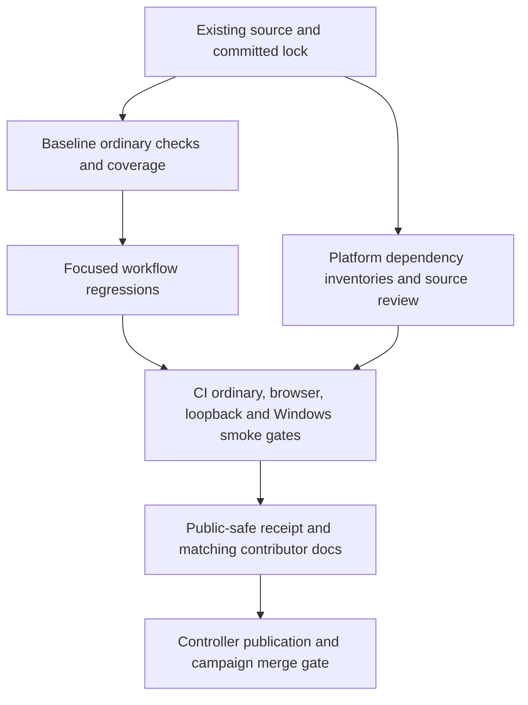

# nopo-7 Reliability and Maintenance Hygiene - Plan

## Goal Capsule

- **Objective:** Maintainers can check that the lawyer's existing screening and Word-export workflow still works, identify known dependency risks, and give contributors instructions that reproduce those checks.
- **Means:** Focused regression coverage, execution of the existing suites in CI, a dated dependency and source-security review, and corrected maintenance documentation (KTD1-KTD6).
- **Scope:** Only mandate item `nopo-7`, the assigned hygiene work; this is not a feature expansion. The origin plan's behavior and unfinished validation obligations remain unchanged.
- **Authority:** The origin Product Contract governs product behavior. Campaign authority is the chief repository's `docs/plans/2026-10-26-0705-feat-codex-drawdown-campaign-plan.md` and `ops/drawdown/mandates/_common.md`. References below distinguish `Origin R...`, `Campaign R...`, and this plan's local R-IDs.
- **Delivery:** This stage commits only this plan on `drawdown/nopo-7`. The build stage implements one branch for one controller-managed PR; the controller scans, pushes, and opens it, and the campaign merge gate owns merging (Campaign R15, R17, R19). The lane must not add a remote, seek credentials, or dispatch a release.
- **Stops:** No spend, credential or security-setting changes, sends in the owner's voice, unbacked deletion, force-push, production data access, schema migration, data rewrite, package release, deployment change, or new outside service. Campaign R11 also prohibits reading credential material. Any necessary held change or owner-only prerequisite must be reported separately under the campaign rules.

---

## Product Contract

### Summary

Strengthen regression coverage around the existing workspace, import, and dossier workflow.
Make CI execute the suites it currently omits, audit the resolved dependencies and existing security boundaries, and align contributor documentation with the verified commands and limitations.

### Problem Frame

The repository already has substantial synthetic tests and Linux/Windows CI.
Its default pytest selection excludes browser and socket tests, while CI explicitly selects only the packaged Windows smoke test.
Consequently, a successful ordinary check does not demonstrate that the browser workflow or fetch client's loopback integration ran.
There is no configured coverage measurement or dependency-advisory audit, and the contributor install example bypasses the lockfile used by CI.

**Product Contract preservation:** The origin plan and the `nopo-1` plan remain unchanged. This item adds maintenance assurance for their existing behavior, without completing or replacing their feature and empirical-validation work.

### Requirements

**Regression coverage and execution**

- R1. Add meaningful tests for gaps in the primary documented lawyer workflow: workspace selection, imports, screening, dossier review, and Word export (Origin R1, R8-R12, R14-R19, R23-R24; F1, F2, F4).
- R2. Preserve every existing test and assertion, statistical threshold, interpretation, provenance behavior, and supported workflow; fix only defects demonstrated within this item's maintenance scope (Campaign R15, R16).
- R3. CI must run the existing ordinary suites on Linux and Windows, the existing browser/accessibility suite and fetch loopback integration on a capable runner, and the existing packaged Windows smoke test.
- R4. Measure coverage of the primary workflow and report which gaps the new tests exercise; distinguish measured results, unavailable checks, and residual gaps.

**Dependency and security review**

- R5. Audit the resolved runtime, development, and declared build-tool dependencies on Python 3.12 for both supported CI platforms, recording tool versions, lock digest, advisory findings, and inventory exclusions.
- R6. Review the current local-session, file/import/export, outbound-fetch, repository-data, and dependency-supply boundaries using source and synthetic tests; neither a package audit nor a passing test suite establishes general security certification (Origin R13, R17, R18, R20).
- R7. Preserve failed or incomplete audit outcomes and record each finding's disposition; apply compatible, evidence-backed dependency fixes without a blanket update, automatic suppression, or changed security policy.

**Documentation and evidence**

- R8. Contributor and IT instructions must match the actual locked setup, test selectors, audit scope, and host requirements; existing empirical-validation limits remain explicit (Origin R18-R22; origin U15).
- R9. Commit only public-safe documentation, code, and invented fixtures; keep workspaces, imports, generated dossiers, collected records, and private review material out of evidence and artifacts (Origin R20; Campaign R11).
- R10. If implementation changes a frontend page, run and inspect a Playwright screenshot of that page, commit it under `docs/plans/evidence/`, and report `SCREENSHOT: <repo-relative path>` at build completion (Campaign R15, R16).

### Key Decisions

- **Maintain the existing product.** Governs R1-R2. (session-settled: user-directed — chosen over speculative features when planned work and worthwhile expansions run out: this lane is assigned durable hygiene.)
- **Use the campaign's guarded delivery.** Governs R2, R9-R10. (session-settled: user-directed — chosen over holding ordinary guarded changes for owner review: the campaign supplies the checks and controller-managed merge path.)

### Scope Boundaries

In scope: additions to existing regression suites, test infrastructure needed to execute them, dev-only measurement/audit tooling, compatible fixes for demonstrated maintenance defects, CI verification, and documentation corrections.
Tests use existing synthetic markets and temporary external workspaces.
Application templates, styles, routes, and the data schema have no planned feature changes.

The origin's **Deferred for later** and **Outside this product's identity** boundaries remain controlling: no hosted service, account-based collection, proof-of-agreement claims, or expanded product audience.

#### Deferred to Follow-Up Work

- `nopo-1` historical validation/pilot work, `nopo-2` distribution follow-ups, `nopo-3` analytical checks, `nopo-4` non-compete extraction, `nopo-5` PDF export, and `nopo-6` validation packets.
- Actual historical records, pilot acceptance, or buying validation data; hygiene evidence must not imply those obligations are complete.

#### Considered and not built

- A new browser harness, extra browser engines, or hosted coverage dashboard: the existing Chromium suite already covers the main workflow. Revisit only for a demonstrated compatibility gap.
- A whole-repository coverage quota: no executed baseline exists, and a percentage alone would reward low-value assertions. R4 requires measured workflow evidence and named residual gaps.
- Automatic dependency upgrades or a general security-control redesign: audit findings determine necessary fixes; neither is justified by an unexecuted audit.
- A broad concurrency refactor or exhaustive busy-state matrix: existing import race coverage remains intact; investigate a concrete failure if the new tests expose one.

No held change or owner decision is currently required by the proposed work.

---

## Planning Contract

### Reverified Starting State

Static review started from a clean `drawdown/nopo-7` at `ddc0807`.
No tests, browser launches, builds, installs, coverage runs, or vulnerability audits ran in this plan stage.
The catalog's test-health claims are not accepted as evidence; baseline execution belongs to U1.

| Evidence in this checkout | Consequence |
|---|---|
| `pyproject.toml` requires Python `>=3.12,<3.13`; pytest defaults to `not browser and not live` | Preserve the fast default and select capability-dependent suites explicitly. |
| `.github/workflows/ci.yml` runs lint, formatting, mypy, and ordinary pytest on Ubuntu and Windows | Extend this workflow; do not replace working gates. |
| CI explicitly runs `tests/packaging/test_smoke.py` with the live marker on Windows | Keep this build and smoke path; the fetch loopback test still needs its own selection. |
| `tests/app/test_e2e.py` contains five browser scenarios and directly launches Chromium | Missing Chromium already fails. Do not introduce a skip or claim a nonexistent skip needs removal. |
| Browser tests create `ranked-list.png` and `dossier.png` beside synthetic workspaces in temporary storage | Retain only selected image/report files, never the whole temporary tree. |
| `tests/app/test_routes.py`, `tests/test_pipeline.py`, and `tests/export/test_dossier.py` cover the main synthetic flows, partial acceptance, imports, retries, and record traceability | Add boundary scenarios instead of duplicating the happy path or inventing statistical features. |
| `choose_workspace` clears current result and upload state; `column_mapping` rejects structural ambiguity before importing | Add regression assertions at these user-facing boundaries. |
| The browser fixture starts its server before the cleanup block surrounding browser use | Put setup under teardown protection so a launch failure does not leave the test server alive. |
| `tests/packaging/test_safety_gates.py` requires locked dependency installs and release checkout safeguards | Preserve these tests; new workflow steps must satisfy their existing contract. |
| `pyproject.toml` and `uv.lock` share the `2026-10-13T14:50:00Z` resolution cutoff; no coverage or advisory tool is declared | Add tools deliberately, review lock diffs, and retain the cutoff unless a demonstrated fix requires a documented narrow change. |
| `README.md` uses locked setup for source users but unlocked `uv pip install` in its contributor section | Give both paths the same locked dependency basis. |
| `packaging/IT-REVIEW.md`, `THIRD-PARTY.md`, and the repository scanner already document and test extensive safeguards | Audit and preserve them rather than claiming these controls are missing. |

The v1 build handoff was retired in `77ed323`, merged by `dc23ace`; this item does not revive it.
No repository `AGENTS.md`, `CLAUDE.md`, `docs/handoffs/`, `.planning/`, `docs/solutions/`, or separate strategy document was present.
The chief campaign source and common mandate were not available in this checkout or the accessible adjacent directories.
Campaign R11/R15/R16/R17/R19/R20 are therefore grounded in the supplied lane instructions, not a claimed independent reading of their source Goal Capsule.
The controller must reconcile that capsule and those cited R-IDs before build/publication; this is a controller handoff prerequisite, not a request for owner time.

### Key Technical Decisions

- KTD1. **Use the documented workflow as the coverage target.** Extend the existing TestClient, real synthetic-pipeline, loader, and DOCX-content tests. Add development-only `coverage` for branch measurement over `src/nopoach`, with a focused report for app routes, imports, pipeline, and exporter. Measure before and after U2 with identical selection, and inspect covered branches rather than choosing a percentage in advance. Governs R1, R2, R4.
- KTD2. **Keep test capabilities explicit.** Retain ordinary Linux/Windows checks and the Windows build smoke. Add Ubuntu browser/accessibility and local fetch-server checks to the existing CI workflow. Install Chromium through the locked Playwright package and preserve setup failures. Use existing SHA-pinned actions, without changing permissions, secret handling, or release configuration. Governs R3, R6. [Playwright CI guidance](https://playwright.dev/python/docs/ci), [browser installation](https://playwright.dev/python/docs/browsers#install-system-dependencies).
- KTD3. **Audit a locked public-package inventory with PyPA pip-audit.** Add a compatible development-only `pip-audit` version to the committed lock. Export hashed requirements with explicit dev/build groups and the local project omitted; audit using PyPI's advisory data with dependency resolution disabled and strict failure handling. PyPI is the existing dependency registry; no new service, account, source upload, or application network permission is introduced. Governs R5-R7. [uv export](https://docs.astral.sh/uv/reference/cli/#uv-export), [pip-audit security model and options](https://github.com/pypa/pip-audit), [PyPI JSON API](https://docs.pypi.org/api/json/).
- KTD4. **Separate audit coverage from a clean result.** Run the same locked inventory on Linux and Windows because environment markers are evaluated on the running platform. Report the isolated PEP 517 backend, native libraries, OS packages, and vendored assets separately; the declared build group alone does not inventory Hatchling's isolated environment. Inspect actual backend versions when build evidence exposes them, otherwise mark that scope unaudited. Do not disable build isolation to hide this gap. Governs R5-R7. [pip-audit requirement collection](https://github.com/pypa/pip-audit/blob/main/pip_audit/_dependency_source/requirement.py), [uv build isolation](https://docs.astral.sh/uv/concepts/projects/config/#build-isolation).
- KTD5. **Use existing security tests and a bounded source review.** Trace requests through `src/nopoach/app/main.py`, file handling through `src/nopoach/app/routes/pages.py` and the importer/exporter, network policy through `src/nopoach/collect/fetch.py`, and publication hygiene through `packaging/scan_repository.py`. Review vendored htmx/font notices, third-party licenses, and action pins against authoritative sources. Record reachability and residual limits; add a regression only for a concrete gap. Governs R2, R6-R7, R9.
- KTD6. **Keep one dated maintenance receipt.** Create `docs/plans/evidence/nopo-7-hygiene-verification.md` during implementation. Record baseline/revision identifiers, commands and selectors, platform/tool versions, lock digest, coverage comparison, suite counts, source-review findings, advisory dispositions, and unavailable checks. Keep raw workspaces and local-path-bearing output outside git; upload only the selected public-safe JUnit, audit summaries, and named screenshots. Governs R4-R10.

The audit protocol must reject findings, collection failures, missing reports, and unexpected skipped packages as successful completion.
An environment-marker exclusion is expected only when the other platform's inventory accounts for it or the receipt explicitly identifies it as outside the supported platforms.
Do not use `--fix`, blanket ignores, `continue-on-error`, or shell success masking.
Compatible fixes use targeted resolution with before/after inventory evidence; a larger incompatible change remains an unresolved finding rather than expanding this item.

### Assumptions

- “Most-used” means the primary workflow documented in `README.md` and Origin F1/F2/F4. No usage telemetry was supplied or collected.
- One Ubuntu Chromium run plus the existing Windows packaged-app smoke is adequate for this hygiene item; this does not claim Windows browser coverage.
- Development-only measurement/audit tools and the existing PyPI registry fit the mandate's maintenance scope. Exact compatible tool versions are build-time choices, subject to the committed cutoff and lock validation.
- No frontend change should be needed. A regression fix that changes rendered output still invokes R10.

### Verification Flow

CI is the maintainer-facing failure signal: a failing suite or audit must retain its nonzero result even if a later artifact upload succeeds.
Missing local socket capability transfers the host check to the controller's capable runner; it never changes the test to a skip or a pass.

### Sequencing and Risks

U1 establishes the original baseline and adds audit/measurement tooling before U2's added tests.
U3 consumes the finalized tools and tests; U4 reconciles all results and documents the final commands.
These units stay in one branch and one PR.

New development tools can cause resolver changes or appear in the existing broad environment SBOM; inspect the lock diff and update third-party notices.
The audit can expose a real vulnerability or registry outage; neither may be relabeled as a clean scan.
The current sandbox denies Unix sockets, so browser, local-server, and packaged-app results may require controller execution.
No CI execution or Windows verification can be claimed from the local plan-stage commit.

---

## Implementation Units

### U1. Establish the baseline and audit dependencies and existing safeguards

**Goal:** Produce a reproducible account of current test health, dependency risk, and security-review scope before changing test coverage.

**Requirements:** R2, R4-R7, R9; Origin R13, R17-R18, R20.

**Dependencies:** Current source and lock; no private data or login.

**Files:** `pyproject.toml`, `uv.lock`, `.gitignore`, `THIRD-PARTY.md`; new `docs/plans/evidence/nopo-7-hygiene-verification.md`.
Review the KTD5 source paths and existing `tests/app/test_routes.py`, `tests/collect/test_fetch.py`, `tests/packaging/test_safety_gates.py`, and `tests/packaging/test_smoke.py`.
Change a production/test file only for a demonstrated, in-scope finding with a specific regression.

**Approach:**

1. Recheck the branch and run the existing lint/type/ordinary-test baseline using the original lock; record failures before remediation and capability-dependent tests as unrun where necessary.
2. Add locked dev-only measurement and audit tools under KTD1/KTD3, preserving existing runtime versions unless a verified compatibility or advisory finding requires a targeted change. Keep generated coverage/audit files out of git through external output locations and narrow ignores.
3. Measure the pre-U2 workflow coverage and conduct the platform inventories and source review under KTD4-KTD5. Record each finding with an advisory/source link, affected version or code path, exposure, compatible remedy, and residual disposition.
4. Verify narrowly required dependency changes against the existing suites. Preserve unresolved findings and inventory gaps for the controller; do not weaken a gate to make the receipt look complete.

**Patterns to follow:** Existing dependency groups, lock cutoff, SHA-pinned workflows, and source-safeguard tests.
No custom vulnerability scanner or replacement repository scanner is needed.

**Test expectation:** No tests for third-party audit-tool internals. Run the existing suites for dependency compatibility, and add focused tests in the owning suite only for demonstrated source fixes.

**Verification:** Both platform inventories use the same lock digest and declared groups, with all nonmatching/skipped entries accounted for.
The receipt differentiates known advisories, audit failures, source findings, and unaudited components.
Tooling additions do not change application collection or authentication behavior.

### U2. Cover workspace, import, and Word-export boundaries

**Goal:** Catch regressions that can mix an analyst's workspaces, silently lose rejection evidence, or misstate a dossier's available evidence.

**Requirements:** R1-R2, R4, R6, R9; Origin F1, F2, F4 and AE2, AE3, AE5.

**Dependencies:** U1's baseline and coverage instrumentation.

**Files:** `tests/app/test_routes.py`, `tests/imports/test_loader.py`, `tests/export/test_dossier.py`; use existing fixtures from `tests/test_pipeline.py` and `src/nopoach/synth/scenarios.py`.
Only test-proven fixes may touch `src/nopoach/app/routes/pages.py`, `src/nopoach/imports/loader.py`, or `src/nopoach/export/dossier.py`.

**Approach:** Extend the existing tests under KTD1; retain current fixture construction and all old assertions.
TestClient checks HTTP/state behavior, loader tests inspect persisted rows and receipts, and DOCX tests inspect document contents and embedded resources.
These seams do not replace the real browser suite or establish real-world statistical accuracy.

**Execution note:** Add characterization and regression assertions before changing behavior. Compare semantic source rows and provenance, allowing intended export files; do not require byte-identical DuckDB files.

**Test scenarios:**

1. Run a small synthetic screen and prepare an upload in workspace A, switch to B, and confirm current result/preview state is cleared. A's preview cannot import into B, and dossier/export requests cannot return A's result before B runs. A fresh B screen and import succeed with B-only sources and records, even if a pair URL has the same shape.
2. A failed workspace selection retains the previously usable workspace rather than partially adopting the failed selection.
3. Duplicate headers, ambiguous aliases, unknown canonical mappings, and one input mapped to multiple fields are refused before adding import metadata, source records, or provenance. A corrected mapping for the same preview can then import normally.
4. Representative row failures cover field-count mismatch, impossible/date-precision mismatch, invalid SOC, and incomplete/non-finite/out-of-range centroid data. Valid neighboring rows import; rejected rows retain their number, raw fields, reason, and declared source without creating employment entities for the invalid row.
5. Covers Origin AE2/AE5. An AE2 Word dossier keeps the unilateral label, direction labels, caveats, and traceable evidence without implying mutual suppression.
6. Covers Origin AE3/AE5 where applicable. A dossier with no flow series explicitly shows unavailable flow, retains independent clause/tie evidence and insufficiency notices, and does not invent a chart or zero-flow claim.
7. Reading a stored dossier, expanding its move records, and exporting Word works with outbound connections forbidden. Source rows and provenance remain unchanged; only the intended export output is added.

**Verification:** New scenarios pass alongside all existing tests, exercise the identified branches in the focused coverage report, and preserve the existing browser/statistical acceptance cases.

### U3. Make CI execute and report the existing suites

**Goal:** A maintainer can see whether each supported verification path actually ran and failed when appropriate.

**Requirements:** R2-R3, R5-R7, R9-R10; Origin R18-R20 and origin U12/U15.

**Dependencies:** U1 tooling and U2 regression tests.

**Files:** `.github/workflows/ci.yml`, `tests/app/test_e2e.py`, `tests/packaging/test_safety_gates.py`; reuse `tests/collect/test_fetch.py` and `tests/packaging/test_smoke.py` unchanged unless a demonstrated harness defect requires a fix.
Do not alter `.github/workflows/release.yml`, repository permissions, or secret configuration.

**Approach:**

1. Preserve the hygiene gate, Linux/Windows matrix, current locked installation command, and Windows build/smoke/artifact behavior. Add explicit Ubuntu browser and local fetch-server selections under KTD2, and run KTD3's audit for both matrix platforms.
2. Measure ordinary-suite branch coverage on one platform without duplicating that full suite in the same job. Record browser, loopback, ordinary, and Windows-smoke outcomes separately.
3. Move browser fixture server cleanup around the complete startup/yield path, preserving its existing browser-network, accessibility, and teardown assertions. Missing browser/system dependencies still fail the test.
4. Add JUnit results and retain only named synthetic screenshots and public-package audit output under KTD6. Keep artifacts available after failures without masking the original exit status.
5. Extend the existing workflow-contract tests to protect suite selection and retained gates. Keep the current exact locked-install assertions intact; browser preparation is a separate step after the existing dependency install.

**Patterns to follow:** Existing YAML safety tests and SHA-pinned action references.
Static workflow tests detect missing configuration; actual runner results prove that the selected commands and browser binaries work.
Do not copy pytest-playwright plugin flags into this repository's direct Playwright API fixture.

**Test scenarios:**

1. CI definitions retain both ordinary-test platforms, the repository history scan, and the Windows executable smoke, while selecting the browser module and only the existing fetch loopback integration explicitly.
2. A capable Ubuntu run executes all five existing browser scenarios without skips, plus any new harness checks; its JUnit report records execution and failures normally.
3. An injected Chromium-startup failure still fails and releases the fixture's server thread/listener. Successful startup retains the existing loopback-only request check.
4. Artifact selections contain the named screenshots and reports but no workspace database, provenance log, imported records, or generated dossier; no whole temporary directory is uploaded.
5. A failed test or advisory/collection error remains a failing job after artifact handling. Audit invocations retain strict/no-resolution options, and missing or unexpectedly skipped inventory entries remain unresolved evidence.

**Verification:** Actual Ubuntu browser/loopback and Windows packaged-app evidence accompanies the ordinary suites and both platform audits.
An incapable sandbox may finish code changes and hand off commands, but it cannot satisfy this verification outcome by itself.

### U4. Align contributor docs and finalize the maintenance receipt

**Goal:** A contributor can reproduce the checks and an IT reviewer can distinguish verified facts from outstanding validation and audit limits.

**Requirements:** R4-R10; Origin R18-R22 and origin U15.

**Dependencies:** U1-U3 results; controller-host results may complete the receipt after the local build.

**Files:** `README.md`, `packaging/IT-REVIEW.md`, `THIRD-PARTY.md`, new `docs/testing.md`, and `docs/plans/evidence/nopo-7-hygiene-verification.md`.
Inspect `docs/method.md` and `docs/validation.md`; change only statements shown to disagree with current code or verification, without performing other mandate items.

**Approach:**

1. Replace the unlocked contributor dependency setup with the committed-lock path and retain the documented source-layout/launcher requirements unless execution proves a correction.
2. Put the detailed test/audit matrix in `docs/testing.md` and link it from README. Explain marker exclusions, Chromium preparation, loopback requirements, Windows executable prerequisite, coverage scope, and how to interpret a failed or unavailable audit.
3. Reconcile third-party notices and the IT review note with actual tooling, runtime behavior, and the limited audit scope. Record that maintainer audit traffic is separate from the application's collection policy.
4. Complete KTD6's receipt with inspectable synthetic evidence and outstanding host checks. Preserve the explicit distinction between synthetic regression evidence and historical validation/pilot acceptance.

**Test expectation:** No tests that mirror prose. Rehearse documented commands on the appropriate platform and check links/paths against files and tool output.

**Verification:** The documented commands select the intended suites, results refer to the reviewed revision and lock, and no claimed gate is supported solely by a skipped or unrun command.
If R10 applies, inspect and commit the changed-page screenshot and name its relative path in the completion message.

---

## Verification Contract

All commands below describe build-stage verification, not results obtained during planning.
Use Python 3.12, the committed lock, and external temporary output locations.
Verify the chosen locked audit-tool version supports the documented flags before adopting them in CI.

| Gate | Entry point | Required evidence |
|---|---|---|
| Locked setup | `uv sync --locked --group dev --group build` | No uncommitted re-resolution; tool/runtime versions and lock digest recorded. |
| Lint and formatting | `uv run --no-sync ruff check .`; `uv run --no-sync ruff format --check .` | No violations in the final diff. |
| Types | `uv run --no-sync mypy src` | No new or unresolved failures. |
| Ordinary suites | `uv run --no-sync pytest` | All existing and added ordinary tests pass on Linux and Windows; record collected/passed/skipped counts. |
| Workflow branch coverage | `uv run --no-sync coverage run --branch --source=nopoach -m pytest`; `uv run --no-sync coverage report -m` | Same-selector before/after report for app routes, loader, pipeline, and exporter, with new scenarios mapped to exercised branches. This can replace the ordinary invocation on the measured CI platform. |
| Offline assertions | `uv run --no-sync pytest -m network_off` | Stored screen/dossier/export tests make no outbound connection; this selection alone does not prove browser or whole-process isolation. |
| Browser setup and suite | `uv run --no-sync python -m playwright install --with-deps chromium`; `uv run --no-sync pytest -m browser tests/app/test_e2e.py` | All existing browser scenarios execute on Ubuntu; JUnit, accessibility outcomes, inspected screenshots, and cleanup evidence. |
| Fetch loopback integration | `uv run --no-sync pytest -m live tests/collect/test_fetch.py` | The existing local-server provenance test executes on a socket-capable runner. |
| Packaged Windows smoke | Existing CI build followed by `uv run --no-sync pytest -m live tests/packaging/test_smoke.py` with its built executable configured | Authenticated home/assets and clean shutdown pass on Windows; no release dispatch. |
| Dependency inventory | `uv export --locked --format requirements.txt --group dev --group build --no-emit-project` | Hashed third-party requirements written outside git; platform markers retained. |
| Advisory audit | `uv run --no-sync pip-audit --requirement INVENTORY --require-hashes --no-deps --disable-pip --strict --vulnerability-service pypi --format json --output REPORT` | Run on Linux and Windows; record findings, skipped entries, failures, exclusions, and targeted remediation. `INVENTORY` and `REPORT` denote external temporary files. |
| Repository hygiene | `python packaging/scan_repository.py`; `python packaging/scan_repository.py --history` | Data-file guard passes without reading or configuring a private denylist; preserve existing optional-denylist behavior. |
| Documentation/evidence | U4 command rehearsal and source-to-doc comparison | Accurate paths/commands, public-safe receipt, and no fabricated historical, security, Windows, or browser acceptance. |

The local sandbox has no remote or GitHub login and denies Unix sockets.
Record capability failures separately from application failures, then have the controller obtain the missing results on an authorized runner.
Do not modify tests, mark them skipped, find credentials, or change infrastructure protections to avoid that limitation.
For any unresolved advisory or unavoidable out-of-scope fix, preserve the failing/incomplete disposition and identify what remains before the campaign merge gate can accept the change.

---

## Definition of Done

- U1-U4 deliver their stated outcomes for `nopo-7` only, with every existing test and supported behavior retained under R2.
- Coverage evidence identifies the exercised workflow gaps and remaining limitations; no arbitrary percentage substitutes for the new regression scenarios.
- Every R3 suite and R5 platform audit has an actual result for the final implementation revision and lock; unavailable host checks remain pending until the controller supplies them.
- The dependency/source review has a dated, public-safe receipt, compatible findings are remediated and rechecked, and unresolved findings or unaudited components remain visible.
- Contributor, IT, and third-party documentation agree with the verified code and commands; historical-case runs and live-pilot acceptance remain outstanding where they are today.
- No abandoned implementation attempts, temporary audit output, workspace data, private material, release/deployment changes, or unrelated feature work is included in the final diff.
- Any frontend fix satisfies R10. Without a frontend change, no changed-page screenshot is required for this hygiene item.
- The local build is handed to the controller on `drawdown/nopo-7` for scanning and publication, with verification gaps and any campaign-required held-change or decision report stated truthfully.
